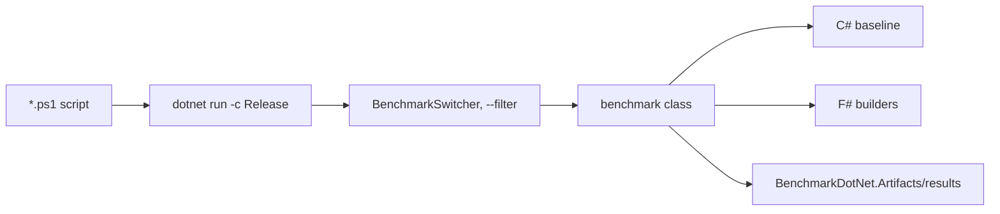

# Benchmarks domain

`benchmarks/` compares the IcedTasks builders with C# async code and other F# builders. BenchmarkDotNet runs the comparisons with `[<MemoryDiagnoser>]`.

| Project | TFMs | Content |
|---|---|---|
| `benchmarks/FSharpBenchmarks/benchmarks.fsproj` | net8.0, net9.0, net10.0 | the benchmark classes, Release and `Optimize` forced |
| `benchmarks/CSharpTaskBenchmarks` | net8.0, net9.0 | C# `Task` and `ValueTask` baselines |

Benchmark classes in `benchmarks/FSharpBenchmarks/`:

- `SyncCompletionBenchmarks` (`SynchonousCompletionBenchmark.fs`)
- `AsyncCompletionBenchmarks` (`AsynchonousCompletionBenchmark.fs`)
- `FileWriteBenchmarks` (`FileWritingBenchmarks.fs`)
- `ParallelAsyncBenchmarks` (`ParallelAsyncBenchmarks.fs`)

Most classes compare a C# baseline with F# `async`, Ply, `task`, `valueTask`, `cancellableTask`, and `cancellableValueTask`. `ParallelAsyncBenchmarks` uses an F# baseline. `Program.fs` uses `BenchmarkSwitcher.FromAssembly`, so a filter selects the class.

```powershell
# benchmarks/FSharpBenchmarks/asyncCompletion.ps1
dotnet run -c Release -f net8.0 -- --filter "*IcedTasks.Benchmarks.AsyncCompletionBenchmarks*"
```

`fileWriting.ps1` and `syncCompletion.ps1` run the other classes the same way.



The committed files in `benchmarks/FSharpBenchmarks/BenchmarkDotNet.Artifacts/results` come from an old run. Do not use them as current numbers.

`docsSrc/Explanations/Choosing-a-builder.md` tells users to measure before they choose a pooling builder.

Related: [builders](../builders/summary.md), [summary](../summary.md).
