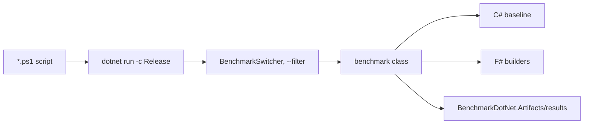

# Benchmarks domain

`benchmarks/` compares the IcedTasks builders with C# async code and other F# builders. BenchmarkDotNet runs the comparisons with `[<MemoryDiagnoser>]`.

| Project | TFMs | Content |
|---|---|---|
| `benchmarks/FSharpBenchmarks/benchmarks.fsproj` | net10.0, net11.0 | the benchmark classes, Release and `Optimize` forced |
| `benchmarks/CSharpTaskBenchmarks` | net10.0, net11.0 | C# `Task` and `ValueTask` baselines |

Benchmark classes in `benchmarks/FSharpBenchmarks/`:

- `SyncCompletionBenchmarks` (`SynchonousCompletionBenchmark.fs`)
- `AsyncCompletionBenchmarks` (`AsynchonousCompletionBenchmark.fs`)
- `FileWriteBenchmarks` (`FileWritingBenchmarks.fs`)
- `ParallelAsyncBenchmarks` (`ParallelAsyncBenchmarks.fs`)

Most classes compare a C# baseline with F# `async`, Ply, `task`, `valueTask`, `cancellableTask`, and `cancellableValueTask`. `ParallelAsyncBenchmarks` uses an F# baseline. `Program.fs` uses `BenchmarkSwitcher.FromAssembly`, so a filter selects the class.

```powershell
# benchmarks/FSharpBenchmarks/asyncCompletion.ps1
dotnet run -c Release -f net10.0 -- --filter "*IcedTasks.Benchmarks.AsyncCompletionBenchmarks*"
```

`fileWriting.ps1` and `syncCompletion.ps1` run the other classes the same way.

## Runtime-async comparison

`runtimeAsync.ps1` runs `SyncCompletionBenchmarks`, `AsyncCompletionBenchmarks`, and `FileWriteBenchmarks` on `net11.0` with the `--runtime-async` switch. `Program.fs` removes the switch and adds two jobs that differ only in an MSBuild property:

| Job | Property | F# `task`, `valueTask`, `cancellableTask`, `cancellableValueTask` | C# `async` methods |
|---|---|---|---|
| `StateMachine` | `/p:RuntimeAsync=false` | state-machine builders (FSharp.Core `task`, `IcedTasks`) | compiler state machine |
| `RuntimeAsync` | `/p:RuntimeAsync=true` | `IcedTasks.Polyfill.RuntimeTask` builders | runtime async |

```xml
<!-- benchmarks/Directory.Build.props -->
<PropertyGroup Condition="'$(RuntimeAsync)' == 'true' And '$(TargetFramework)' == 'net11.0'">
    <IntermediateOutputPath>$(MSBuildProjectDirectory)/obj/$(Configuration)/runtime-async/</IntermediateOutputPath>
    <OutputPath>$(MSBuildProjectDirectory)/bin/$(Configuration)/runtime-async/</OutputPath>
    <DefineConstants>$(DefineConstants);BENCHMARK_RUNTIME_ASYNC</DefineConstants>
    <Features>$(Features);runtime-async=on</Features>
</PropertyGroup>
```

The benchmark files open `IcedTasks.Polyfill.RuntimeTask` under `#if BENCHMARK_RUNTIME_ASYNC`. `async` and Ply (`FSharp.Control.Tasks.Affine.task`) are the same in both jobs, so they show the noise between the jobs.

Invariants and lessons:

- The C# compiler on `net11.0` (SDK 11.0.100) does not emit runtime-async methods by default. `Features=runtime-async=on` makes it set `MethodImplAttributes` `0x2000` on each `async` method.
- An incremental build does not compile again when only `Features` or `DefineConstants` change. Without the separate `obj` and `bin` folders, the second job can run the assembly of the first job.
- A run writes its reports to `BenchmarkDotNet.Artifacts/results` in the project folder. Pass `--artifacts <folder>` to keep the committed reports unchanged.



The committed files in `benchmarks/FSharpBenchmarks/BenchmarkDotNet.Artifacts/results` come from an old run. Do not use them as current numbers.

`docsSrc/Explanations/Choosing-a-builder.md` tells users to measure before they choose a pooling builder.

Related: [builders](../builders/summary.md), [summary](../summary.md).
