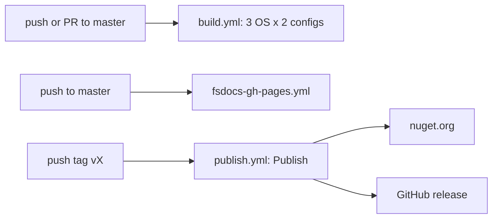

# CI workflows

Three workflows are in `.github/workflows/`.

| Workflow | Trigger | Runs |
|---|---|---|
| `build.yml` | push or PR to `master` | `./build.sh` or `./build.cmd` (default target) |
| `publish.yml` | push of any tag | `./build.sh Publish` |
| `fsdocs-gh-pages.yml` | push to `master`, `workflow_dispatch` | `./build.sh builddocs`, then GitHub Pages deploy |

## build.yml

- The matrix is Debug and Release on ubuntu, windows, and macOS, with `fail-fast: false` and a 30-minute timeout.
- `actions/setup-dotnet` uses `global.json` and the 8.x, 9.x, and 10.x SDKs.
- The job sets `CONFIGURATION` from the matrix and `CI: true`.
- `dorny/test-reporter` reads `**/TestResults/testResults*.trx`.
- A `build-devcontainer` job runs `./build.sh` in `devcontainers/ci`.

## publish.yml

The job uses the `nuget` environment and `id-token: write`. `NuGet/login` gets a short-lived key through trusted publishing (PR #68):

```yaml
# .github/workflows/publish.yml
      - name: NuGet login (trusted publishing)
        uses: NuGet/login@v1
        id: nuget-login
        with:
          user: ${{ secrets.NUGET_USER }}
      - name: publish
        env:
          NUGET_TOKEN: ${{ steps.nuget-login.outputs.NUGET_API_KEY }}
          GITHUB_TOKEN: ${{ secrets.GITHUB_TOKEN }}
          FAKE_DETAILED_ERRORS: true
          CI: true
          CONFIGURATION: Release
        run: |
          chmod +x ./build.sh
          ./build.sh Publish
```

## fsdocs-gh-pages.yml

The job sets `CONFIGURATION: Release`, runs `./build.sh builddocs`, uploads `docs/`, and runs `deploy-pages`. See [fsdocs build](../docs/fsdocs-build.md).



Related: [release and publish](release-and-publish.md), [FAKE targets](fake-targets.md).
