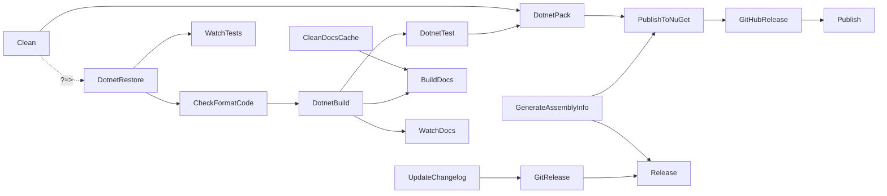

# FAKE targets

`build/build.fs` declares the targets and their order. `==>` is a hard dependency. `?=>` sets order only. The default target is `DotnetPack`.

```fsharp
// build/build.fs
    "DotnetRestore"
    ==> "CheckFormatCode"
    ==> "DotnetBuild"
    ==> "DotnetTest"
    ==> "DotnetPack"
    ==> "PublishToNuGet"
    ==> "GitHubRelease"
    ==>! "Publish"
```



## What each entry point runs

| Command | Targets |
|---|---|
| `./build.sh` | Clean, DotnetRestore, CheckFormatCode, DotnetBuild, DotnetTest, DotnetPack |
| `./build.sh Publish` | the default list, GenerateAssemblyInfo, PublishToNuGet, GitHubRelease |
| `./build.sh Release 0.2.0` | UpdateChangelog, GenerateAssemblyInfo, GitRelease. It does not build or test. |
| `./build.sh BuildDocs` | DotnetRestore, CheckFormatCode, DotnetBuild, CleanDocsCache, BuildDocs |
| `./build.sh FormatCode` | FormatCode only |

`FSharpAnalyzers` and `FormatCode` are not in a chain.

## Commands that the targets run

- DotnetBuild: `dotnet build IcedTasks.sln --no-restore -c <cfg> /p:PackageVersion=<latest changelog version>`.
- DotnetTest: `dotnet test IcedTasks.sln --no-build -c <cfg> --logger "trx;LogFilePrefix=testResults"`.
- DotnetPack: packs to `dist/` with the version and release notes from `CHANGELOG.md`.
- GenerateAssemblyInfo: writes `src/IcedTasks/AssemblyInfo.fs`. The file is tracked and is in `.fantomasignore`.

## Configuration

`./build.sh` uses Debug unless `Publish` runs:

```fsharp
// build/build.fs
let configuration (targets: Target list) =
    let defaultVal = if isRelease targets then "Release" else "Debug"

    match Environment.environVarOrDefault "CONFIGURATION" defaultVal with
    | "Debug" -> DotNet.BuildConfiguration.Debug
    | "Release" -> DotNet.BuildConfiguration.Release
    | config -> DotNet.BuildConfiguration.Custom config
```


Related: [release and publish](release-and-publish.md), [formatting and analyzers](formatting-and-analyzers.md), [build summary](summary.md).
