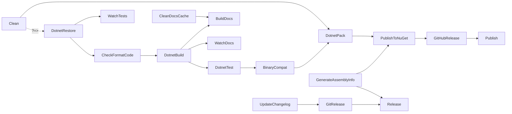

# FAKE targets

`build/build.fs` declares the targets and their order. `==>` is a hard dependency. `?=>` sets order only. The default target is `DotnetPack`.

```fsharp
// build/build.fs
    "DotnetRestore"
    ==> "CheckFormatCode"
    ==> "DotnetBuild"
    ==> "DotnetTest"
    ==> "BinaryCompat"
    ==> "DotnetPack"
    ==> "PublishToNuGet"
    ==> "GitHubRelease"
    ==>! "Publish"
```



## What each entry point runs

| Command | Targets |
|---|---|
| `./build.sh` | Clean, DotnetRestore, CheckFormatCode, DotnetBuild, DotnetTest, BinaryCompat, DotnetPack |
| `./build.sh Publish` | the default list, GenerateAssemblyInfo, PublishToNuGet, GitHubRelease |
| `./build.sh Release 0.2.0` | UpdateChangelog, GenerateAssemblyInfo, GitRelease. It does not build or test. |
| `./build.sh BuildDocs` | DotnetRestore, CheckFormatCode, DotnetBuild, CleanDocsCache, BuildDocs |
| `./build.sh FormatCode` | FormatCode only |

`FSharpAnalyzers` and `FormatCode` are not in a chain.

## Commands that the targets run

- DotnetBuild: `dotnet build IcedTasks.sln --no-restore -c <cfg> /p:PackageVersion=<latest changelog version>`.
- DotnetTest: `dotnet test IcedTasks.sln --no-build -c <cfg> --logger "trx;LogFilePrefix=testResults"`.
- BinaryCompat: builds `src/IcedTasks` (a no-op after DotnetBuild), restores `tests/IcedTasks.BinaryCompat` with the CI retry, and builds it in Debug and Release against the IcedTasks 0.11.9 package. For each fixture configuration and TFM, it runs the program, copies the output to `temp/binary-compat/<library cfg>/<fixture cfg>/<tfm>`, replaces `IcedTasks.dll` with the current build, and runs it again. The `net10.0` run gets the current `net9.0` build and the `net11.0` run the current `net11.0` build, because both TFMs compile against the 0.11.9 `net9.0` build and an upgrade selects these builds. The target fails if a run fails, if a run does not load the expected IcedTasks version, target framework, and path, if a run does not print each case of `binaryCompatCases` exactly once as a `name=value` line with a value, if a run takes more than 5 minutes, if the current build has the package version, or if the two outputs differ. It runs the program by file name from its folder, so a path with a space works. A change that intends to change the result of a case fails the target, because the 0.11.9 run gives the old result. Such a change is a behavior break for 0.11.9 consumers. Record it in `CHANGELOG.md`, and in the same PR either raise `VersionOverride` in `IcedTasks.BinaryCompat.fsproj` to the first release with the new behavior, or change the case so that it no longer depends on the changed behavior.
- DotnetPack: packs to `dist/` with the version and release notes from `CHANGELOG.md`.
- GenerateAssemblyInfo: writes `src/IcedTasks/AssemblyInfo.fs`. The file is tracked and is in `.fantomasignore`.

## Configuration

`./build.sh` uses Debug unless `Publish` runs:

```fsharp
// build/build.fs
let configuration (targets: Target list) =
    let defaultVal = if isRelease targets then "Release" else "Debug"

    match Environment.environVarOrDefault "CONFIGURATION" defaultVal with
    | "Debug" -> DotNet.BuildConfiguration.Debug
    | "Release" -> DotNet.BuildConfiguration.Release
    | config -> DotNet.BuildConfiguration.Custom config
```


Related: [release and publish](release-and-publish.md), [formatting and analyzers](formatting-and-analyzers.md), [build summary](summary.md).
