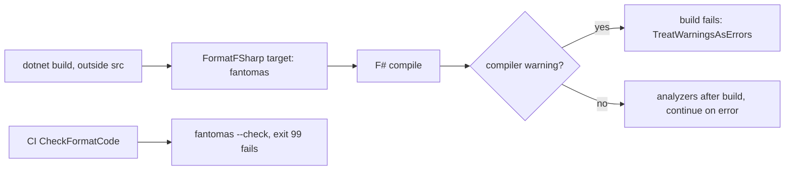

# Formatting and analyzers

## Fantomas

Fantomas formats all F# code. The version is in `.config/dotnet-tools.json`. The settings are in `.editorconfig`. `.fantomasignore` excludes `AssemblyInfo.fs`, `.claude/**`, and `runtime-scripts/**`.

Fantomas runs in three places:

- F# project builds outside `src/`: the root `Directory.Build.targets` runs `dotnet fantomas $(MSBuildProjectDirectory)` before the build, once for each project, with `ContinueOnError="WarnAndContinue"`. A plain `dotnet build` of a test, benchmark, example, or build project thus rewrites files. `src/Directory.Build.targets` does not import the root file, so a build of `src/IcedTasks` does not run Fantomas.
- `FormatCode` target: `dotnet fantomas <root>`.
- `CheckFormatCode` target: on CI it runs `dotnet fantomas <root> --check`. Only exit code 99 fails the build. Off CI it formats the files.

```xml
<!-- Directory.Build.targets -->
  <Target Name="FormatFSharp" Condition=" '$(MSBuildProjectExtension)' == '.fsproj' AND '$(DesignTimeBuild)' != 'true' " BeforeTargets="BeforeBuild" Inputs="@(Compile)" Outputs="$(_DotnetFantomasOutputFile)" >
    <Exec Command="dotnet fantomas $(MSBuildProjectDirectory)" StandardOutputImportance="High" StandardErrorImportance="High" WorkingDirectory="$(MSBuildThisFileDirectory)" ContinueOnError="WarnAndContinue" />
    <Touch Files="$(_DotnetFantomasOutputFile)" AlwaysCreate="True" ForceTouch="True" />
  </Target>
```

`.git-blame-ignore-revs` lists two formatting commits.

## Analyzers

- `src/Directory.Build.props` references `FSharp.Analyzers.Build`, `Ionide.Analyzers`, and `G-Research.FSharp.Analyzers`.
- `src/Directory.Build.targets` sets `RunAnalyzersDuringBuild` and the analyzer paths. The analyzers thus run after each build of `src/`.
- `FSharp.Analyzers.Build` sets `FSharpAnalyzersContinueOnError` to true by default. An analyzer warning does not fail the build. `TreatWarningsAsErrors` applies to compiler warnings.
- The `FSharpAnalyzers` FAKE target fails on `BDH0002`. It reads analyzers from `packages/analyzers`, and the build does not create that directory.
- `.vscode/settings.json` turns the editor analyzers off.



Related: [FAKE targets](fake-targets.md), [practices](../practices.md).
