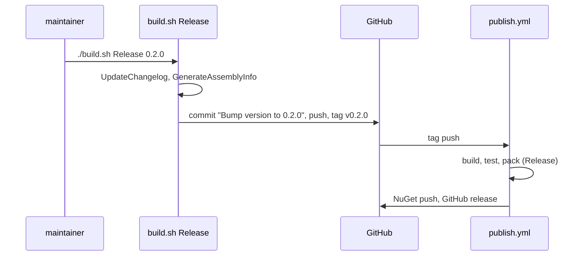

# Release and publish

A release has two steps. A maintainer runs `Release` on a local machine. The tag push then starts `Publish` on CI.



## Changelog

`CHANGELOG.md` uses Keep a Changelog 1.0.0 and SemVer 2.0.0. Each entry links the PR and credits the author:

```markdown
<!-- CHANGELOG.md -->
### Fixed
- [Fix multi-start of cold and cancellable tasks on the dynamic path](https://github.com/TheAngryByrd/IcedTasks/pull/67) - Credits @xperiandri
```

`UpdateChangelog` (`build/Changelog.fs`):

- Moves the `[Unreleased]` changes into a new dated entry. It also copies the changes of the prerelease entries of the same version into that entry. The prerelease entries stay in the file.
- Rejects a version that exists or that is older than an existing version.
- Strips a leading `v` from the version and writes a warning.
- Rewrites the link references at the end of the file.
- Saves a backup in `Changelog.changelogBackupFilename`. `RevertChangelog` and `DeleteChangelogBackupFile` read a different variable, `changelogBackupFilename` in `build/build.fs`, which no code sets. They thus do nothing, and a failed release keeps the changed `CHANGELOG.md`.

An empty changelog fails the build.

## Guards

- `GitRelease` calls `allReleaseChecks`. It must run on `master`, and the changelog must not be empty (`build/build.fs`).
- `PublishToNuGet` and `GitHubRelease` call `allPublishChecks`. They must run on CI (`build/build.fs`).
- `GitRelease` stages `CHANGELOG.md` and `src/**/AssemblyInfo.fs`, commits `Bump version to X`, pushes, and pushes the tag `vX`.
- `GitHubRelease` makes a draft release, uploads `dist/*.nupkg`, and then publishes the release.
- `publish.yml` uses NuGet trusted publishing. See [CI workflows](ci-workflows.md).

`README.md` "Releasing" describes the same flow for maintainers.

Related: [FAKE targets](fake-targets.md), [build summary](summary.md).
