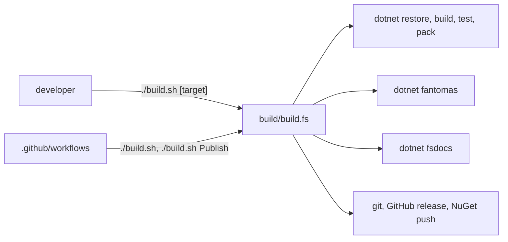

# Build domain

The build domain covers `build/`, `build.cmd`, `build.sh`, `global.json`, the root `Directory.Build.props`, `Directory.Build.targets`, `Directory.Packages.props`, `.config/dotnet-tools.json`, `.devcontainer/`, and `.github/workflows/`.

The build is a FAKE 6 console app. `build/build.fsproj` targets `net9.0` and compiles `FsDocs.fs`, `Changelog.fs`, and `build.fs`. The scripts pass their arguments to it:

```sh
# build.sh
FAKE_DETAILED_ERRORS=true dotnet run --project ./build/build.fsproj -- -t "$@"
```

```bat
:: build.cmd
dotnet run --project ./build/build.fsproj -- -t %*
```



## Toolchain

- `global.json` pins the SDK version with `rollForward: latestMinor`.
- CI installs the 8.x, 9.x, and 10.x SDKs, because the tests target `net10.0;net9.0;net8.0`.
- `.config/dotnet-tools.json` pins `fantomas`, `fsdocs-tool`, and `fsharp-analyzers`. The root `Directory.Build.targets` runs `dotnet tool restore` before a restore when the tool manifest changed. `src/Directory.Build.targets` does not import the root file, so a restore of `src/IcedTasks` alone does not restore the tools.
- `.devcontainer/devcontainer.json` installs .NET 10.0, 9.0, and 8.0 and runs `dotnet tool restore && dotnet restore`.

## Environment variables

| Variable | Effect | Source |
|---|---|---|
| `CONFIGURATION` | Overrides the configuration. The default is Debug, or Release when `Publish` runs. | `build/build.fs` |
| `CI` | Retries restore, limits `/m`, makes `CheckFormatCode` check only. | `build/build.fs` |
| `RELEASE_VERSION` | Version for `Release`. The first argument after the target also works. | `build/Changelog.fs` |
| `GITHUB_TOKEN`, `NUGET_TOKEN` | GitHub release and NuGet push. The build masks them in the log. | `build/build.fs` |

Topics:

- [FAKE targets](fake-targets.md) - the target graph and the commands.
- [CI workflows](ci-workflows.md) - `build.yml`, `publish.yml`, `fsdocs-gh-pages.yml`.
- [Release and publish](release-and-publish.md) - changelog, tags, NuGet trusted publishing.
- [Formatting and analyzers](formatting-and-analyzers.md) - Fantomas and F# analyzers.

Related: [practices](../practices.md), [tests](../tests/summary.md), [docs](../docs/summary.md).
