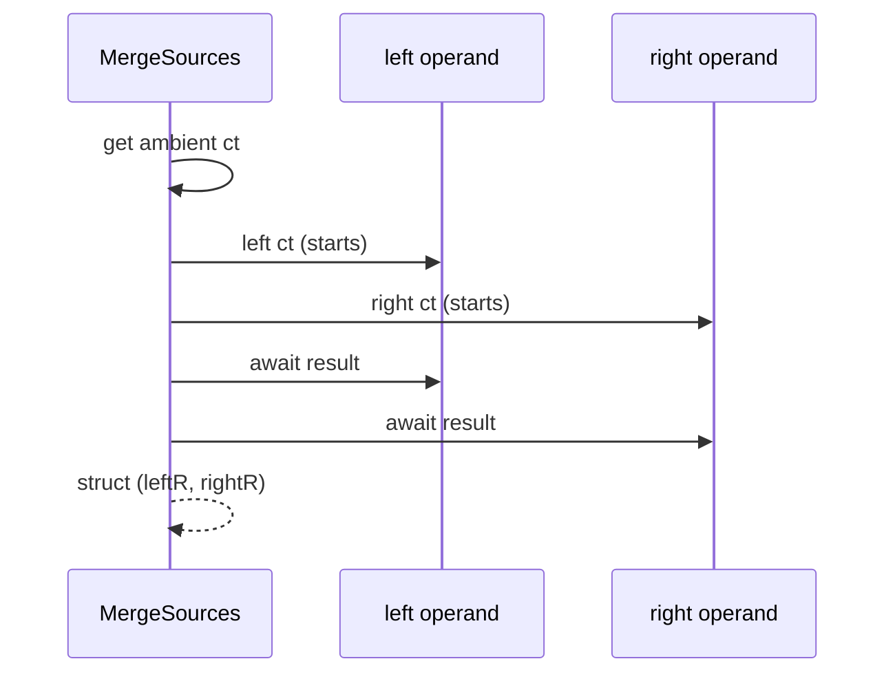

# and! and MergeSources

F# turns `let! a = x and! b = y` into a call to `MergeSources`.

| Builder | `MergeSources` location |
|---|---|
| `task`, `backgroundTask`, `taskUnit`, `backgroundTaskUnit`, `valueTask`, `valueTaskUnit`, `poolingValueTask` | on each builder type |
| `cancellableTask`, `cancellableValueTask`, `cancellablePoolingValueTask` | on each builder type |
| `coldTask`, `backgroundColdTask` | extension on `ColdTaskBuilderBase` (`ColdTask.fs`) |
| `backgroundCancellableTask` | none, so `and!` does not compile (`error FS3343`) |
| `parallelAsync`, `parallelAsyncUsingStartChild` | on `ParallelAsyncBuilderUsingStartImmediateAsTask` and `ParallelAsyncBuilderUsingStartChild` (`ParallelAsync.fs`) |

## Contract

- Cancellable builders: `MergeSources` gets the ambient token, calls `left ct` and `right ct`, and then awaits both results. The operands start concurrently. This is concurrent start, not a guarantee of CPU parallelism (`docsSrc/Explanations/Understanding-and-bang.md`).
- Cold builders: `MergeSources` invokes both cold operands before it awaits either result (`src/IcedTasks/ColdTask.fs`).
- Hot builders: the operands are task-like values, so their work can already be running.
- `parallelAsync`: starts both `Async` values with `Async.StartImmediateAsTask` and the ambient `Async.CancellationToken`. `parallelAsyncUsingStartChild` uses `Async.StartChild`. See [AsyncEx and ParallelAsync](asyncex-and-parallelasync.md).
- `asyncEx` has no `MergeSources`.
- Use `and!` only for independent operands.

```fsharp
// src/IcedTasks/CancellableTask.fs (CancellableTaskBuilder)
        [<NoEagerConstraintApplication>]
        member inline this.MergeSources
            (
                [<InlineIfLambda>] left: CancellationToken -> 'Awaiter1,
                [<InlineIfLambda>] right: CancellationToken -> 'Awaiter2
            ) =
            this.Source(
                this.Run(
                    this.Bind(
                        (fun ct -> this.Source(ValueTask<_> ct)),
                        fun ct ->
                            let left = left ct
                            let right = right ct

                            this.Bind(
                                left,
                                fun leftR ->
                                    this.BindReturn(right, (fun rightR -> struct (leftR, rightR)))
                            )
                    )
                )
            )
```



## Tests

The FsCheck property "parallelism" checks the concurrent start. It runs in `testSequencedGroup "MergeSourcesParallel - ..."` blocks, for example in `tests/IcedTasks.Tests/CancellableTaskTests.fs`. See [tests summary](../tests/summary.md).

Related: [cancellation flow](cancellation-flow.md), [companion modules](companion-modules.md).
