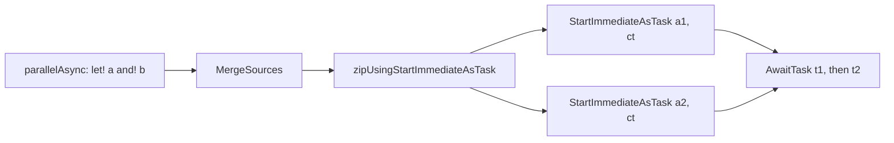

# AsyncEx and ParallelAsync

Both builders return F# `Async<'T>`. They wrap the FSharp.Core `async` builder and do not use resumable code.

## AsyncEx

`AsyncExBuilder` (`src/IcedTasks/AsyncEx.fs`) keeps `Async` semantics and adds:

- `let!` and `do!` for `Task`, `ValueTask`, and any awaitable.
- `use` for `IAsyncDisposable`.
- `for` over `IAsyncEnumerable`, with `Async.CancellationToken` for the enumerator.
- Task exceptions without `AggregateException`. An `AggregateException` with exactly one inner exception is unwrapped (fslang-suggestions 840).
- `TryFinallyAsync` wraps a body exception and a compensation exception together in one `AggregateException`.

A cancelled task goes to the error continuation, not the cancel continuation. The code comment gives the reason from FSharp.Core:

```fsharp
// src/IcedTasks/AsyncEx.fs
            | :? AggregateException as ae when ae.InnerExceptions.Count = 1 ->
                onError ae.InnerExceptions.[0]
            | e ->
                // Why not handle TaskCanceledException/OperationCanceledException?
                // From https://github.com/dotnet/fsharp/blob/89e641108e8773e8d5731437a2b944510de52567/src/FSharp.Core/async.fs#L1228-L1231:
                // A cancelled task calls the exception continuation with TaskCanceledException, since it may not represent cancellation of
                // the overall async (they may be governed by different cancellation tokens, or
                // the task may not have a cancellation token at all).
                onError e
```

The `AsyncEx` type also has `AwaitAwaiter`, `AwaitAwaitable`, `AwaitTask`, and `AwaitValueTask`.

## ParallelAsync

`parallelAsync` adds `and!` for `Async` values. `parallelAsync` is `parallelAsyncUsingStartImmediateAsTask`. `parallelAsyncUsingStartChild` uses `Async.StartChild`.

```fsharp
// src/IcedTasks/ParallelAsync.fs (zipUsingStartImmediateAsTask)
        async.Bind(
            Async.CancellationToken,
            fun ct ->
                let t1 = Async.StartImmediateAsTask(a1, cancellationToken = ct)
                let t2 = Async.StartImmediateAsTask(a2, cancellationToken = ct)

                async.Bind(
                    Async.AwaitTask t1,
                    fun t1r -> async.Bind(Async.AwaitTask t2, (fun t2r -> async.Return(t1r, t2r)))
                )
        )
```

`ParallelAsync.fs` calls `async.Bind` directly. Its comment says to avoid `async {}` there because of recursion.



Decisions:

- [ADR 0002, start `Async` with `Async.StartImmediateAsTask`](../../adr/0002-start-async-with-startimmediateastask.md)
- [ADR 0006, `asyncEx` task-await semantics](../../adr/0006-asyncex-task-await-semantics.md)

Related: [and! and MergeSources](and-bang-merge-sources.md), [namespaces and TFMs](namespaces-and-tfms.md), [builder catalog](builder-catalog.md).
