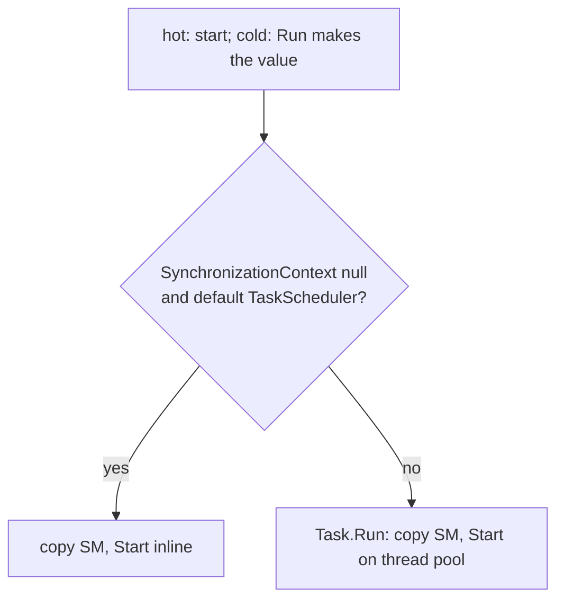

# Background builders

The background builders are `backgroundTask`, `backgroundTaskUnit`, `backgroundColdTask`, and `backgroundCancellableTask`. They have the same result type as their base builder. They change only where the state machine starts.

## Contract

- If `SynchronizationContext.Current` is null and `TaskScheduler.Current` is `TaskScheduler.Default`, the builder starts the state machine inline.
- Otherwise the builder starts it in `Task.Run`.
- The hot builders check the context when the expression runs, which is also the start.
- `backgroundColdTask` and `backgroundCancellableTask` check the context once, when `Run` makes the value. Each later start uses the same branch, whatever the context of the later caller.
- `backgroundCancellableTask` has no `MergeSources`, so it does not support `and!`.
- `backgroundCancellableTask` gives the token to `Task.Run(..., ct)` (`src/IcedTasks/CancellableTask.fs`).
- The code comment links the `ConfigureAwait(false)` FAQ as the specification.
- Each start copies the state machine, also in the inline branch. See [run and start paths](run-and-start-paths.md).
- The background cold builders forward to the same `RunDynamic` as their base builder.

```fsharp
// src/IcedTasks/Task.fs (BackgroundTaskBuilder.Run)
                    (AfterCode<_, _>(fun sm ->
                        // backgroundTask { .. } escapes to a background thread where necessary
                        // See spec of ConfigureAwait(false) at https://devblogs.microsoft.com/dotnet/configureawait-faq/
                        if
                            isNull SynchronizationContext.Current
                            && obj.ReferenceEquals(TaskScheduler.Current, TaskScheduler.Default)
                        then
                            let mutable sm = sm

                            sm.Data.MethodBuilder <- AsyncTaskMethodBuilder<'T>.Create()
                            sm.Data.MethodBuilder.Start(&sm)
                            sm.Data.MethodBuilder.Task
                        else
                            let sm = sm // copy

                            Task.Run<'T>(fun () ->
                                let mutable sm = sm // host local mutable copy of contents of state machine on this thread pool thread
                                sm.Data.MethodBuilder <- AsyncTaskMethodBuilder<'T>.Create()
                                sm.Data.MethodBuilder.Start(&sm)
                                sm.Data.MethodBuilder.Task
                            )
                    ))
```



The tests set a synchronization context with `TestHelpers.setSyncContext` (`tests/IcedTasks.Tests/Expect.fs`) to test the `Task.Run` branch.

Human docs: `docsSrc/How-To-Guides/Use-background-builders-to-avoid-caller-context.fsx`.

Related: [builder catalog](builder-catalog.md), [test helpers](../tests/expect-helpers.md).
