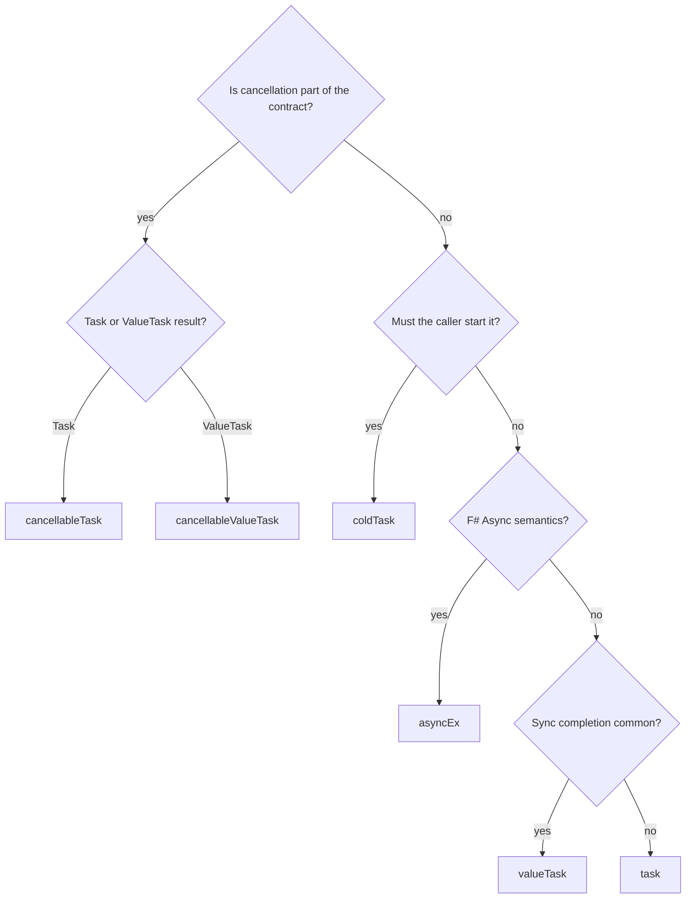

# Builder catalog

Each builder keyword is a value in an AutoOpen module. Paths are under `src/IcedTasks/`.

| Keyword | Alias | Builder type | Result | Base | Start |
|---|---|---|---|---|---|
| `task`, `backgroundTask` | - | `TaskBuilder`, `BackgroundTaskBuilder` (`Task.fs`) | `Task<'T>` | `TaskBuilderBase` | hot |
| `taskUnit`, `backgroundTaskUnit` | - | `TaskUnitBuilder`, `BackgroundTaskUnitBuilder` (`TaskUnit.fs`) | `Task` | `TaskBuilderBase` | hot |
| `valueTask` | `vTask` | `ValueTaskBuilder` (`ValueTask.fs`) | `ValueTask<'T>` | `TaskBuilderBase` | hot |
| `valueTaskUnit` | `vTaskUnit` | `ValueTaskUnitBuilder` (`ValueTaskUnit.fs`) | `ValueTask` | `TaskBuilderBase` | hot |
| `poolingValueTask` | `pvTask` | `PoolingValueTaskBuilder` (`PoolingValueTask.fs`) | `ValueTask<'T>` | `TaskBuilderBase` | hot |
| `coldTask`, `backgroundColdTask` | - | `ColdTaskBuilder`, `BackgroundColdTaskBuilder` (`ColdTask.fs`) | `ColdTask<'T>` | `ColdTaskBuilderBase` | cold |
| `cancellableTask`, `backgroundCancellableTask` | - | `CancellableTaskBuilder`, `BackgroundCancellableTaskBuilder` (`CancellableTask.fs`) | `CancellableTask<'T>` | `CancellableTaskBuilderBase` | cold |
| `cancellableValueTask` | - | `CancellableValueTaskBuilder` (`CancellableValueTask.fs`) | `CancellableValueTask<'T>` | `CancellableTaskBuilderBase` | cold |
| `cancellablePoolingValueTask` | `cancelablePVTask` | `CancellablePoolingValueTaskBuilder` (`CancellablePoolingValueTask.fs`) | `CancellableValueTask<'T>` | `CancellableTaskBuilderBase` | cold |
| `asyncEx` | `async` in `IcedTasks.Polyfill.Async` | `AsyncExBuilder` (`AsyncEx.fs`) | `Async<'T>` | none | `Async` |
| `parallelAsync` | - | `ParallelAsyncBuilderUsingStartImmediateAsTask` (`ParallelAsync.fs`) | `Async<'T>` | `ParallelAsyncBuilderBase` | `Async` |
| `parallelAsyncUsingStartChild` | - | `ParallelAsyncBuilderUsingStartChild` (`ParallelAsync.fs`) | `Async<'T>` | `ParallelAsyncBuilderBase` | `Async` |

## Contracts

- `task` and `backgroundTask` are in `IcedTasks.Polyfill.Task`. That namespace is not auto-opened. See [namespaces and TFMs](namespaces-and-tfms.md).
- The pooling builders and their aliases exist only on `net6.0` and `net9.0`.
- `ColdTask.fs`, `CancellableTask.fs`, `CancellableValueTask.fs`, and `CancellablePoolingValueTask.fs` define the result aliases:

```fsharp
// src/IcedTasks/ColdTask.fs
    /// unit -> Task<'T>
    type ColdTask<'T> = unit -> Task<'T>
    /// unit -> Task
    type ColdTask = unit -> Task
```

- A `ValueTask` result should be awaited once. A cancellable ValueTask value can start many times, but each start returns a new `ValueTask` (`docsSrc/Explanations/Choosing-a-builder.md`).
- `asyncEx` has no `and!`. Use `parallelAsync` for parallel `Async` work (`docsSrc/Explanations/Understanding-and-bang.md`).



The decision path above copies the "A short decision path" section of `docsSrc/Explanations/Choosing-a-builder.md`. That file also holds the full feature table.

Decisions:

- [ADR 0001, cold result types are function type aliases](../../adr/0001-function-type-aliases-for-cold-results.md)
- [ADR 0008, shared builder base classes](../../adr/0008-shared-builder-base-classes.md)

Related: [run and start paths](run-and-start-paths.md), [companion modules](companion-modules.md), [summary](summary.md).
