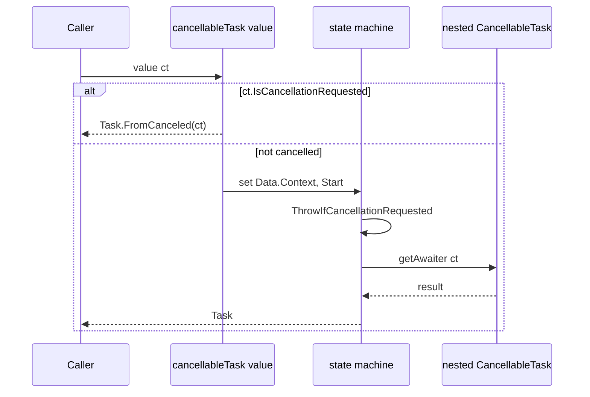

# Cancellation flow

The cancellable builders keep the ambient `CancellationToken` in the state machine data. `CancellableTaskBaseStateMachineData` is an abbreviation of `TrampolinedData<CancellationToken, 'T, 'Builder>` (`src/IcedTasks/Trampoline.fs`), so the token is in the `Context` field.

## Invariants

- Start: if the token is already cancelled, the start function returns `Task.FromCanceled(ct)` or `ValueTask.FromCanceled` and does not start the state machine (`CancellableTask.fs`, `CancellableValueTask.fs`).
- Bind: the builder has four bind members. The static and dynamic paths behave the same.
  - `Bind(getAwaiter: CancellationToken -> 'Awaiter)` checks the token, then calls `getAwaiter`. A token-dependent operand does not start when the token is cancelled.
  - `Bind(awaiter: 'Awaiter)` checks the token when it runs. The awaiter already exists, so a hot task has already started.
  - `BindNoCancellation` and `BindDynamicNoCancellation` are internal and do not check the token.
- Nested work: a bound `CancellationToken -> 'Awaiter` gets the ambient token.
- Cleanup: `TryFinallyAsync` and the `IAsyncDisposable` `Using` call `BindNoCancellation`. Async disposal and `finally` code thus run when the token is cancelled.
- `for` over `IAsyncEnumerable` gives `sm.Data.Context` to the enumerator. `TaskBuilderBase` gives `CancellationToken.None`.
- `Return` and `For` over `seq` do not check the token. A `for` loop over `seq` checks the token only at the binds in its body.

```fsharp
// src/IcedTasks/CancellableTaskBuilderBase.fs (LowPriority Bind)
                CancellableTaskBaseCode<'TOverall, 'TResult2, 'Builder>(fun sm ->
                    if __useResumableCode then
                        //-- RESUMABLE CODE START
                        sm.Data.Context.ThrowIfCancellationRequested()
                        // Get an awaiter from the Awaiter
                        let mutable awaiter = getAwaiter sm.Data.Context
```



## Get the token in an expression

```fsharp
// README.md
        cancellableTask {
            let junk = Array.zeroCreate bufferSize
            use file = File.Create(path)
            // You can bind against `CancellableTask.getCancellationToken` to get the current context's `CancellationToken`.
            let! ct = CancellableTask.getCancellationToken ()
            for i = 1 to manyIterations do
                do! file.WriteAsync(junk, 0, junk.Length, ct)
        }
```

## No cancellable binds in FSharp.Core task

The FSharp.Core `task` builder has no `Bind` for a CancellableTask. The caller must pass a token. `ColdTaskBuilderBase` also has no `Bind` for a CancellableTask. FSharp.Core `task` can bind a ColdTask (`src/IcedTasks/ColdTask.fs`). The code states the reason:

```fsharp
// src/IcedTasks/CancellableTask.fs
    // There is explicitly no Binds for `CancellableTasks` in `Microsoft.FSharp.Control.TaskBuilderBase`.
    // You need to explicitly pass in a `CancellationToken`to start it, you can use `CancellationToken.None`.
    // Reason is I don't want people to assume cancellation is happening without the caller being explicit about where the CancellationToken came from.
    // Similar reasoning for `IcedTasks.ColdTasks.ColdTaskBuilderBase`.
```

`AsyncEx` and FSharp.Core `async` can bind a CancellableTask. They give it `Async.CancellationToken`.

Related: [source overload priority](source-overload-priority.md), [and! and MergeSources](and-bang-merge-sources.md), [run and start paths](run-and-start-paths.md).
