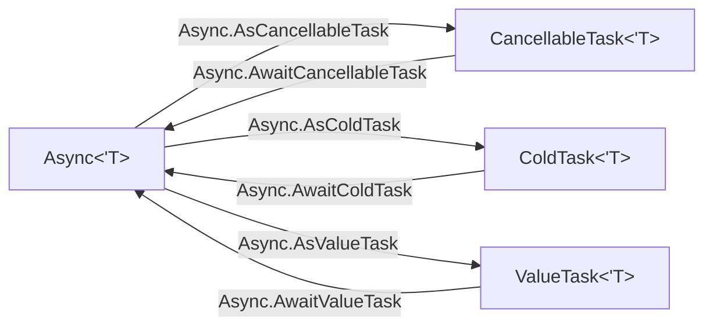

# Companion modules

Some result types have a module with the same name and functional helpers. The modules are `[<RequireQualifiedAccess>]` or nested, so callers write `CancellableTask.map`.

| Module | File | Functions |
|---|---|---|
| `ValueTask` | `ValueTask.fs` | `singleton`, `bind`, `map`, `apply`, `zip`, `ofUnit`, `ofTask`, `ofTaskUnit`, `toTask`, `toTaskUnit`, `toUnit` |
| `ValueTask` (pooling) | `PoolingValueTask.fs` | the same set, built with `poolingValueTask` |
| `ColdTask` | `ColdTask.fs` | `singleton`, `bind`, `map`, `apply`, `zip`, `parallelZip`, `ofUnit`, `toUnit` |
| `CancellableTask` | `CancellableTask.fs` | `getCancellationToken`, `singleton`, `bind`, `map`, `apply`, `zip`, `parallelZip`, `whenAll`, `whenAllThrottled`, `sequential`, `ofUnit`, `toUnit` |
| `CancellableValueTask` | `CancellableValueTask.fs`, `CancellablePoolingValueTask.fs` | `getCancellationToken`, `singleton`, `bind`, `map`, `apply`, `zip`, `parallelZip`, `ofUnit`, `toUnit` |

`task`, `taskUnit`, and `valueTaskUnit` have no companion module.

## Contracts

- `ColdTask.zip` and `CancellableTask.zip` start and await the left operand before they start the right operand. `ValueTask.zip` gets two values that already exist, so their work can already run. It only awaits them in order.
- `parallelZip` starts both cold operands before it awaits either.
- `whenAllThrottled` limits the operations in flight with a `SemaphoreSlim`. Each operation holds the semaphore until it completes.
- `CancellableValueTask` has no `whenAll`.

```fsharp
// src/IcedTasks/CancellableTask.fs
        let inline parallelZip
            ([<InlineIfLambda>] left: CancellableTask<'left>)
            ([<InlineIfLambda>] right: CancellableTask<'right>)
            =
            cancellableTask {
                let! ct = getCancellationToken ()
                let r1 = left ct
                let r2 = right ct
                let! r1 = r1
                let! r2 = r2
                return r1, r2
            }
```

## Conversion extensions

- `ValueTask.fs` adds `ValueTask.FromCanceled`, `Async.AwaitValueTask`, and `Async.AsValueTask`.
- `ColdTask.fs` adds `AwaitColdTask` on `AsyncEx` and `Async`, and `Async.AsColdTask`.
- `CancellableTaskBuilderBase.fs` adds `AsyncEx.AwaitCancellableTask`, `Async.AwaitCancellableTask`, and `Async.AsCancellableTask`.
- `CancellableValueTask.fs` and `CancellablePoolingValueTask.fs` add `AsCancellableValueTask`. Both use `Async.StartAsTask`, not `StartImmediateAsTask`. See [ADR 0002](../../adr/0002-start-async-with-startimmediateastask.md).



Human docs: `docsSrc/How-To-Guides/Compose-task-values-with-helper-functions.fsx` and `docsSrc/How-To-Guides/Convert-between-async-shapes.fsx`.

Related: [builder catalog](builder-catalog.md), [and! and MergeSources](and-bang-merge-sources.md).
