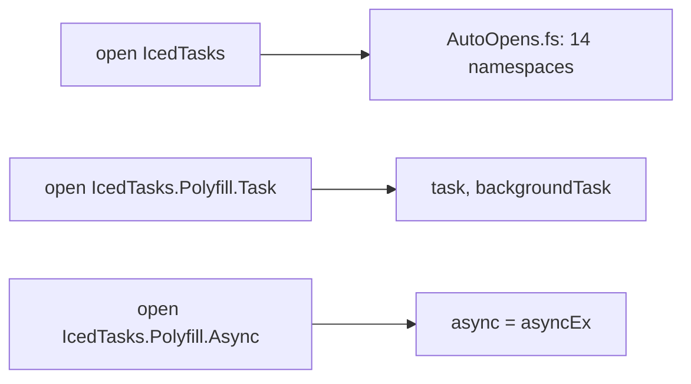

# Namespaces and TFMs

## AutoOpen

`src/IcedTasks/AutoOpens.fs` marks each builder namespace with an assembly-level `AutoOpen`. Its comment says that this is "for ease of use when opening the main IcedTasks namespace":

```fsharp
// src/IcedTasks/AutoOpens.fs
    [<assembly: AutoOpen("IcedTasks")>]
    [<assembly: AutoOpen("IcedTasks.TaskLike")>]
    [<assembly: AutoOpen("IcedTasks.TasksUnit")>]
    [<assembly: AutoOpen("IcedTasks.AsyncEx")>]
    [<assembly: AutoOpen("IcedTasks.ParallelAsync")>]
    [<assembly: AutoOpen("IcedTasks.TaskBase")>]
    [<assembly: AutoOpen("IcedTasks.ValueTasks")>]
    [<assembly: AutoOpen("IcedTasks.PoolingValueTasks")>]
    [<assembly: AutoOpen("IcedTasks.ValueTasksUnit")>]
    [<assembly: AutoOpen("IcedTasks.ColdTasks")>]
    [<assembly: AutoOpen("IcedTasks.CancellableTaskBase")>]
    [<assembly: AutoOpen("IcedTasks.CancellableValueTasks")>]
    [<assembly: AutoOpen("IcedTasks.CancellablePoolingValueTasks")>]
    [<assembly: AutoOpen("IcedTasks.CancellableTasks")>]
```

These namespaces are not auto-opened:

- `IcedTasks.Polyfill.Task` (`Task.fs`) - shadows FSharp.Core `task` and `backgroundTask`.
- `IcedTasks.Polyfill.Async` (`AsyncEx.fs`) - defines `let async = asyncEx` and shadows FSharp.Core `async`.
- `IcedTasks.Nullness` (`Nullness.fs`).

A new builder namespace must get a line in `AutoOpens.fs`. `AutoOpens.fs` is the last file in the compile order.



`docsSrc/Explanations/Polyfill-namespaces-and-shadowing.md` recommends a local module open of a polyfill namespace.

## Target frameworks

`IcedTasks.fsproj` targets `net9.0;net6.0;netstandard2.1;netstandard2.0`.

| Item | Condition | Source |
|---|---|---|
| `Microsoft.Bcl.AsyncInterfaces` | `netstandard2.0` only | `IcedTasks.fsproj` |
| FSharp.Core 9.0.300 | TFM compatible with `net9.0` | `IcedTasks.fsproj` |
| FSharp.Core 6.0.4 | other TFMs | `IcedTasks.fsproj` |
| `LangVersion` 9.0 and `Nullable` | `net9.0` | `Directory.Build.props` |
| Pooling builders | `#if NET6_0_OR_GREATER` | `PoolingValueTask.fs`, `CancellablePoolingValueTask.fs` |
| Nullness unions | `#if NULLABLE` | `Nullness.fs` |

The pooling files declare their namespace before the `#if`. On `netstandard` the namespaces exist and are empty, so the AutoOpen lines stay valid.

## Name reuse

- `PoolingValueTask.fs` reuses the module names `ValueTaskBuilder` and `ValueTask`.
- `CancellablePoolingValueTask.fs` reuses the alias `CancellableValueTask<'T>` and the modules `CancellableValueTaskBuilder` and `CancellableValueTask`.

Related: [builder catalog](builder-catalog.md), [test projects and TFMs](../tests/test-projects-and-tfms.md).
