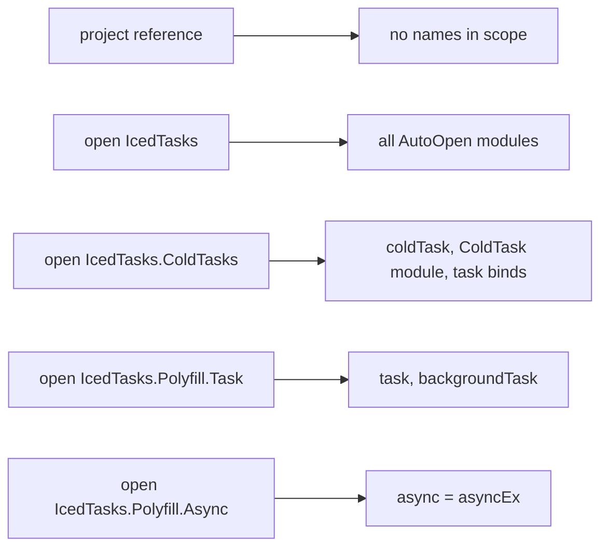

# Namespaces and TFMs

## Namespaces and AutoOpen

Each library file declares `namespace IcedTasks`. `Task.fs` declares only `IcedTasks.Polyfill.Task`, and `AsyncEx.fs` also declares `IcedTasks.Polyfill.Async`. Each builder file puts its public items in `[<AutoOpen>]` modules with the 0.11.9 names. `TaskLike.fs`, `Nullness.fs`, `AsyncEx.fs` (`AsyncEx`, `AsyncExBuilder`), and `ParallelAsync.fs` (`ParallelAsync` and the builder types) also put types directly in `IcedTasks`.

```fsharp
// src/IcedTasks/ColdTask.fs
namespace IcedTasks

[<AutoOpen>]
module ColdTasks =
```

| File | Module in `IcedTasks` |
|---|---|
| `TaskBuilderBase.fs` | `TaskBase` |
| `ValueTask.fs` | `ValueTaskExtensions`, `ValueTasks` |
| `PoolingValueTask.fs` | `PoolingValueTasks` |
| `ValueTaskUnit.fs` | `ValueTasksUnit` |
| `TaskUnit.fs` | `TasksUnit` |
| `AsyncEx.fs` | `AsyncExtensions`, `AsyncExExtensionsLowPriority` (holds `asyncEx`), `AsyncExExtensionsHighPriority` |
| `ParallelAsync.fs` | `ParallelAsyncs` |
| `ColdTask.fs` | `ColdTasks` |
| `CancellableTaskBuilderBase.fs` | `CancellableTaskBase` |
| `CancellableValueTask.fs` | `CancellableValueTasks` |
| `CancellablePoolingValueTask.fs` | `CancellablePoolingValueTasks` |
| `CancellableTask.fs` | `CancellableTasks` |

Contracts:

- The assembly has no assembly-level `AutoOpen`. A project reference alone opens no IcedTasks namespace. `tests/IcedTasks.Tests.NoOpen` and the `Public API` tests guard this.
- `open IcedTasks` brings each `[<AutoOpen>]` module. A single module open, for example `open IcedTasks.CancellableTasks`, brings the builder but not the `Source` and `Bind` extension members in `TaskBase` or `CancellableTaskBase`. `ColdTasks` holds its own extension members.
- The public metadata must keep each 0.11.9 entry. `tests/IcedTasks.Tests/PublicApiTests.fs` compares it with `tests/IcedTasks.Tests/PublicApi/IcedTasks-0.11.9-<tfm>.txt`. Do not edit these files: they come from the 0.11.9 package through `PublicApi/list-public-api.fsx`. A new public entry goes in `PublicApi/additions-<tfm>.txt` in the same change. A removed entry fails the test.
- Most builder values are in a nested `[<AutoOpen>]` module, so their qualified path names that module: `IcedTasks.ColdTasks.ColdTaskBuilder.coldTask`. `asyncEx` is directly in `IcedTasks.AsyncExExtensionsLowPriority`, and `parallelAsync` is directly in `IcedTasks.ParallelAsyncs`.

These namespaces are not opened by `open IcedTasks`:

- `IcedTasks.Polyfill.Task` (`Task.fs`) - shadows FSharp.Core `task` and `backgroundTask`.
- `IcedTasks.Polyfill.Async` (`AsyncEx.fs`) - defines `let async = asyncEx` and shadows FSharp.Core `async`.

`open IcedTasks` adds `Bind` and `ReturnFrom` overloads for `ColdTask` to the FSharp.Core `task` builder (`ColdTasks.AsyncExtensions`). With these overloads, a `task { do! f a b }` whose `f` has no type annotation fails with FS0041. 0.11.9 has the same behavior.

### Graph-based checking

Graph-based type checking links each file that declares `namespace IcedTasks` to every earlier file with a type or an `[<AutoOpen>]` module in that namespace. So the library files check in series (graph depth 15 on `net9.0`). An `open` of one module cannot remove a link. [ADR 0014](../../adr/0014-restore-autoopen-modules-in-icedtasks-namespace.md) records the measured cost and the selective signature file option.



`docsSrc/Explanations/Polyfill-namespaces-and-shadowing.md` lists what each open brings into scope, and recommends a local module open of a polyfill namespace.

## Target frameworks

`IcedTasks.fsproj` targets `net9.0;net6.0;netstandard2.1;netstandard2.0`.

| Item | Condition | Source |
|---|---|---|
| `Microsoft.Bcl.AsyncInterfaces` | `netstandard2.0` only | `IcedTasks.fsproj` |
| FSharp.Core 9.0.300 | TFM compatible with `net9.0` | `IcedTasks.fsproj` |
| FSharp.Core 6.0.4 | other TFMs | `IcedTasks.fsproj` |
| `LangVersion` 9.0 and `Nullable` | `net9.0` | `Directory.Build.props` |
| Pooling builders | `#if NET6_0_OR_GREATER` | `PoolingValueTask.fs`, `CancellablePoolingValueTask.fs` |
| Nullness unions | `#if NULLABLE` | `Nullness.fs` |

The pooling files put their `#if` inside `namespace IcedTasks`. On `netstandard` the files declare no module.

## Name reuse

- `PoolingValueTask.fs` reuses the module names `ValueTaskBuilder` and `ValueTask`.
- `CancellablePoolingValueTask.fs` reuses the alias `CancellableValueTask<'T>` and the modules `CancellableValueTaskBuilder` and `CancellableValueTask`.

Decisions:

- [ADR 0004, library target frameworks](../../adr/0004-library-target-frameworks.md)
- [ADR 0009, opt-in polyfill namespaces](../../adr/0009-opt-in-polyfill-namespaces.md)
- [ADR 0010, Microsoft.Bcl.AsyncInterfaces on netstandard2.0](../../adr/0010-bcl-asyncinterfaces-on-netstandard2-0.md)
- [ADR 0011, FSharp.Core per target framework](../../adr/0011-fsharp-core-per-target-framework.md)
- [ADR 0012, one namespace for each builder file](../../adr/0012-namespace-per-builder-file.md) (superseded)
- [ADR 0014, AutoOpen modules in the IcedTasks namespace](../../adr/0014-restore-autoopen-modules-in-icedtasks-namespace.md)

Related: [builder catalog](builder-catalog.md), [test projects and TFMs](../tests/test-projects-and-tfms.md).
