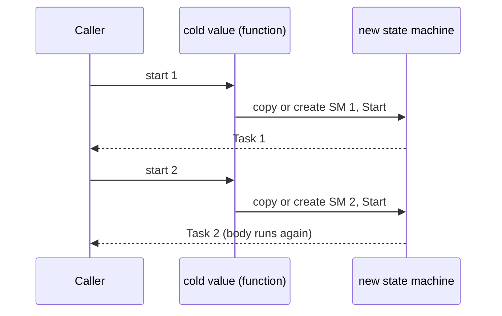

# Run and start paths

Each resumable builder has a `Run` member with two paths. The base builders have no `Run`. Each derived builder adds `Run` and `RunDynamic`. See [and! and MergeSources](and-bang-merge-sources.md) for where `MergeSources` is defined.

- Static path: `Run` checks `if __useResumableCode then __stateMachine<...>(MoveNextMethodImpl)(SetStateMachineMethodImpl)(AfterCode)`. The compiler makes a struct state machine.
- Dynamic path: otherwise `Run` calls `static member RunDynamic`. `RunDynamic` makes a `...ResumptionDynamicInfo` object expression with `MoveNext` and `SetStateMachine`.
- The dynamic `MoveNext` uses `MethodBuilder.AwaitOnCompleted`. The static `Bind` uses `AwaitUnsafeOnCompleted` (`src/IcedTasks/TaskBuilderBase.fs`).

## Hot and cold

A hot builder calls `MethodBuilder.Start` in `AfterCode` and returns the task. A cold builder returns a function from `AfterCode`. Each call of the function copies the state machine, makes a new method builder, and starts it:

```fsharp
// src/IcedTasks/ColdTask.fs (ColdTaskBuilder.Run, static path)
                    (AfterCode<_, _>(fun sm ->
                        let sm = sm

                        fun () ->
                            let mutable sm = sm
                            sm.Data.MethodBuilder <- AsyncTaskMethodBuilder<'T>.Create()
                            sm.Data.MethodBuilder.Start(&sm)
                            sm.Data.MethodBuilder.Task
                    ))
```

Each cold builder passes the start function through `Trampoline.wrap`, so the value is a `TrampolinedStart`. A call from user code is an immediate start, and a `Source` bind is a nested start. See [recursion and tail calls](../plans/recursion-and-tail-calls.md).

## Multi-start invariant

Each start of a cold value must use its own state machine and its own resumption info. The dynamic `Bind` stores the continuation of the running start in the resumption info. If two starts share it, the second start resumes the first start and does not run the body again (PR #67, issue #65). `RunDynamic` thus makes both objects inside the start function:

```fsharp
// src/IcedTasks/ColdTask.fs (ColdTaskBuilder.RunDynamic)
            fun () ->
                let mutable sm = ColdTaskStateMachine<'T>()
                sm.ResumptionDynamicInfo <- newResumptionInfo ()
                sm.Data.MethodBuilder <- AsyncTaskMethodBuilder<'T>.Create()
                sm.Data.MethodBuilder.Start(&sm)
                sm.Data.MethodBuilder.Task
```

The background static branches also copy the state machine for each start. The same rule applies to `cancellableTask`, `cancellableValueTask`, and `cancellablePoolingValueTask`.



## When the dynamic path runs

With .NET SDK 10.0.400 and later, every Debug build takes the dynamic path. Release builds take the static path when the compiler can compile the state machine. The tests force the dynamic path with test builders whose `Run` calls `RunDynamic`. See [test helpers](../tests/expect-helpers.md).

## Exceptions

Both paths save the exception and call `SetException` after the `try ... with` block. See [practices](../practices.md).

Related: [background builders](background-builders.md), [cancellation flow](cancellation-flow.md), [builder catalog](builder-catalog.md).
