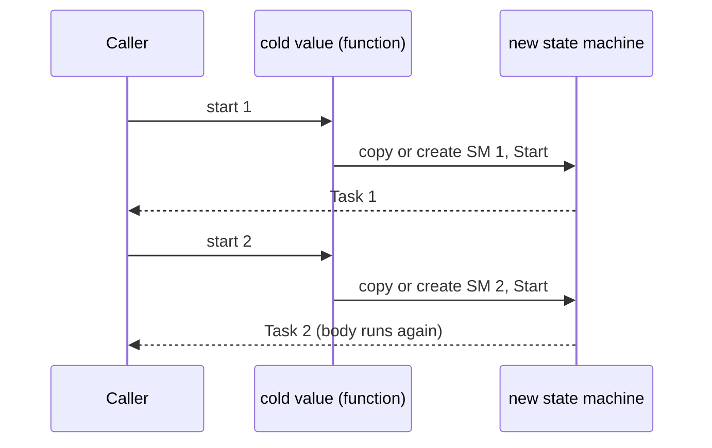

# Run and start paths

Each resumable builder has a `Run` member with two paths. The base builders have no `Run`. Each derived builder adds `Run` and `RunDynamic`. See [and! and MergeSources](and-bang-merge-sources.md) for where `MergeSources` is defined.

- Static path: `Run` checks `if __useResumableCode then __stateMachine<...>(MoveNextMethodImpl)(SetStateMachineMethodImpl)(AfterCode)`. The compiler makes a struct state machine. The `MoveNext` body after `__resumeAt` is a shared resumable code helper. A builder supplies only `SetStateMachine` and the start in `AfterCode`:
  - `TaskBase.moveNext` and `TaskBase.moveNextUnit` (`TaskBuilderBase.fs`) for the hot builders. Both call `moveNextWith`, which takes the `SetResult` call as resumable code, because the unit builders' method builders take no result.
  - `CancellableTaskBase.trampolinedMoveNext` (`CancellableTaskBuilderBase.fs`) and `ColdTasks.trampolinedMoveNext` (`ColdTask.fs`) for the cold builders. They hold the trampoline hooks and call `TrampolinedCode.yieldOnBindLimit` and `yieldOnCompletionLimit` for the start and completion bounces. There are two copies because each reads the data fields of its own state machine data type.
- Dynamic path: otherwise `Run` calls `static member RunDynamic`. `RunDynamic` keeps only the start code. Two base classes hold the shared `MoveNext`, and a builder overrides only the method builder calls:
  - `TaskBaseResumptionInfo<_, _>` (`TaskBuilderBase.fs`) for the hot builders. `newResumptionInfo` and `newResumptionInfoUnit` make it. The unit form exists because the unit builders' method builders take no result.
  - `TrampolinedResumptionInfo<_>` (`Trampoline.fs`) for the cold builders (see [recursion and tail calls](../plans/recursion-and-tail-calls.md)). `CancellableTaskBase.newResumptionInfo` makes it for the three cancellable builders. `ColdTaskBuilder.RunDynamic` has its own object expression, because it is the only copy for its data type.
- The dynamic `MoveNext` uses `MethodBuilder.AwaitOnCompleted`. The static `Bind` uses `AwaitUnsafeOnCompleted` (`src/IcedTasks/TaskBuilderBase.fs`).

```fsharp
// src/IcedTasks/CancellableTask.fs (CancellableTaskBuilder.Run, static path)
                    (MoveNextMethodImpl<_>(fun sm ->
                        __resumeAt sm.ResumptionPoint
                        let __stack_fin = trampolinedMoveNext(code).Invoke(&sm)

                        __stack_fin
                        |> ignore
                    ))
```

Rules for the helpers:

- The `MoveNextMethodImpl` lambda and `__resumeAt` stay in `Run`. A helper that returns the whole lambda fails with FS3402: `__stateMachine` must see the lambda at the call site, and `__resumeAt` is not valid in a function of its own.
- Bind the helper result to a `__stack_` local, then ignore the local. `trampolinedMoveNext(code).Invoke(&sm) |> ignore` does not compile statically: each `Run` that the library itself uses (the `MergeSources` members) fails with FS3401 and FS0073.
- The helpers return `bool` for the same reason that `Trampoline.exited` does: `MoveNext` must not end with a call to a unit function (see [recursion and tail calls](../plans/recursion-and-tail-calls.md)).
- A helper has no hoisted local, only `__stack_` locals. The compiler clears a hoisted local at the end of its `let` scope. In a helper that scope ends before `MoveNext` returns, so the clear also runs when `MoveNext` suspends. The clear erases the value that the resumption needs, and it writes to the state machine after `exited ()`. So the state that crosses a bounce is in data fields: `Error` and `NoBounce` on `CancellableTaskBaseStateMachineData` and `ColdTaskStateMachineData`. Check: in the IL of a consuming assembly, no `stfld` comes after the last `call exited` in a `MoveNext`.

## Hot and cold

A hot builder calls `MethodBuilder.Start` in `AfterCode` and returns the task. A cold builder returns a function from `AfterCode`. Each call of the function copies the state machine, makes a new method builder, and starts it:

```fsharp
// src/IcedTasks/ColdTask.fs (ColdTaskBuilder.Run, static path)
                    (AfterCode<_, _>(fun sm ->
                        let sm = sm

                        fun () ->
                            let mutable sm = sm
                            sm.Data.MethodBuilder <- AsyncTaskMethodBuilder<'T>.Create()
                            sm.Data.MethodBuilder.Start(&sm)
                            sm.Data.MethodBuilder.Task
                    ))
```

Each cold builder's value is a `TrampolinedStart`. The static `Run` and `RunDynamic` both make it with `TrampolinedStart.create`. A call from user code is an immediate start, and a `Source` bind is a nested start. See [recursion and tail calls](../plans/recursion-and-tail-calls.md).

## Multi-start invariant

Each start of a cold value must use its own state machine and its own resumption info. The dynamic `Bind` stores the continuation of the running start in the resumption info. If two starts share it, the second start resumes the first start and does not run the body again (PR #67, issue #65). `RunDynamic` thus makes both objects inside the start function. The initial resumption function stays outside it, so a start allocates no delegate. `CancellableTaskBase.newResumptionInfo` thus takes that function as an argument:

```fsharp
// src/IcedTasks/ColdTask.fs (ColdTaskBuilder.RunDynamic)
            fun () ->
                let mutable sm = ColdTaskStateMachine<'T>()
                sm.ResumptionDynamicInfo <- newResumptionInfo ()
                sm.Data.MethodBuilder <- AsyncTaskMethodBuilder<'T>.Create()
                sm.Data.MethodBuilder.Start(&sm)
                sm.Data.MethodBuilder.Task
```

The background static branches also copy the state machine for each start. The same rule applies to `cancellableTask`, `cancellableValueTask`, and `cancellablePoolingValueTask`.



## When the dynamic path runs

With .NET SDK 10.0.400 and later, every Debug build takes the dynamic path. Release builds take the static path when the compiler can compile the state machine. The tests force the dynamic path with test builders whose `Run` calls `RunDynamic`. See [test helpers](../tests/expect-helpers.md).

## Exceptions

Both paths save the exception and call `SetException` after the `try ... with` block. See [practices](../practices.md).

Related: [background builders](background-builders.md), [cancellation flow](cancellation-flow.md), [builder catalog](builder-catalog.md).
