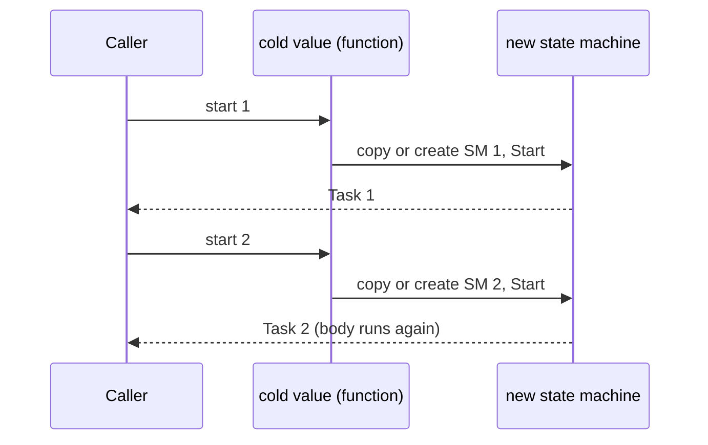

# Run and start paths

Each resumable builder has a `Run` member with two paths. The base builders have no `Run`. Each derived builder adds `Run` and `RunDynamic`. See [and! and MergeSources](and-bang-merge-sources.md) for where `MergeSources` is defined.

- Static path: `Run` checks `if __useResumableCode then __stateMachine<...>(MoveNextMethodImpl)(SetStateMachineMethodImpl)(AfterCode)`. The compiler makes a struct state machine.
- Dynamic path: otherwise `Run` calls `static member RunDynamic`. `RunDynamic` makes a `...ResumptionDynamicInfo` object expression with `MoveNext` and `SetStateMachine`.
- The dynamic `MoveNext` uses `MethodBuilder.AwaitOnCompleted` with the awaiter as `ICriticalNotifyCompletion`. The static `Bind` members of `TaskBuilderBase` and `CancellableTaskBuilderBase` call `MethodBuilder.AwaitUnsafeOnCompletedTyped`. See [Suspension and the awaiter type](#suspension-and-the-awaiter-type).

## Hot and cold

A hot builder calls `MethodBuilder.Start` in `AfterCode` and returns the task. A cold builder returns a function from `AfterCode`. Each call of the function copies the state machine, makes a new method builder, and starts it:

```fsharp
// src/IcedTasks/ColdTask.fs (ColdTaskBuilder.Run, static path)
                    (AfterCode<_, _>(fun sm ->
                        let sm = sm

                        fun () ->
                            let mutable sm = sm
                            sm.Data.MethodBuilder <- AsyncTaskMethodBuilder<'T>.Create()
                            sm.Data.MethodBuilder.Start(&sm)
                            sm.Data.MethodBuilder.Task
                    ))
```

## Multi-start invariant

Each start of a cold value must use its own state machine and its own resumption info. The dynamic `Bind` stores the continuation of the running start in the resumption info. If two starts share it, the second start resumes the first start and does not run the body again (PR #67, issue #65). `RunDynamic` thus makes both objects inside the start function:

```fsharp
// src/IcedTasks/ColdTask.fs (ColdTaskBuilder.RunDynamic)
            fun () ->
                let mutable sm = ColdTaskStateMachine<'T>()
                sm.ResumptionDynamicInfo <- newResumptionInfo ()
                sm.Data.MethodBuilder <- AsyncTaskMethodBuilder<'T>.Create()
                sm.Data.MethodBuilder.Start(&sm)
                sm.Data.MethodBuilder.Task
```

The background static branches also copy the state machine for each start. The same rule applies to `cancellableTask`, `cancellableValueTask`, and `cancellablePoolingValueTask`.



## Suspension and the awaiter type

The .NET method builders have fast paths for `TaskAwaiter`, `ValueTaskAwaiter`, `ConfiguredTaskAwaiter`, and `YieldAwaiter`. They use them only when `AwaitUnsafeOnCompleted<TAwaiter, TStateMachine>` gets the concrete awaiter type. With `ICriticalNotifyCompletion` as `TAwaiter`, each suspension on a struct awaiter boxes the awaiter, and the builder calls `UnsafeOnCompleted(Action)`.

The base builders reach the method builder through an SRTP constraint on `'Builder`, and that constraint can name one awaiter type. A member that is generic in `'Builder` and binds two awaiter types (`Using` for `IAsyncDisposable`, `For` over `IAsyncEnumerable`, `MergeSources`) needs one constraint. So does a generic user function with two binds in a cancellable builder, because the two `Bind` overloads delay the inference of `'Builder` (`CancellableTask.zip`, `apply`, and `bind` fail to compile with a concrete awaiter in the constraint). The constraint therefore keeps `byref<ICriticalNotifyCompletion>`.

`MethodBuilder.AwaitUnsafeOnCompletedTyped` (`src/IcedTasks/TaskLike.fs`) keeps that constraint. The helper is `inline internal`: the public `Bind` members inline it into consumer code, and no direct caller can omit `'TOverall`. On `net6.0` and later it compares `typeof<'Builder>` with the five .NET method builders and calls the generic method of that builder with the concrete awaiter. In optimized code (Tier 1 and full optimization) the JIT removes the comparisons, because each builder is a struct. Tier 0 code keeps them. Other builders and the `netstandard` builds pass the awaiter as `ICriticalNotifyCompletion`.

```fsharp
// src/IcedTasks/TaskLike.fs (MethodBuilder.AwaitUnsafeOnCompletedTyped)
        if System.Type.op_Equality (typeof<'Builder>, typeof<AsyncTaskMethodBuilder<'TOverall>>) then
            let typed = &Unsafe.As<'Builder, AsyncTaskMethodBuilder<'TOverall>>(&builder)
            typed.AwaitUnsafeOnCompleted(&awaiter, &stateMachine)
```

- Invariant: the call must use the method builder field by reference (`let typed = &Unsafe.As ...`). A copy loses the task that `AwaitUnsafeOnCompleted` stores in the builder, and the result never completes.
- `coldTask` has its own `Bind` that calls `sm.Data.MethodBuilder.AwaitUnsafeOnCompleted` on the concrete `AsyncTaskMethodBuilder<'T>`, so it does not use the helper.
- `tests/IcedTasks.Tests/SuspensionAllocationTests.fs` checks each builder on the two bases, and `use` of an `IAsyncDisposable` whose `DisposeAsync` is pending (the `BindNoCancellation` path of the cancellable builders, through `ValueTaskAwaiter`). A struct awaiter or an `IValueTaskSource` runs the continuation at once on the test thread, with no `SynchronizationContext` (a context sends the background builders to the thread pool), and `GC.GetAllocatedBytesForCurrentThread` must show no more bytes for ten extra suspensions than for ten extra binds of a completed awaiter. The runs use 12 and 22 binds, because `AsyncTaskMethodBuilder` caches the `Task<int>` of results up to 8. The file is not linked into the `netstandard` test projects, which use the fallback.

Lesson: on the static path, a cold or cancellable `Run` returns a function whose closure holds the whole state machine struct (one field for each awaiter and each bound value). Moving `__stateMachine` inside that function does not work. With `if __useResumableCode` outside the function, the compiler takes `RunDynamic` and gives no FS3511 warning. With the check inside the function, the compiler compiles static code but also captures `code` for the dynamic branch: three objects for each call and 35 helper classes instead of 2 for one expression.

## When the dynamic path runs

With .NET SDK 10.0.400 and later, every Debug build takes the dynamic path. Release builds take the static path when the compiler can compile the state machine. The tests force the dynamic path with test builders whose `Run` calls `RunDynamic`. See [test helpers](../tests/expect-helpers.md).

## Exceptions

Both paths save the exception and call `SetException` after the `try ... with` block. See [practices](../practices.md).

Related: [background builders](background-builders.md), [cancellation flow](cancellation-flow.md), [builder catalog](builder-catalog.md).
