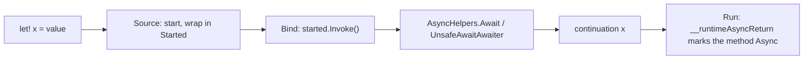

# Runtime-async task builders

`src/IcedTasks/RuntimeTask.fs` defines `task`, `backgroundTask`, and `valueTask` in the namespace `IcedTasks.Polyfill.RuntimeTask`. The file compiles only for `net11.0` (`#if NET11_0_OR_GREATER`). The .NET runtime suspends these builders. They use no resumable code and no state machine. Human docs: `docsSrc/Explanations/Runtime-async-task-builders.md`.

## Shape

| Item | Value |
|---|---|
| Base | `RuntimeTaskBuilderBase` in AutoOpen module `RuntimeTaskBase` |
| Body type | `'T` directly. `Return` is identity, `Zero` is `()` |
| Bound value | `Started<'T>`, a delegate that awaits and returns the result |
| `Run` | `__runtimeAsyncReturn (code ())`, or `__runtimeAsyncReturnValueTask` |
| Suspension | `AsyncHelpers.Await` for `Task`/`ValueTask`, `AsyncHelpers.UnsafeAwaitAwaiter` for other awaiters |

```fsharp
// src/IcedTasks/RuntimeTask.fs
        [<NoDynamicInvocation>]
        member inline _.Run([<InlineIfLambda>] code: unit -> 'T) : Task<'T> =
            __runtimeAsyncReturn (code ())
```



## Source priority

- Builder type: `Source(Task<'T>)` on `RuntimeTaskBuilder` and `RuntimeBackgroundTaskBuilder`, `Source(ValueTask<'T>)` on `RuntimeValueTaskBuilder`.
- `HighPriority`: `IAsyncEnumerable`, `Task<'T>`, `Task`, `ValueTask<'T>`, `ValueTask`, `Async<'T>` (`Async.StartImmediateAsTask` at `Source`), `unit -> Task<'T>`, `unit -> Task`.
- `LowPriority`: any awaiter, any awaitable, `IDisposable` `Using`, `seq`.

## Invariants

- Each member is `inline` and has `NoDynamicInvocation`. Without it, a Debug consumer on `LangVersion` 11.0 compiles and returns wrong values. See [ADR 0013](../../adr/0013-runtime-async-task-builders.md).
- `Source` starts an `Async` or a cold task. It captures a task, a value task, or an awaiter in its current state: it does not start a created task, and an awaiter that starts its work in `UnsafeOnCompleted` starts when the builder awaits it. A throw during `Source` evaluation wins over the operands. `MergeSources` returns a `Started` that awaits left, then right. A left fault skips the right await, and the result has the left exception.
- `Using` captures a body exception with `ExceptionDispatchInfo`, awaits `DisposeAsync` outside the `try`, and then rethrows. A suspension in a `finally` loses the stack trace on rethrow (dotnet/fsharp#20869). A `DisposeAsync` exception replaces the body exception.
- `backgroundTask` uses `Task.Run(fun () -> __runtimeAsyncReturn (code ()))` when a `SynchronizationContext` or non-default scheduler is present.

## Lessons

- A consumer needs `net11.0` and `LangVersion` `preview`. Error FS3350 reports a missing `preview`.
- In Release, the optimizer can inline a small function that uses the builder into its caller, so its name is missing from stack traces. Tests that assert frame names put `MethodImplOptions.NoInlining` on the functions.
- The SDK 11.0.100 compiler names the generated method after a nearby binding. A local function inside a large expression gets names such as `task@319` or `computation@405`.
- Test: `tests/IcedTasks.Tests/RuntimeTaskTests.fs`. It checks `MethodImplAttributes.Async` on the method that runs the body, the start order of `and!` operands with a deadline, and the `AsyncDisposalOutcome` matrix for `use` and `for`.

Related: [namespaces and TFMs](namespaces-and-tfms.md), [source overload priority](source-overload-priority.md), [builder catalog](builder-catalog.md).
