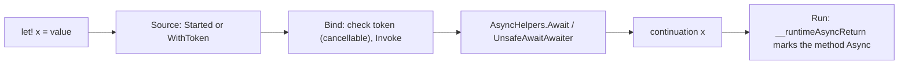

# Runtime-async task builders

The namespace `IcedTasks.Polyfill.RuntimeTask` has eight builders that the .NET runtime suspends. They use no resumable code and no state machine. Both files compile only for `net11.0` (`#if NET11_0_OR_GREATER`). Human docs: `docsSrc/Explanations/Runtime-async-task-builders.md` and `docsSrc/How-To-Guides/Use-runtime-async-task-builders.md`.

| File | Base | Builders |
|---|---|---|
| `RuntimeTask.fs` | `RuntimeTaskBuilderBase` (body is `'T`) | `task`, `backgroundTask`, `valueTask`, `coldTask`, `backgroundColdTask` |
| `RuntimeCancellableTask.fs` | `RuntimeCancellableTaskBuilderBase` (body is `CancellationToken -> 'T`) | `cancellableTask`, `backgroundCancellableTask`, `cancellableValueTask` |

## Shape

| Item | Non-cancellable | Cancellable |
|---|---|---|
| `Return`, `Zero` | `value`, `()` | `fun _ -> value`, `fun _ -> ()` |
| Bound value | `Started<'T>` (`unit -> 'T`) | `Started<'T>` for hot values, `WithToken<'T>` (`CancellationToken -> 'T`) for token-dependent and cold values |
| `Run` | `__runtimeAsyncReturn (code ())`, or `fun () -> ...` for cold | `fun ct -> __runtimeAsyncReturn (ct.ThrowIfCancellationRequested(); code ct)` |
| Suspension | `AsyncHelpers.Await` for `Task`/`ValueTask`, `UnsafeAwaitAwaiter` for other awaiters | same |

```fsharp
// src/IcedTasks/RuntimeCancellableTask.fs
        member inline _.Run
            ([<InlineIfLambda>] code: CancellationToken -> 'T)
            : CancellationToken -> Task<'T> =
            fun ct ->
                __runtimeAsyncReturn (
                    ct.ThrowIfCancellationRequested()
                    code ct
                )
```



## Source priority

- Builder type: `Source(Task<'T>)` on the task and cold builders, `Source(ValueTask<'T>)` on `valueTask`, `Source(CancellationToken -> Task<'T>)` or `-> ValueTask<'T>` on the cancellable builders.
- Non-cancellable `HighPriority`: `IAsyncEnumerable`, `Task<'T>`, `Task`, `ValueTask<'T>`, `ValueTask`, `Async<'T>`, `unit -> Task<'T>`, `unit -> Task`. `LowPriority`: any awaiter, any awaitable, `unit -> 'Awaiter`, `unit -> 'Awaitable`, `IDisposable` `Using`, `seq`. These sources start the operation in `Source`.
- Cancellable `HighPriority`: the same hot types as `Started`, and `Async<'T>`, `CancellationToken -> Task<'T>`/`Task`/`ValueTask<'T>`/`ValueTask`, `unit -> Task<'T>`/`Task` as `WithToken`. `LowPriority`: any awaiter, any awaitable, `CancellationToken -> 'Awaitable`, `unit -> 'Awaitable`, `IDisposable` `Using`, `seq`. A `WithToken` source starts in `Bind`, after the token check.

## Invariants

- Each member is `inline` and has `NoDynamicInvocation`. Without it, a Debug consumer on `LangVersion` 11.0 compiles and returns wrong values. See [ADR 0013](../../adr/0013-runtime-async-task-builders.md).
- Cancellable: `Run` checks the token at the call. `Bind`, `BindReturn`, and `ReturnFrom` check it before they await. `Return`, `Zero`, `For` over `seq`, `Using` cleanup, and `TryFinally` do not check it. `For` over `IAsyncEnumerable` gives the token to `GetAsyncEnumerator`.
- `and!`: non-cancellable sources start in `Source`. Cancellable `MergeSources` starts each `WithToken` operand with `__runtimeAsyncReturnValueTask (operand.Invoke ct)`, from left to right, then awaits from left to right. A left fault skips the right await. The order matches `Task.fs` and `CancellableTask.fs` `MergeSources`.
- A source captures a `Task`, `ValueTask`, or awaiter in its current state. It does not start a created task.
- `Using` captures a body exception with `ExceptionDispatchInfo`, awaits `DisposeAsync` outside the `try`, and then rethrows. A suspension in a `finally` loses the stack trace on rethrow (dotnet/fsharp#20869). A `DisposeAsync` exception replaces the body exception.
- Cold and cancellable `Run` return a function. Each call runs a new runtime-async closure, so multi-start runs the body again.
- `background*` use `Task.Run(fun () -> __runtimeAsyncReturn (...))` when a `SynchronizationContext` or non-default scheduler is present. `backgroundCancellableTask` gives the token to `Task.Run`.

## Tests

`tests/IcedTasks.Tests.RuntimeAsync` (`net11.0`, defines `TEST_RUNTIME_ASYNC`) links the suites for `task`, `backgroundTask`, `valueTask`, `coldTask`, `cancellableTask`, and `cancellableValueTask`. Each linked file opens the runtime namespace under `#if TEST_RUNTIME_ASYNC`, so the same tests run against the runtime builders. `RuntimeTaskTests.fs` adds the runtime-only tests: the `Async` flag, start order with a deadline, token checks on the `Bind` and `BindReturn` paths, the `DisposeAsync` outcome matrix, and the background escape.

## Lessons

- A consumer needs `net11.0` and `LangVersion` `preview`. Error FS3350 reports a missing `preview`.
- `let! x = e; stmt; return x` compiles to `BindReturn`, not `Bind`. A test for `Bind` needs another computation step after the `let!`.
- In Release, the optimizer can inline a small function that uses the builder into its caller, so its name is missing from stack traces. Tests that assert frame names put `MethodImplOptions.NoInlining` on the functions.
- The SDK 11.0.100 compiler names the generated method after a nearby binding. A local function inside a large expression gets names such as `task@319` or `computation@405`.
- The full name of a builder without the `open` is `IcedTasks.Polyfill.RuntimeTask.RuntimeTasks.task`. `IcedTasks.Polyfill.RuntimeTask.task` gives FS0039.

Related: [namespaces and TFMs](namespaces-and-tfms.md), [source overload priority](source-overload-priority.md), [cancellation flow](cancellation-flow.md), [builder catalog](builder-catalog.md).
