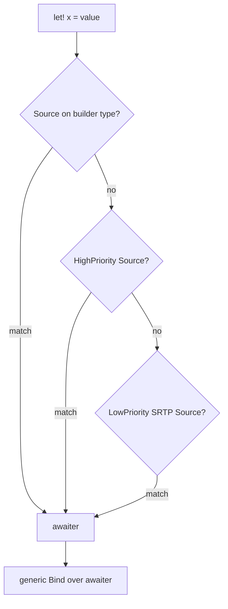

# Source overload priority

The builders convert each bound value to an awaiter with a `Source` member. Then a small set of generic `Bind` members handles all types. `docsSrc/Explanations/Why-is-there-different-binds.md` explains the reason: `Task<'T>` has two `GetAwaiter` methods, so the SRTP awaitable overload cannot resolve it, and `Source` avoids one `Bind` and `ReturnFrom` per type.

## SRTP shapes

`src/IcedTasks/TaskLike.fs` defines the shapes:

- `Awaiter<'Awaiter,'TResult>` requires `ICriticalNotifyCompletion`, `get_IsCompleted`, and `GetResult`.
- `Awaitable` requires `GetAwaiter`.
- A `MethodBuilder` SRTP shim calls `SetResult`, `SetException`, `Start`, `get_Task`, `AwaitUnsafeOnCompleted`, and `AwaitOnCompleted` on any method builder.

## Priority modules

Each base builder file has a `LowPriority` module and a `HighPriority` module of extension members. Members on the builder type itself come first.

| Level | `TaskBuilderBase` (`TaskBuilderBase.fs`) | `CancellableTaskBuilderBase` (`CancellableTaskBuilderBase.fs`) |
|---|---|---|
| Builder type | `Source` for its own result type | `Source` for its own result type |
| HighPriority | `IAsyncEnumerable`, `Task<'T>`, `Async`, `TaskAwaiter` | `IAsyncEnumerable`, `TaskAwaiter`, `Task<'T>`, ColdTask, CancellableTask, `Async` |
| LowPriority | any awaiter (identity), any awaitable, `IDisposable` `Using`, `seq` | `CancellationToken -> 'Awaitable`, `unit -> 'Awaitable`, any awaiter, any awaitable, `IDisposable` `Using`, `seq` |

```fsharp
// src/IcedTasks/TaskBuilderBase.fs (HighPriority)
            member inline _.Source(task: Task<'T>) = Awaitable.GetTaskAwaiter task

            member inline this.Source(async: Async<'TResult1>) =
                this.Source(Async.StartImmediateAsTask(async))
```



## Contracts

- In the cancellable builders, `Source` returns `CancellationToken -> 'Awaiter` for token-dependent and cold operands. For a `Task<'T>`, an awaiter, or an awaitable, it returns the awaiter itself. Two `Bind` overloads handle the two shapes. See [cancellation flow](cancellation-flow.md).
- In the cold builders, `Bind` accepts only `unit -> 'Awaiter`. The `LowPriority` `Source` members lift awaiters and awaitables into that shape (`src/IcedTasks/ColdTask.fs`).
- `Async` values bound in `TaskBuilderBase` start with `Async.StartImmediateAsTask` and no token.
- `ColdTask.fs` also extends the FSharp.Core `AsyncBuilder` and `TaskBuilderBase` and the IcedTasks `AsyncExBuilder` and `TaskBuilderBase` so that they can bind a ColdTask.
- Most `Source`, `Bind`, and `MergeSources` members that use SRTP constraints carry `[<NoEagerConstraintApplication>]`.
- Each `HighPriority` module comes after its `LowPriority` module in the same file. F# prefers intrinsic members to extension members, and among extension members it prefers the module opened later.

Decisions:

- [ADR 0003, `Source` members and awaiter binds](../../adr/0003-source-members-and-awaiter-binds.md)
- [ADR 0002, start `Async` with `Async.StartImmediateAsTask`](../../adr/0002-start-async-with-startimmediateastask.md)

Related: [cancellation flow](cancellation-flow.md), [namespaces and TFMs](namespaces-and-tfms.md), [summary](summary.md).
