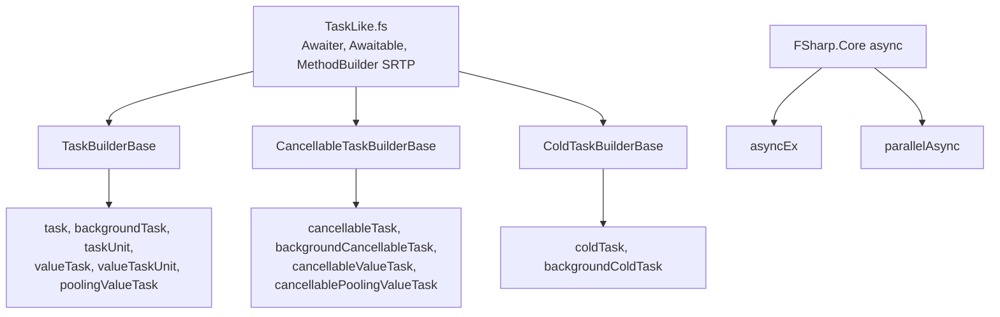

# Builders domain

The builders domain is the library in `src/IcedTasks`. It defines the computation expression builders, their base builders, the `Source` overloads, and the companion modules. `IcedTasks.fsproj` compiles the files in this order:

```xml
<!-- src/IcedTasks/IcedTasks.fsproj -->
    <Compile Include="AssemblyInfo.fs" />
    <Compile Include="Nullness.fs" />
    <Compile Include="TaskLike.fs" />
    <Compile Include="ExceptionCache.fs" />
    <Compile Include="Trampoline.fs" />
    <Compile Include="TaskBuilderBase.fs" />
    <Compile Include="ValueTask.fs" />
    <Compile Include="PoolingValueTask.fs" />
    <Compile Include="ValueTaskUnit.fs" />
    <Compile Include="TaskUnit.fs" />
    <Compile Include="Task.fs" />
    <Compile Include="AsyncEx.fs" />
    <Compile Include="ParallelAsync.fs" />
    <Compile Include="ColdTask.fs" />
    <Compile Include="CancellableTaskBuilderBase.fs" />
    <Compile Include="CancellableValueTask.fs" />
    <Compile Include="CancellablePoolingValueTask.fs" />
    <Compile Include="CancellableTask.fs" />
    <Compile Include="AutoOpens.fs" />
```



Topics:

- [Builder catalog](builder-catalog.md) - each builder, its result type, and its base.
- [Run and start paths](run-and-start-paths.md) - hot and cold starts, static and dynamic paths, multi-start.
- [Source overload priority](source-overload-priority.md) - how `let!` selects an overload for each bound type.
- [Cancellation flow](cancellation-flow.md) - the ambient token and the cancellation checks.
- [and! and MergeSources](and-bang-merge-sources.md) - concurrent start of `and!` operands.
- [Background builders](background-builders.md) - thread pool escape.
- [Namespaces and TFMs](namespaces-and-tfms.md) - AutoOpen, polyfill namespaces, and `#if` guards.
- [AsyncEx and ParallelAsync](asyncex-and-parallelasync.md) - the `Async` builders.
- [Companion modules](companion-modules.md) - `map`, `bind`, `zip`, and other functions.

Human docs: `docsSrc/Explanations/Choosing-a-builder.md` and `docsSrc/Explanations/Why-is-there-different-binds.md`.

Related: [tests](../tests/summary.md), [benchmarks](../benchmarks/summary.md).
