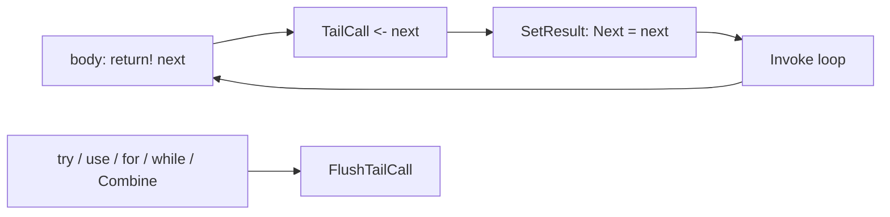

# Tail-recursive cancellable task

`tailRecursiveCancellableTask` (`src/IcedTasks/TailRecursiveCancellableTask.fs`, `net6.0` and later) builds a `CancellableTask<'T>` whose `return!` of a `CancellableTask<'T>` is a tail call.

```fsharp
type TailRecursiveStep<'T> = { Result: 'T; Next: TailRecursiveStepFunc<'T> voption }
and TailRecursiveStepFunc<'T> = CancellationToken -> Task<TailRecursiveStep<'T>>

type TailRecursiveCancellableTaskMethodBuilder<'T> =
    val mutable Inner: AsyncTaskMethodBuilder<TailRecursiveStep<'T>>
    val mutable TailCall: TailRecursiveStepFunc<'T> voption
```

- One body is one step. `ReturnFrom` writes `TailCall`; `SetResult` gives it as `Next`.
- `TailRecursiveCancellableTask<'T>` subclasses `FSharpFunc<CancellationToken, Task<'T>>`. `Invoke` runs the steps in one loop. `StepOf` gives the first step of another `TailRecursiveCancellableTask<'T>`, or a step that awaits any other `CancellableTask<'T>`.
- `Source(CancellableTask<'T>)` is an intrinsic member, so it wins over the base `Source` extensions.
- `FlushTailCall` wraps the sub-computation of `Combine`, `While`, `For`, `TryWith`, `TryFinally`, and `Using`, and awaits a pending tail call inside the scope. It reads `TailCall` through `Unsafe.As` on `sm.Data.MethodBuilder` in place; a by-reference helper reads a copy on the static path. The `Using` and `IAsyncEnumerable` `For` overloads are in `LowPriority` and `HighPriority` modules, as in the base.



## Contracts

- A `return!` inside `try`, `use`, `for`, or `while` is not a tail call. A `return!` in a `with` handler is.
- Each step checks the token and gives `Task.FromCanceled` when it is cancelled.
- `RunDynamic` is the dynamic path. The tests have a dynamic test builder.
- No `MergeSources`, so no `and!`. A struct awaiter is boxed on suspension.

Decision: [ADR 0016](../../adr/0016-tail-recursive-cancellable-task.md). Related: [builder catalog](builder-catalog.md), [run and start paths](run-and-start-paths.md).
