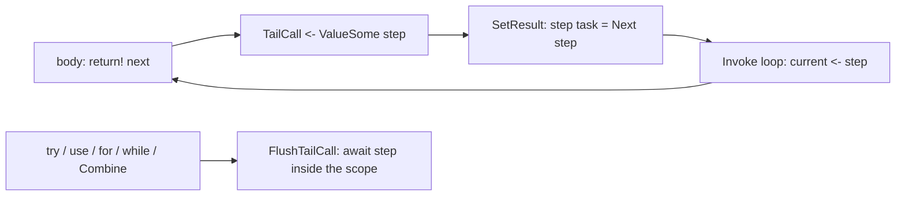

# Tail-recursive cancellable task

`tailRecursiveCancellableTask` (`src/IcedTasks/TailRecursiveCancellableTask.fs`) builds a `CancellableTask<'T>` whose `return!` of a `CancellableTask<'T>` is a tail call. The file is under `#if NET6_0_OR_GREATER`, because the scoped combinators read the method builder through `Unsafe.As`.

## Types

```fsharp
// src/IcedTasks/TailRecursiveCancellableTask.fs
    type TailRecursiveStep<'T> = { Result: 'T; Next: TailRecursiveStepFunc<'T> voption }
    and TailRecursiveStepFunc<'T> = CancellationToken -> Task<TailRecursiveStep<'T>>

    type TailRecursiveCancellableTaskMethodBuilder<'T> =
        val mutable Inner: AsyncTaskMethodBuilder<TailRecursiveStep<'T>>
        val mutable TailCall: TailRecursiveStepFunc<'T> voption
```

- One computation expression body is one step. `SetResult` completes the step task with `Next = TailCall` when the slot is set, else with the result.
- `TailRecursiveCancellableTask<'T>` is a sealed subclass of `FSharpFunc<CancellationToken, Task<'T>>`, so it is a `CancellableTask<'T>` at run time. `Invoke` runs the chain of steps in one `task { while ... }` loop. `StepOf` gives the first step of another `TailRecursiveCancellableTask<'T>`, or a step that awaits any other `CancellableTask<'T>`. `AsCancellableTask` unboxes, because the compiler does not coerce an `FSharpFunc` subclass to a function type.
- `Source(CancellableTask<'T>)` on the builder type returns `TailRecursiveCancellableTaskSource<'T>`, so it has priority over the base `Source` extension members for the same function type. `ReturnFrom` of that source writes the slot and returns `true`. `Bind` and `BindReturn` of that source await the task.

## Flush

`FlushTailCall` runs a sub-computation, then loops while the slot is set: it clears the slot, awaits the step, and either writes the result or writes the next step to the slot. `Combine`, `While`, `For` (`seq` and `IAsyncEnumerable`), `TryWith`, `TryFinally`, and `Using` (`IDisposable` and `IAsyncDisposable`) wrap their sub-computation in it. They are generic in `'Builder` and hide the base members with the same signatures. The `Using` and `For` overloads that the base defines as extension members are extension members here too, in `LowPriority` and `HighPriority` modules after the base modules, so the base priority between `IDisposable` and `IAsyncDisposable` stays.



## Contracts

- A `return!` at the end of the body, or in a `with` handler, is a tail call. A `return!` inside `try`, `use`, `for`, or `while` runs to completion inside that scope, as in `async`.
- Each step checks the token before it starts and gives `Task.FromCanceled` when it is cancelled.
- `RunDynamic` is the dynamic path, like `CancellableTaskBuilder.RunDynamic` with this method builder. The test file has a dynamic test builder.
- On suspension, `MethodBuilder.AwaitUnsafeOnCompletedTyped` passes the awaiter as `ICriticalNotifyCompletion`, because the typed branches cover only the .NET method builders.
- The builder has no `MergeSources`, so no `and!`.
- The public entries are in `tests/IcedTasks.Tests/PublicApi/additions-net6.0.txt`, `additions-net9.0.txt`, and `additions-net11.0.txt`.

Measurements with a Release build on .NET 10, one synchronous `let!` and one `return!` per iteration: `cancellableTask` overflows a 512 KB stack between 900 and 1,000 iterations and keeps about 168 B of live heap per iteration until the loop ends. `tailRecursiveCancellableTask` runs 1,000,000 iterations on a 512 KB stack with a flat live heap, at about 0.2 to 0.5 µs and 288 B allocated per iteration, against about 4.6 µs and 240 B for `cancellableTask` at 1,000 iterations.

Decision: [ADR 0016, tail-recursive cancellable task](../../adr/0016-tail-recursive-cancellable-task.md).

Related: [builder catalog](builder-catalog.md), [run and start paths](run-and-start-paths.md), [cancellation flow](cancellation-flow.md).
