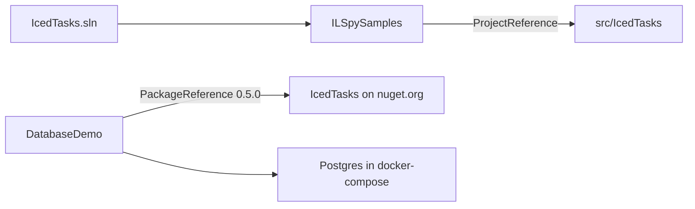

# Examples

`examples/` holds two sample projects. `examples/Directory.Build.props` applies to both.

| Project | In `IcedTasks.sln` | Reference to IcedTasks | Purpose |
|---|---|---|---|
| `examples/ILSpySamples` | yes | project reference | inspect the IL of the generated state machines |
| `examples/DatabaseDemo` | no | package `IcedTasks` 0.5.0 | Giraffe, Dapper.FSharp, and Npgsql against Postgres |

```markdown
<!-- examples/ILSpySamples/README.md -->
# ILSpy Samples

Playground for seeing what ILSpy says about our Task generation code.
```

- `dotnet build IcedTasks.sln` builds `ILSpySamples`. A break in the library API thus breaks this sample too.
- `DatabaseDemo` uses `examples/DatabaseDemo/docker-compose.yml` for Postgres.



Related: [docs summary](summary.md), [benchmarks](../benchmarks/summary.md).
