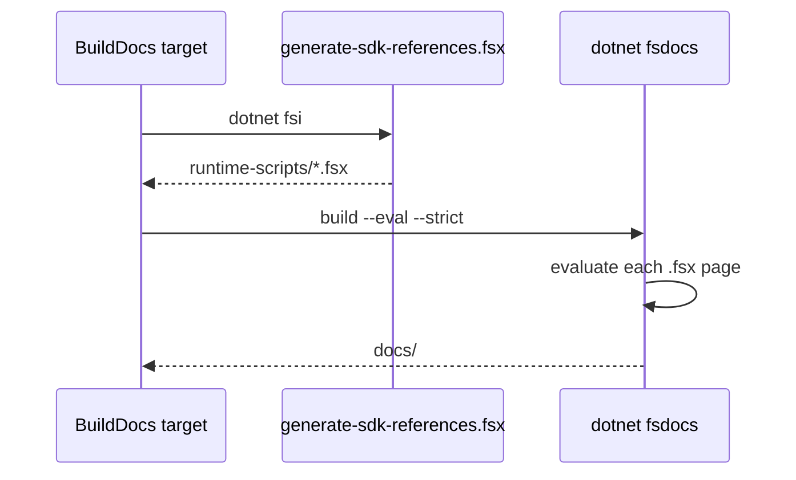

# fsdocs build

The `BuildDocs` target makes the site in `docs/`. It depends on `DotnetBuild` and `CleanDocsCache`. `WatchDocs` writes to `temp/watch-docs` and is not strict.

## Steps

1. `BuildDocs` runs `dotnet fsi generate-sdk-references.fsx`. The script reads `dotnet --list-runtimes` and writes `runtime-scripts/<Name>-<version>.fsx` and `runtime-scripts/<Name>-latest-<major>.fsx` with `#I` and `#r` lines. `.gitignore` excludes `runtime-scripts/`.
2. `BuildDocs` runs `dotnet fsdocs build` with these parameters:

```fsharp
// build/build.fs
    let fsDocsBuildParams configuration (p: Fsdocs.BuildCommandParams) = {
        p with
            Clean = Some true
            Input = Some(quoted docsSrcDir)
            Output = Some(quoted docsDir)
            Eval = Some true
            Projects = Some(Seq.map quoted (!!srcGlob))
            Properties = Some($"Configuration=%s{configuration}")
```

`Eval = Some true` runs each `.fsx` page. `Strict = Some true` makes an error in a page fail the build.

## Requirements

- The `.fsx` pages reference the Release `net9.0` build of the library. Set `CONFIGURATION=Release` for a local `BuildDocs`. `fsdocs-gh-pages.yml` sets it.
- The ASP.NET guides load the ASP.NET Core 8 runtime references. The machine must have the ASP.NET Core 8 runtime.

```fsharp
// docsSrc/How-To-Guides/Cancellable-Task-In-Giraffe.fsx
#load "../../runtime-scripts/Microsoft.AspNetCore.App-latest-8.fsx"
#r "nuget: Giraffe"
#r "../../src/IcedTasks/bin/Release/net9.0/IcedTasks.dll"
```



The `.agents/skills/grill-me-docs/SKILL.md` skill is a docs interview workflow. Its source priority is code, then the owner, then internal docs, then Microsoft docs.

Related: [docs summary](summary.md), [CI workflows](../build/ci-workflows.md).
