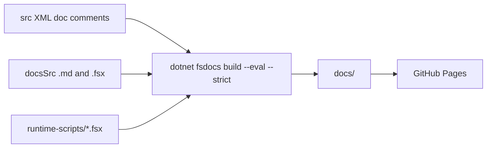

# Docs domain

The docs domain covers `docsSrc/`, `generate-sdk-references.fsx`, and `examples/`. fsdocs builds the site from `docsSrc/` and the XML doc comments in `src/`. GitHub Pages hosts it at `https://www.jimmybyrd.me/IcedTasks/`.

## Layout

`docsSrc/` uses the Diataxis split. The front matter `category` and `categoryindex` set the menu order:

| Folder | `categoryindex` | Content |
|---|---|---|
| `docsSrc/Tutorials/` | 1 | one `.fsx` tutorial |
| `docsSrc/How-To-Guides/` | 2 | eleven `.fsx` guides |
| `docsSrc/Explanations/` | 3 | six `.md` explanations |

`docsSrc/index.md` is the landing page. `docsSrc/_template.html` and `docsSrc/content/fsdocs-theme.css` are the custom template and theme.

```markdown
<!-- docsSrc/Explanations/Choosing-a-builder.md -->
---
title: Choosing a builder
category: Explanations
categoryindex: 3
index: 1
---
```



Topics:

- [fsdocs build](fsdocs-build.md) - the `BuildDocs` target and its requirements.
- [Examples](examples.md) - `examples/ILSpySamples` and `examples/DatabaseDemo`.

Related: [build](../build/summary.md), [builders](../builders/summary.md).
