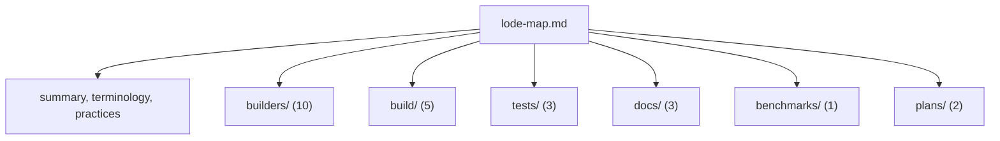

# Lode map

Read [summary](summary.md), [terminology](terminology.md), and this map at the start of a session.

## Root

- [summary.md](summary.md) - the system and its main parts.
- [terminology.md](terminology.md) - domain terms.
- [practices.md](practices.md) - conventions, gotchas, and a change checklist.

## builders - `src/IcedTasks`

- [builders/summary.md](builders/summary.md) - compile order and topic index.
- [builders/builder-catalog.md](builders/builder-catalog.md) - each builder, result type, base, and alias.
- [builders/run-and-start-paths.md](builders/run-and-start-paths.md) - hot and cold starts, static and dynamic paths, multi-start.
- [builders/source-overload-priority.md](builders/source-overload-priority.md) - `Source` members and priority modules.
- [builders/cancellation-flow.md](builders/cancellation-flow.md) - the ambient token and cancellation checks.
- [builders/and-bang-merge-sources.md](builders/and-bang-merge-sources.md) - `and!` and concurrent start.
- [builders/background-builders.md](builders/background-builders.md) - thread pool escape.
- [builders/namespaces-and-tfms.md](builders/namespaces-and-tfms.md) - AutoOpen, polyfill namespaces, TFM guards.
- [builders/asyncex-and-parallelasync.md](builders/asyncex-and-parallelasync.md) - the `Async` builders.
- [builders/companion-modules.md](builders/companion-modules.md) - module functions and conversions.

## build - `build/`, root build files, `.github/`, `.config/`, `.devcontainer/`

- [build/summary.md](build/summary.md) - toolchain and environment variables.
- [build/fake-targets.md](build/fake-targets.md) - the target graph and commands.
- [build/ci-workflows.md](build/ci-workflows.md) - GitHub Actions workflows.
- [build/release-and-publish.md](build/release-and-publish.md) - changelog, release, NuGet trusted publishing.
- [build/formatting-and-analyzers.md](build/formatting-and-analyzers.md) - Fantomas and F# analyzers.

## tests - `tests/`

- [tests/summary.md](tests/summary.md) - Expecto setup and conventions.
- [tests/test-projects-and-tfms.md](tests/test-projects-and-tfms.md) - the three projects and `#if` symbols.
- [tests/expect-helpers.md](tests/expect-helpers.md) - shared helpers, multi-start tests, manual clock.

## docs - `docsSrc/`, `examples/`, `generate-sdk-references.fsx`

- [docs/summary.md](docs/summary.md) - site layout.
- [docs/fsdocs-build.md](docs/fsdocs-build.md) - the `BuildDocs` target and its requirements.
- [docs/examples.md](docs/examples.md) - the sample projects.

## benchmarks - `benchmarks/`

- [benchmarks/summary.md](benchmarks/summary.md) - BenchmarkDotNet projects and run scripts.

## plans

- [plans/open-enhancements.md](plans/open-enhancements.md) - open enhancement issues #3 and #4.
- [plans/recursion-and-tail-calls.md](plans/recursion-and-tail-calls.md) - trampoline and tail-call design for issue #3 (branch `trampoline`).

## Out of scope

- `.agents/` - agent skills. [docs/fsdocs-build.md](docs/fsdocs-build.md) names the docs skill.
- `.vscode/` - editor settings.
- `.DS_Store`, `msbuild.binlog` - tracked artifacts with no function.
- `lode/tmp/` - git-ignored session scraps.

## Outside Lode

- [AGENTS.md](../AGENTS.md) - agent instructions and the Lode Coding prompt.
- [adr/](../adr/) - decision records. A Lode file links the ADRs for its domain when one exists. Decision records live in `adr/`, because `docs/` is the generated fsdocs output and each docs build deletes it.
- [README.md](../README.md) - user overview and developer setup.
- [CHANGELOG.md](../CHANGELOG.md) - release notes.
- [docsSrc/index.md](../docsSrc/index.md) - docs site landing page.
- [docsSrc/Explanations/Choosing-a-builder.md](../docsSrc/Explanations/Choosing-a-builder.md) - builder comparison table.
- [docsSrc/Explanations/Why-is-there-different-binds.md](../docsSrc/Explanations/Why-is-there-different-binds.md) - the reason for `Source`.
- [docsSrc/Explanations/Understanding-and-bang.md](../docsSrc/Explanations/Understanding-and-bang.md) - `and!` behavior by builder.
- [docsSrc/Explanations/Pooling-builders.md](../docsSrc/Explanations/Pooling-builders.md) - pooling builders.
- [docsSrc/Explanations/Recursion-and-stack-safety.md](../docsSrc/Explanations/Recursion-and-stack-safety.md) - which recursive calls are stack safe.
- [docsSrc/Explanations/Polyfill-namespaces-and-shadowing.md](../docsSrc/Explanations/Polyfill-namespaces-and-shadowing.md) - polyfill namespaces.

```gitignore
# .gitignore
# Lode session scraps
lode/tmp/
```


