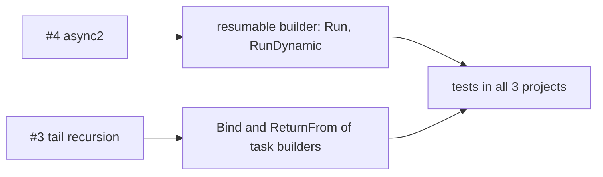

# Open enhancements

The open GitHub issues with the `enhancement` label are the open work. Both also have the `help wanted` label. No roadmap file exists.

| Issue | Title | Request |
|---|---|---|
| [#4](https://github.com/TheAngryByrd/IcedTasks/issues/4) | Implement async2 | Finish the partial FSharp.Core `async2` implementation, which uses resumable code. |
| [#3](https://github.com/TheAngryByrd/IcedTasks/issues/3) | Tail Recursion | Add tail call support to the task builders, as `async` has. |

Both issues list "Don't do it" as an alternative. Neither issue has a design.

## Related code

The existing resumable builders use this `Run` shape, with a static path and a dynamic path:

```fsharp
// src/IcedTasks/CancellableTask.fs (CancellableTaskBuilder.Run)
        member inline _.Run(code: CancellableTaskBaseCode<'T, 'T, _>) : CancellableTask<'T> =
            if __useResumableCode then
                __stateMachine<CancellableTaskBaseStateMachineData<'T, _>, CancellableTask<'T>>
```



Related: [run and start paths](../builders/run-and-start-paths.md), [builder catalog](../builders/builder-catalog.md).
