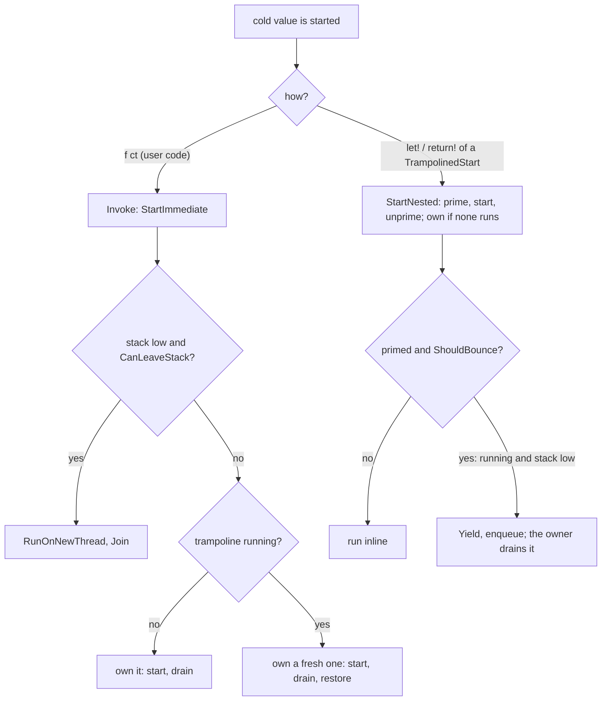

# Recursion and tail calls (design, branch `trampoline`)

Status: steps 1 to 4 done (local, not pushed). Draft PR [TheAngryByrd/IcedTasks#54 "Enable safe recursion with trampoline"](https://github.com/TheAngryByrd/IcedTasks/pull/54) on the branch `trampoline` (remote `majocha`). Addresses issue [#3](https://github.com/TheAngryByrd/IcedTasks/issues/3). See [open enhancements](open-enhancements.md).

## Goals

1. Deep non-tail recursion through `let!` and `return!` does not overflow the stack.
2. A tail `return!` (`ReturnFromFinal`) runs in constant memory and constant stack.
3. Hard rule: code that works today must not deadlock or change results. A new behavior may appear only where today's code overflows the stack.

## Scope by builder

| Builder | Deep recursion | Tail calls | Reason |
|---|---|---|---|
| `coldTask`, `cancellableTask`, `cancellableValueTask`, `cancellablePoolingValueTask` (and background variants) | yes | yes | The value is an unstarted function, so the binder controls the start. |
| `task`, `valueTask`, `taskUnit`, `valueTaskUnit`, `poolingValueTask` | no | no | The value starts inside `Run`. Nothing knows if the caller awaits or blocks, so a bounce can deadlock. |
| `asyncEx` | already | already | `ReturnFrom` forwards to `async.ReturnFrom`. |

## Reference implementations

- `E:\repos\Async2\Async2\Async2.fs` (resumable code). `Async2<'t>` is an interface with `StartImmediate`, `Await`, and `TailCall`. Only `Await` (a builder `Bind`) starts a nested machine, which can bounce. `StartImmediate` inside a running trampoline installs a fresh trampoline (`Trampoline.Isolate`) and drains it before it returns, so a caller can block on the task.
- `E:\repos\FSharp.Control.Async2` (runtime async). The tail-call loop uses a `TailBox` and captures the `ExecutionContext` at the hand-over.

## Current mechanism (`src/IcedTasks/Trampoline.fs`)

- `Trampoline` is per thread (`[<ThreadStatic>]` field `current`). It is an `ICriticalNotifyCompletion` over a `Queue<Action>`. A bounce is `ResumableCode.Yield` plus `MethodBuilder.AwaitOnCompleted(&trampoline)` on a stack local (`bounceWhen` in `ColdTask.fs` and `CancellableTaskBuilderBase.fs`), which enqueues the state machine without an allocation.
- Owner: the outermost start on a thread (`RunAsOwner`) sets `running`, runs the start, and drains the queue in `finally`. A start while the trampoline runs (`Run`) does not drain. So bounced work always unwinds to the owner's shallow stack before it runs again.
- `ShouldBounce` is `running && not HasSufficientStack`. With no owner further up there is nowhere to unwind to, so it never bounces then. The state machines check it after their first `IsAwaited()` (`yieldOnBindLimit`).
- `ShouldBounceCompletion` is the check before `SetResult` and `SetException` (`yieldOnCompletionLimit`, `maybeBounceCompletion`). It is `ShouldBounce`, except on netstandard2.0, where it is also true when no trampoline runs. Reason: .NET Framework runs continuations inline with no stack guard, so a completion chain after a real async resumption can overflow. The bounce runs at once on the same thread and makes the trampoline the owner of the rest of the chain. Resumable Async2 counts depth for this (`completeCounted`, `MaxDepth`); IcedTasks uses the stack check instead, so it does not bounce where the stack is sufficient.
- Each cold builder's `Run` and `RunDynamic` wrap the start function with `Trampoline.wrap`. The result is a `TrampolinedStart<'Arg, 'Result>`, a sealed subclass of `FSharpFunc<'Arg, 'Result>`, so `ColdTask<'T>` and `CancellableTask<'T>` stay function aliases ([ADR 0001](../../adr/0001-function-type-aliases-for-cold-results.md)). `'Arg` is `unit` or `CancellationToken`. `'Result` is `Task<'T>` or `ValueTask<'T>`.
- `Source` members start a bound function with `Trampoline.bind`. It type-tests for `INestedStart<'Arg, 'Result>` and calls `StartNested`. Any other function is called as it is.
- `StartNested` sets the `primed` flag (only when `CanLeaveStack`), calls the start, and clears the flag in `finally`. It owns the trampoline when none runs. The state machine reads and clears it with `IsAwaited()` as its first action, so no user code runs between set and read. Only a primed start can bounce.
- `Invoke` (a call from user code) is `StartImmediate`. It owns the trampoline of the thread, or, when that one runs, a fresh trampoline that it owns, and the old one is restored after it. When the stack is low (`HasSufficientStack` is false), `StartImmediate` runs again on a new thread with a 16 MB stack (`RunOnNewThread`), and the caller waits for its synchronous part with `Join`. The new thread runs in the captured `ExecutionContext`.
- SynchronizationContext rule (`CanLeaveStack`): no bounce and no thread hop when `SynchronizationContext.Current` is not null or `TaskScheduler.Current` is not the default. There the behavior is as on `master`, including a stack overflow at extreme depth.
- The dynamic path makes a resumption info per start (`newResumptionInfo ()` / `makeResumptionInfo ()`) and reads `IsAwaited()` when it makes it (see [run and start paths](../builders/run-and-start-paths.md)).
- Resumption isolation: code that is not IcedTasks (for example `TaskCompletionSource.SetResult`) can resume an awaiting state machine inline while a trampoline runs further up the stack. If that resumption bounces into the running trampoline, and the code then blocks on the resumed task, nothing drains the bounce. So a resumption that is not trusted, while a trampoline runs, installs a fresh trampoline (`Trampoline(ValueSome previous)`) that it owns until its `MoveNext` returns. A trusted resumption is a drained bounce (`Drain` calls `Trust()` before each item) or the completion of a cold builder task (`Trust()` and `ClearTrust()` around `SetResult` and `SetException`).
- The hooks: `Trampoline.Started()` after `IsAwaited()`, `Trampoline.Resumed()` after each `ResumableCode.Yield` that returns true (the resume branch of `Bind`, `TryFinallyAsync` and `yieldOnBindLimit`), and `Trampoline.Exited()` as the last statement of `MoveNext`. The dynamic path calls them once per entry from a loop that replaces the recursive `info.MoveNext` calls. A resumption-owned trampoline counts the `MoveNext` frames on it. When the count goes to 0 it drains, then restores the previous trampoline. No hook can go before `__resumeAt` (FS3511: it must be the start of `MoveNext`), and `Exited()` must not read the state machine: after `AwaitUnsafeOnCompleted` another thread can run it, and after `SetResult` a pooling builder can reuse it. `Exited()` returns `bool` and the static `MoveNext` calls `Trampoline.Exited() |> ignore`. A unit call at the end of `MoveNext` gets the IL `tail.` prefix in the user's assembly, and the JIT compiles a method with an explicit tail call straight to FullOpts: no tiering, no dynamic PGO, so the bind's `Await` is not devirtualized and the bound computation is boxed per level. This shows only when the library is referenced as a DLL (found in Async2, where SimpleRecursion went from 32.5 to 51.6 MB). Check: scan the IL of a consuming assembly for `tail.` + `call Exited`, or `DOTNET_JitDisasm=MoveNext`.
- On netstandard2.0, `HasSufficientStack` calls `EnsureSufficientExecutionStack` and catches `InsufficientExecutionStackException`, because `TryEnsureSufficientExecutionStack` does not exist there.

```fsharp
// src/IcedTasks/Trampoline.fs
    let inline bind (f: 'Arg -> 'Result) (arg: 'Arg) : 'Result =
        match box f with
        | :? INestedStart<'Arg, 'Result> as nested -> nested.StartNested arg
        | _ -> f arg
```

```fsharp
// src/IcedTasks/Trampoline.fs
    static member Resumed() =
        let trampoline = Trampoline.current

        if not (isNull (box trampoline)) then
            if not (trampoline.TakeTrust()) && trampoline.IsRunning then
                Trampoline.current <- Trampoline(ValueSome trampoline)
            elif trampoline.IsResumptionOwner then
                trampoline.EnterFrame()
```



Invariant: a task that user code gets from `Invoke` is complete or truly pending. It never waits on a trampoline that an outer frame on the same thread owns. Also, when code that is not IcedTasks resumes a state machine, the resumption drains everything it bounced before control goes back to that code.

Why the thread hop: an isolated start drains its trampoline on the current stack. Recursion through hot tasks (`return! f (n - 1) ct`, user-code starts) therefore grows the stack, and the branch's mutual recursion tests (10 000 to 40 000 levels) need the hop. Thread affinity is lost only where `master` overflows: `[<ThreadStatic>]` values, a `lock` held by the waiting thread, UI-thread checks.

### Defects removed

1. Wrapper deadlock: a plain function is not a `TrampolinedStart`, so its inner start is immediate.
2. Stale flag: `StartNested` always clears the flag.
3. Single `pending` slot: replaced by the queue.
4. Bounce counter modulo 50: replaced by the stack check, so no bounce occurs where `master` does not overflow.
5. Inline resumption from code that is not IcedTasks: removed by resumption isolation. Before, a frame inside a drain called `TaskCompletionSource.SetResult`, the waiter resumed inline and bounced its `let!` into the running trampoline, and the frame then blocked on the waiter (small stack, depth 1 000, Release).

### Defects still open

6. Cost of `Trampoline.bind`: for an `[<InlineIfLambda>]` lambda literal, the type test needs a closure. Measure with `benchmarks/`.
7. Speed of the dynamic path: the 9 `Recursion` tests take 41 s in Debug before step 3 and 65 s after it, on net10.0. The full Release suite takes about 9 s. The likely causes are the thread hops in the mutual recursion tests and the extra `TrampolinedStart` per value; neither is measured yet.
8. Stale trust: a hot state machine (`task`, `valueTask`) that a cold completion resumes does not clear the trust flag. If it then completes a `TaskCompletionSource` that resumes a cold waiter inline, the waiter is trusted and is not isolated. `ClearTrust()` after `SetResult` limits the window to that inline call. No test covers it.
9. Flaky: `IcedTasks.CancellableValueTask.CancellableValueTaskBuilder.For.TaskSeq receives CancellationToken` errored in 2 of 6 full NS21 Debug runs on the branch, with a `NullReferenceException` in `Seq.toArray` inside TaskSeq's `DisposeAsync`. It passed in 15 runs alone and in 3 full runs on `master`. The `master` suite has no `Recursion` tests and takes 5.5 s against about 95 s on the branch, so the load differs. Not yet known if the trampoline causes it.

## Target design

### 1. Tail-call interface

`TailCall` goes on the same object as `StartNested`:

```fsharp
type INestedStart<'Arg, 'Result> =
    abstract StartNested: 'Arg -> 'Result
    // step 5: abstract TailCall: 'Arg * TaskCompletionSource<'T> -> unit
```

### 2. netstandard2.0 on .NET Framework

Done with `ShouldBounceCompletion` (see the current mechanism). Not tested on .NET Framework: the test projects run only on .NET 8 to 10, where the runtime guards inline continuations.

### 3. Tail calls

As in resumable Async2. `ReturnFromFinal(callee)` of an exact type:

- No `TailCallSource` in the state machine data: this frame is the head. Make a `TaskCompletionSource<'T>`, call `callee.TailCall(ct, tcs)`, then `Bind(tcs.Task, Return)`.
- `TailCallSource` present: call `callee.TailCall(ct, tcs)` and return `false`. The machine is abandoned and its builder task is never made.
- The last callee completes `tcs` instead of its builder.
- Any other callee: fall back to `ReturnFrom`.

New data field: `TailCallSource: TaskCompletionSource<'TOverall> | null` in each cold state machine data struct. Cross-builder tail calls (`coldTask` to `cancellableTask`) need one shared interface for `TailCall`.

Context rules:

- The head binds `tcs.Task` with the normal awaiter, so the final resumption uses the head's captured `SynchronizationContext`, as `ReturnFrom` does today.
- Hand-overs between frames never go back to a captured context. A callee starts on the thread where the previous frame reached its tail `return!`, as today.
- `ExecutionContext` flows because each `TailCall` runs inline in the handing frame.

## Test plan

Port from the branch (already in the tests on `trampoline`):

- `Non-tail recursion`, 100 000 levels with `try/finally` and `try/with`, for `coldTask`, `cancellableTask`, `cancellableValueTask`, `cancellablePoolingValueTask`.
- `Immediate start nested recursion` (`(foo (n - 1)) ()` then `GetResult()`).
- Mutual recursion `ColdTask` and `CancellableTask`, both start sides, with accumulation and token flow.

### Sync-over-async tests (`tests/IcedTasks.Tests/SyncOverAsyncTests.fs`)

Root list `IcedTasks.SyncOverAsync`, 180 tests, in all three test projects. Run them alone with `--filter-test-list SyncOverAsync`. `runGuarded` runs each case on a background thread and fails with "Deadlock: ..." after 10 s. The stack is 64 MB, or 512 KB inside `withStack smallStack`. The large stack checks code that works on `master`. The small stack makes the builders bounce and hop threads at depth 1 000: on `master` those cases stop the process with a stack overflow. The `TaskCompletionSource` cases (`coldTask` with a user-started and a `let!`-started waiter, and `cancellableTask`) run on both stacks; without resumption isolation, 3 of them deadlock on the small stack. The `BlockedContext` cases run only on the large stack, because there the builders do not leave the stack and overflow as on `master`. Cases that block are run with each of `.Result`, `.Wait()`, `GetAwaiter().GetResult()`, `Async.RunSynchronously (Async.AwaitTask t)`, at depths 100 and 1 000. `BlockedContext` is a `SynchronizationContext` that drops every `Post`.

```fsharp
// tests/IcedTasks.Tests/SyncOverAsyncTests.fs (Cold.mixed)
                elif n % 2 = 0 then
                    let! x = mixed wait (n - 1)
                    return x + 1
                else
                    return wait (mixed wait (n - 1) ()) + 1
```

Results of the first 90 tests (large stack) on net10.0, Debug and Release, main and NS20 projects (same in each):

| Case | `master` | `trampoline` |
|---|---|---|
| coldTask: block on a user-started child | pass | pass |
| block and `let!` on alternate levels (cold, cancellable, cancellableValue) | pass | deadlock |
| `let!` a plain function that blocks (defect 1; cold, cancellable) | pass | deadlock |
| block after a `let!` of a plain function (defect 2; cold, cancellable, cancellableValue) | pass | deadlock |
| cancellableTask and coldTask mutual recursion, blocking on the cold side | pass | deadlock |
| coldTask: inline resume from a `TaskCompletionSource`, then block | pass | deadlock |
| `let!` recursion under `BlockedContext` (all three) | pass | pass |
| coldTask: block and `let!` under `BlockedContext` | pass | deadlock |

Total: `master` 90 of 90, `trampoline` before step 3 14 of 90, after step 3 90 of 90. After step 4 with resumption isolation, all 180 pass, small stack included.

Lesson: a bounced child is incomplete when its parent binds it, so the parent's `TaskAwaiter` captures the `SynchronizationContext` and posts its resumption. Under a blocked context that post never runs. Bouncing under a non-default `SynchronizationContext` therefore needs one of two rules: do not bounce, or resume a bounced child's parent without the context. Decided: do not bounce (`CanLeaveStack`). The second rule cannot tell a bounced child from one that waits for real I/O after it bounced.

Still to add:

- `lock` re-entry and a `[<ThreadStatic>]` read across a recursive call.
- Thread-pool starvation (`ThreadPool.SetMaxThreads`).
- A non-IcedTasks callee that wraps an IcedTasks value in tail position.
- Near-overflow depth.
- Stale trust through a hot `task` (defect 8).

## Order of work

1. Merge `master` into `trampoline` (done locally, not pushed).
2. Add the deadlock tests. Record which fail on the branch (done, see the table above).
3. Replace `Allow`/`Prime`/`IsAwaited` with the exact invocation types (done).
4. Replace the trampoline with the queue, the stack-only trigger, and resumption isolation (done; not committed).
5. Add `TailCallSource` and `ReturnFromFinal`.
6. Benchmarks, then docs (`docsSrc/`, XML docs) and the lode builder files.

Related: [run and start paths](../builders/run-and-start-paths.md), [source overload priority](../builders/source-overload-priority.md), [builder catalog](../builders/builder-catalog.md).
