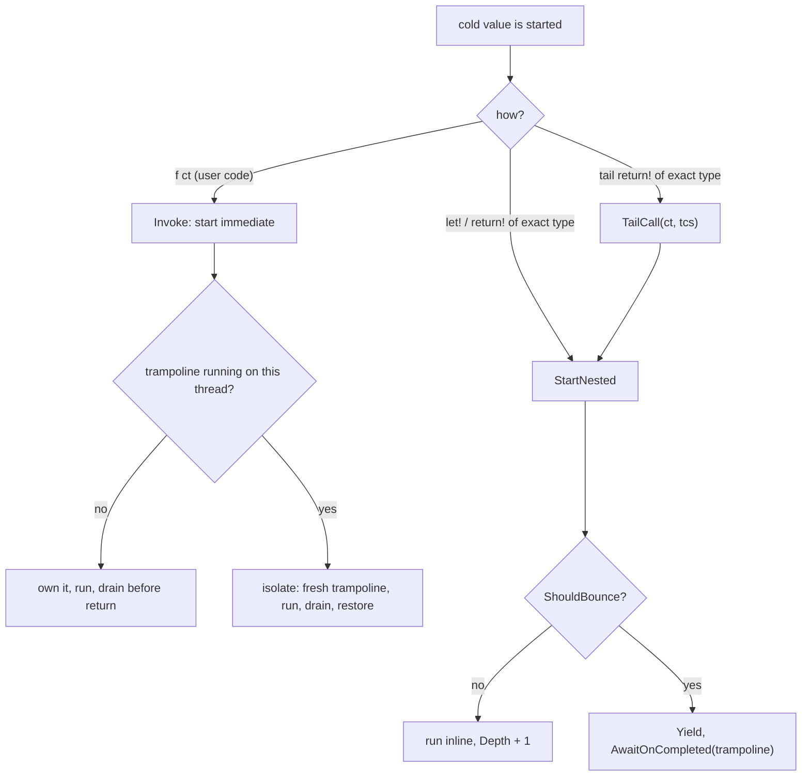

# Recursion and tail calls (design, branch `trampoline`)

Status: design. Draft PR [TheAngryByrd/IcedTasks#54 "Enable safe recursion with trampoline"](https://github.com/TheAngryByrd/IcedTasks/pull/54) on the branch `trampoline` (remote `majocha`). Addresses issue [#3](https://github.com/TheAngryByrd/IcedTasks/issues/3). See [open enhancements](open-enhancements.md).

## Goals

1. Deep non-tail recursion through `let!` and `return!` does not overflow the stack.
2. A tail `return!` (`ReturnFromFinal`) runs in constant memory and constant stack.
3. Hard rule: code that works today must not deadlock or change results. A new behavior may appear only where today's code overflows the stack.

## Scope by builder

| Builder | Deep recursion | Tail calls | Reason |
|---|---|---|---|
| `coldTask`, `cancellableTask`, `cancellableValueTask`, `cancellablePoolingValueTask` (and background variants) | yes | yes | The value is an unstarted function, so the binder controls the start. |
| `task`, `valueTask`, `taskUnit`, `valueTaskUnit`, `poolingValueTask` | no | no | The value starts inside `Run`. Nothing knows if the caller awaits or blocks, so a bounce can deadlock. |
| `asyncEx` | already | already | `ReturnFrom` forwards to `async.ReturnFrom`. |

## Reference implementations

- `E:\repos\Async2\Async2\Async2.fs` (resumable code). `Async2<'t>` is an interface with `StartImmediate`, `Await`, and `TailCall`. Only `Await` (a builder `Bind`) starts a nested machine, which can bounce. `StartImmediate` inside a running trampoline installs a fresh trampoline (`Trampoline.Isolate`) and drains it before it returns, so a caller can block on the task.
- `E:\repos\FSharp.Control.Async2` (runtime async). The tail-call loop uses a `TailBox` and captures the `ExecutionContext` at the hand-over.

## Current branch mechanism (`src/IcedTasks/Trampoline.fs`)

- `Trampoline` is per thread (`ThreadLocal`). It is an `ICriticalNotifyCompletion` with one `pending` slot. A bounce is `ResumableCode.Yield` plus `MethodBuilder.AwaitOnCompleted(Trampoline.Current.Ref)`.
- `ShouldBounce` counts calls modulo `MaxDepth = 50`. The counter never decrements, so it is not a nesting depth.
- "Is awaited" signal: `Source` members call `Trampoline.Allow f x`, which calls `Prime()` before it calls `f`. The start calls `IsAwaited()`, which reads and clears the flag. Only a primed start can bounce.
- The dynamic path makes a resumption info per start (`newResumptionInfo ()` / `makeResumptionInfo ()`). The info reads `IsAwaited()` when it is made, so each start of a multi-start value has its own flag (see [run and start paths](../builders/run-and-start-paths.md)).

```fsharp
// src/IcedTasks/CancellableTaskBuilderBase.fs (branch)
                (fun ct -> Awaitable.GetTaskAwaiter(Trampoline.Allow cancellableTask ct))
```

### Defects to remove

1. Wrapper deadlock. `let! x = fun ct -> Task.FromResult((inner ct).Result)`: `Source` primes, `inner` takes the flag and bounces, the wrapper blocks on `.Result`, and the trampoline cannot run.
2. Stale flag. A bound function that is not an IcedTasks value never takes the flag. A later unrelated start in the same frame takes it, and that start can be blocked on with `GetResult()`.
3. One `pending` slot. A second enqueue while the slot is full overwrites the first continuation. `ShouldBounce` checks `pending.IsNone` to avoid this. A queue removes the hazard.
4. `ThreadLocal` costs more than `[<ThreadStatic>]` on each check.

## Target design

### 1. Exact invocation types

`Run` of each cold builder returns an instance of a sealed class. The class inherits `FSharpFunc<CancellationToken, Task<'T>>` (or `FSharpFunc<unit, Task<'T>>`), so the public aliases do not change ([ADR 0001](../../adr/0001-function-type-aliases-for-cold-results.md)). An internal interface gives the extra starts:

```fsharp
type ICancellableStart<'T> =
    abstract StartNested: CancellationToken -> Task<'T>
    abstract TailCall: CancellationToken * TaskCompletionSource<'T> -> unit

[<Sealed>]
type CancellableStart<'T, 'SM>(sm: 'SM) =   // 'SM: the compiled state machine struct
    inherit FSharpFunc<CancellationToken, Task<'T>>()
    override _.Invoke ct = (* start immediate: own or isolate the trampoline *)
    interface ICancellableStart<'T> with ...
```

Checked in `dotnet fsi`: `box (CancellableStart ...) :?> (CancellationToken -> Task<int>)` is callable, and `:? ICancellableStart<int>` matches.

`Source` and `ReturnFromFinal` type-test the bound function. An exact match calls `StartNested` or `TailCall`. Any other function is called normally and its task is awaited as today. No thread-static flag remains, so defects 1 and 2 cannot occur.

Open: an `[<InlineIfLambda>]` lambda literal passed to `Source` may need a closure only for the type test. Measure with `benchmarks/`.

### 2. Start kinds



Invariant: a task that user code can see is complete or truly pending when `Invoke` returns. It is never waiting on a trampoline that an outer frame on this thread owns.

### 3. Bounce trigger

- net6.0 and later: bounce only when `RuntimeHelpers.TryEnsureSufficientExecutionStack()` is false. No fixed depth. This keeps goal 3 for the remaining case below.
- netstandard2.0: .NET Framework runs continuations inline with no stack guard, so completions also bounce, and a `Depth` counter (inc/dec around nested starts and completions) limits the chain, as in resumable Async2 (`ShouldBounceCompletion`).
- The trampoline is a `Queue<Action>` in a `[<ThreadStatic>]` field. The owner drains it in `finally`.

Remaining case with a fixed depth: a frame inside a drain sets a `TaskCompletionSource`, an awaiting machine resumes inline, `let!`s a child that bounces, suspends, and the frame then blocks on that machine. With the stack-only trigger this can occur only where today's code overflows.

### 4. Tail calls

As in resumable Async2. `ReturnFromFinal(callee)` of an exact type:

- No `TailCallSource` in the state machine data: this frame is the head. Make a `TaskCompletionSource<'T>`, call `callee.TailCall(ct, tcs)`, then `Bind(tcs.Task, Return)`.
- `TailCallSource` present: call `callee.TailCall(ct, tcs)` and return `false`. The machine is abandoned and its builder task is never made.
- The last callee completes `tcs` instead of its builder.
- Any other callee: fall back to `ReturnFrom`.

New data field: `TailCallSource: TaskCompletionSource<'TOverall> | null` in each cold state machine data struct. Cross-builder tail calls (`coldTask` to `cancellableTask`) need one shared interface for `TailCall`.

Context rules:

- The head binds `tcs.Task` with the normal awaiter, so the final resumption uses the head's captured `SynchronizationContext`, as `ReturnFrom` does today.
- Hand-overs between frames never go back to a captured context. A callee starts on the thread where the previous frame reached its tail `return!`, as today.
- `ExecutionContext` flows because each `TailCall` runs inline in the handing frame.

## Test plan

Port from the branch (already in the tests on `trampoline`):

- `Non-tail recursion`, 100 000 levels with `try/finally` and `try/with`, for `coldTask`, `cancellableTask`, `cancellableValueTask`, `cancellablePoolingValueTask`.
- `Immediate start nested recursion` (`(foo (n - 1)) ()` then `GetResult()`).
- Mutual recursion `ColdTask` and `CancellableTask`, both start sides, with accumulation and token flow.

### Sync-over-async tests (`tests/IcedTasks.Tests/SyncOverAsyncTests.fs`)

Root list `IcedTasks.SyncOverAsync`, 90 tests, in all three test projects. Run them alone with `--filter-test-list SyncOverAsync`. `runGuarded` runs each case on a background thread with a 64 MB stack and fails with "Deadlock: ..." after 10 s. Cases that block are run with each of `.Result`, `.Wait()`, `GetAwaiter().GetResult()`, `Async.RunSynchronously (Async.AwaitTask t)`, at depths 100 and 1 000. `BlockedContext` is a `SynchronizationContext` that drops every `Post`.

```fsharp
// tests/IcedTasks.Tests/SyncOverAsyncTests.fs (Cold.mixed)
                elif n % 2 = 0 then
                    let! x = mixed wait (n - 1)
                    return x + 1
                else
                    return wait (mixed wait (n - 1) ()) + 1
```

Results on net10.0, Debug and Release, main and NS20 projects (same in each):

| Case | `master` | `trampoline` |
|---|---|---|
| coldTask: block on a user-started child | pass | pass |
| block and `let!` on alternate levels (cold, cancellable, cancellableValue) | pass | deadlock |
| `let!` a plain function that blocks (defect 1; cold, cancellable) | pass | deadlock |
| block after a `let!` of a plain function (defect 2; cold, cancellable, cancellableValue) | pass | deadlock |
| cancellableTask and coldTask mutual recursion, blocking on the cold side | pass | deadlock |
| coldTask: inline resume from a `TaskCompletionSource`, then block | pass | deadlock |
| `let!` recursion under `BlockedContext` (all three) | pass | pass |
| coldTask: block and `let!` under `BlockedContext` | pass | deadlock |

Total: `master` 90 of 90, `trampoline` 14 of 90.

Lesson: a bounced child is incomplete when its parent binds it, so the parent's `TaskAwaiter` captures the `SynchronizationContext` and posts its resumption. Under a blocked context that post never runs. Bouncing under a non-default `SynchronizationContext` therefore needs one of two rules: do not bounce, or resume a bounced child's parent without the context. The design must pick one.

Still to add:

- `lock` re-entry and a `[<ThreadStatic>]` read across a recursive call.
- Thread-pool starvation (`ThreadPool.SetMaxThreads`).
- A non-IcedTasks callee that wraps an IcedTasks value in tail position.
- Near-overflow depth.

## Order of work

1. Merge `master` into `trampoline` (done locally, not pushed).
2. Add the deadlock tests. Record which fail on the branch (done, see the table above; not committed).
3. Replace `Allow`/`Prime`/`IsAwaited` with the exact invocation types.
4. Replace the trampoline with the queue and the stack-only trigger.
5. Add `TailCallSource` and `ReturnFromFinal`.
6. Benchmarks, then docs (`docsSrc/`, XML docs) and the lode builder files.

Related: [run and start paths](../builders/run-and-start-paths.md), [source overload priority](../builders/source-overload-priority.md), [builder catalog](../builders/builder-catalog.md).
