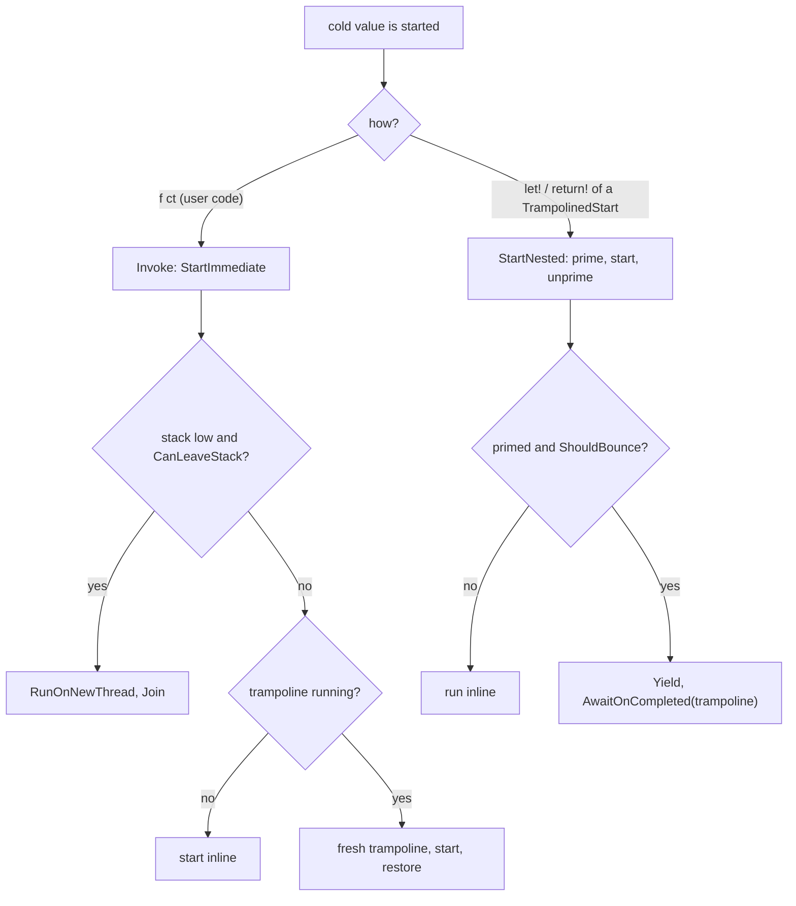

# Recursion and tail calls (design, branch `trampoline`)

Status: steps 1 to 3 done (local, not pushed). Draft PR [TheAngryByrd/IcedTasks#54 "Enable safe recursion with trampoline"](https://github.com/TheAngryByrd/IcedTasks/pull/54) on the branch `trampoline` (remote `majocha`). Addresses issue [#3](https://github.com/TheAngryByrd/IcedTasks/issues/3). See [open enhancements](open-enhancements.md).

## Goals

1. Deep non-tail recursion through `let!` and `return!` does not overflow the stack.
2. A tail `return!` (`ReturnFromFinal`) runs in constant memory and constant stack.
3. Hard rule: code that works today must not deadlock or change results. A new behavior may appear only where today's code overflows the stack.

## Scope by builder

| Builder | Deep recursion | Tail calls | Reason |
|---|---|---|---|
| `coldTask`, `cancellableTask`, `cancellableValueTask`, `cancellablePoolingValueTask` (and background variants) | yes | yes | The value is an unstarted function, so the binder controls the start. |
| `task`, `valueTask`, `taskUnit`, `valueTaskUnit`, `poolingValueTask` | no | no | The value starts inside `Run`. Nothing knows if the caller awaits or blocks, so a bounce can deadlock. |
| `asyncEx` | already | already | `ReturnFrom` forwards to `async.ReturnFrom`. |

## Reference implementations

- `E:\repos\Async2\Async2\Async2.fs` (resumable code). `Async2<'t>` is an interface with `StartImmediate`, `Await`, and `TailCall`. Only `Await` (a builder `Bind`) starts a nested machine, which can bounce. `StartImmediate` inside a running trampoline installs a fresh trampoline (`Trampoline.Isolate`) and drains it before it returns, so a caller can block on the task.
- `E:\repos\FSharp.Control.Async2` (runtime async). The tail-call loop uses a `TailBox` and captures the `ExecutionContext` at the hand-over.

## Current mechanism (`src/IcedTasks/Trampoline.fs`)

- `Trampoline` is per thread (`[<ThreadStatic>]` field `current`). It is an `ICriticalNotifyCompletion` with one `pending` slot. A bounce is `ResumableCode.Yield` plus `MethodBuilder.AwaitOnCompleted(Trampoline.Current.Ref)`. The first bounce on a trampoline that is not running drains it inline (`start ()`).
- `ShouldBounce` counts calls modulo `MaxDepth = 50`. The counter never decrements, so it is not a nesting depth. Step 4 replaces it.
- Each cold builder's `Run` and `RunDynamic` wrap the start function with `Trampoline.wrap`. The result is a `TrampolinedStart<'Arg, 'Result>`, a sealed subclass of `FSharpFunc<'Arg, 'Result>`, so `ColdTask<'T>` and `CancellableTask<'T>` stay function aliases ([ADR 0001](../../adr/0001-function-type-aliases-for-cold-results.md)). `'Arg` is `unit` or `CancellationToken`. `'Result` is `Task<'T>` or `ValueTask<'T>`.
- `Source` members start a bound function with `Trampoline.bind`. It type-tests for `INestedStart<'Arg, 'Result>` and calls `StartNested`. Any other function is called as it is.
- `StartNested` sets the `primed` flag, calls the start, and clears the flag in `finally`. The state machine reads and clears it with `IsAwaited()` as its first action, so no user code runs between set and read. Only a primed start can bounce.
- `Invoke` (a call from user code) is `StartImmediate`. When the trampoline of the thread is running, the start gets a fresh trampoline and the old one is restored after it. When the stack is low (`HasSufficientStack` is false), the start runs on a new thread with a 16 MB stack (`RunOnNewThread`) and the caller waits for its synchronous part with `Join`. The new thread runs in the captured `ExecutionContext`.
- SynchronizationContext rule (`CanLeaveStack`): no bounce and no thread hop when `SynchronizationContext.Current` is not null or `TaskScheduler.Current` is not the default. There the behavior is as on `master`, including a stack overflow at extreme depth.
- The dynamic path makes a resumption info per start (`newResumptionInfo ()` / `makeResumptionInfo ()`) and reads `IsAwaited()` when it makes it (see [run and start paths](../builders/run-and-start-paths.md)).
- On netstandard2.0, `HasSufficientStack` calls `EnsureSufficientExecutionStack` and catches `InsufficientExecutionStackException`, because `TryEnsureSufficientExecutionStack` does not exist there.

```fsharp
// src/IcedTasks/Trampoline.fs
    let inline bind (f: 'Arg -> 'Result) (arg: 'Arg) : 'Result =
        match box f with
        | :? INestedStart<'Arg, 'Result> as nested -> nested.StartNested arg
        | _ -> f arg
```



Invariant: a task that user code gets from `Invoke` is complete or truly pending. It never waits on a trampoline that an outer frame on the same thread owns.

Why the thread hop: an isolated start drains its trampoline on the current stack. Recursion through hot tasks (`return! f (n - 1) ct`, user-code starts) therefore grows the stack, and the branch's mutual recursion tests (10 000 to 40 000 levels) need the hop. Thread affinity is lost only where `master` overflows: `[<ThreadStatic>]` values, a `lock` held by the waiting thread, UI-thread checks.

### Defects removed

1. Wrapper deadlock: a plain function is not a `TrampolinedStart`, so its inner start is immediate.
2. Stale flag: `StartNested` always clears the flag.

### Defects still open

3. One `pending` slot. A second enqueue while the slot is full overwrites the first continuation. `ShouldBounce` checks `pending.IsNone` to avoid this. Step 4 uses a queue.
4. Cost of `Trampoline.bind`: for an `[<InlineIfLambda>]` lambda literal, the type test needs a closure. Measure with `benchmarks/`.
5. Speed of the dynamic path: the 9 `Recursion` tests take 41 s in Debug before step 3 and 65 s after it, on net10.0. The full Release suite takes about 9 s. The likely causes are the thread hops in the mutual recursion tests and the extra `TrampolinedStart` per value; neither is measured yet.

## Target design

### 1. Tail-call interface

`TailCall` goes on the same object as `StartNested`:

```fsharp
type INestedStart<'Arg, 'Result> =
    abstract StartNested: 'Arg -> 'Result
    // step 5: abstract TailCall: 'Arg * TaskCompletionSource<'T> -> unit
```

### 2. Bounce trigger

- net6.0 and later: bounce only when `RuntimeHelpers.TryEnsureSufficientExecutionStack()` is false. No fixed depth. This keeps goal 3 for the remaining case below. `HasSufficientStack` exists already for the thread hop.
- netstandard2.0: .NET Framework runs continuations inline with no stack guard, so completions also bounce, and a `Depth` counter (inc/dec around nested starts and completions) limits the chain, as in resumable Async2 (`ShouldBounceCompletion`).
- The trampoline is a `Queue<Action>` in a `[<ThreadStatic>]` field. The owner drains it in `finally`.

Remaining case with a fixed depth: a frame inside a drain sets a `TaskCompletionSource`, an awaiting machine resumes inline, `let!`s a child that bounces, suspends, and the frame then blocks on that machine. With the stack-only trigger this can occur only where today's code overflows.

### 3. Tail calls

As in resumable Async2. `ReturnFromFinal(callee)` of an exact type:

- No `TailCallSource` in the state machine data: this frame is the head. Make a `TaskCompletionSource<'T>`, call `callee.TailCall(ct, tcs)`, then `Bind(tcs.Task, Return)`.
- `TailCallSource` present: call `callee.TailCall(ct, tcs)` and return `false`. The machine is abandoned and its builder task is never made.
- The last callee completes `tcs` instead of its builder.
- Any other callee: fall back to `ReturnFrom`.

New data field: `TailCallSource: TaskCompletionSource<'TOverall> | null` in each cold state machine data struct. Cross-builder tail calls (`coldTask` to `cancellableTask`) need one shared interface for `TailCall`.

Context rules:

- The head binds `tcs.Task` with the normal awaiter, so the final resumption uses the head's captured `SynchronizationContext`, as `ReturnFrom` does today.
- Hand-overs between frames never go back to a captured context. A callee starts on the thread where the previous frame reached its tail `return!`, as today.
- `ExecutionContext` flows because each `TailCall` runs inline in the handing frame.

## Test plan

Port from the branch (already in the tests on `trampoline`):

- `Non-tail recursion`, 100 000 levels with `try/finally` and `try/with`, for `coldTask`, `cancellableTask`, `cancellableValueTask`, `cancellablePoolingValueTask`.
- `Immediate start nested recursion` (`(foo (n - 1)) ()` then `GetResult()`).
- Mutual recursion `ColdTask` and `CancellableTask`, both start sides, with accumulation and token flow.

### Sync-over-async tests (`tests/IcedTasks.Tests/SyncOverAsyncTests.fs`)

Root list `IcedTasks.SyncOverAsync`, 90 tests, in all three test projects. Run them alone with `--filter-test-list SyncOverAsync`. `runGuarded` runs each case on a background thread with a 64 MB stack and fails with "Deadlock: ..." after 10 s. Cases that block are run with each of `.Result`, `.Wait()`, `GetAwaiter().GetResult()`, `Async.RunSynchronously (Async.AwaitTask t)`, at depths 100 and 1 000. `BlockedContext` is a `SynchronizationContext` that drops every `Post`.

```fsharp
// tests/IcedTasks.Tests/SyncOverAsyncTests.fs (Cold.mixed)
                elif n % 2 = 0 then
                    let! x = mixed wait (n - 1)
                    return x + 1
                else
                    return wait (mixed wait (n - 1) ()) + 1
```

Results on net10.0, Debug and Release, main and NS20 projects (same in each):

| Case | `master` | `trampoline` |
|---|---|---|
| coldTask: block on a user-started child | pass | pass |
| block and `let!` on alternate levels (cold, cancellable, cancellableValue) | pass | deadlock |
| `let!` a plain function that blocks (defect 1; cold, cancellable) | pass | deadlock |
| block after a `let!` of a plain function (defect 2; cold, cancellable, cancellableValue) | pass | deadlock |
| cancellableTask and coldTask mutual recursion, blocking on the cold side | pass | deadlock |
| coldTask: inline resume from a `TaskCompletionSource`, then block | pass | deadlock |
| `let!` recursion under `BlockedContext` (all three) | pass | pass |
| coldTask: block and `let!` under `BlockedContext` | pass | deadlock |

Total: `master` 90 of 90, `trampoline` before step 3 14 of 90, after step 3 90 of 90 (the full suites also pass: 919 main, 711 NS20, Debug and Release).

The `TaskCompletionSource` case passes because `SetResult` runs when no trampoline is running. A stronger case calls `SetResult` from inside a bounced frame, which is the remaining case of the bounce trigger section.

Lesson: a bounced child is incomplete when its parent binds it, so the parent's `TaskAwaiter` captures the `SynchronizationContext` and posts its resumption. Under a blocked context that post never runs. Bouncing under a non-default `SynchronizationContext` therefore needs one of two rules: do not bounce, or resume a bounced child's parent without the context. Decided: do not bounce (`CanLeaveStack`). The second rule cannot tell a bounced child from one that waits for real I/O after it bounced.

Still to add:

- `lock` re-entry and a `[<ThreadStatic>]` read across a recursive call.
- Thread-pool starvation (`ThreadPool.SetMaxThreads`).
- A non-IcedTasks callee that wraps an IcedTasks value in tail position.
- Near-overflow depth.
- `SetResult` of a `TaskCompletionSource` from inside a bounced frame, then block.

## Order of work

1. Merge `master` into `trampoline` (done locally, not pushed).
2. Add the deadlock tests. Record which fail on the branch (done, see the table above; not committed).
3. Replace `Allow`/`Prime`/`IsAwaited` with the exact invocation types (done; not committed).
4. Replace the trampoline with the queue and the stack-only trigger.
5. Add `TailCallSource` and `ReturnFromFinal`.
6. Benchmarks, then docs (`docsSrc/`, XML docs) and the lode builder files.

Related: [run and start paths](../builders/run-and-start-paths.md), [source overload priority](../builders/source-overload-priority.md), [builder catalog](../builders/builder-catalog.md).
