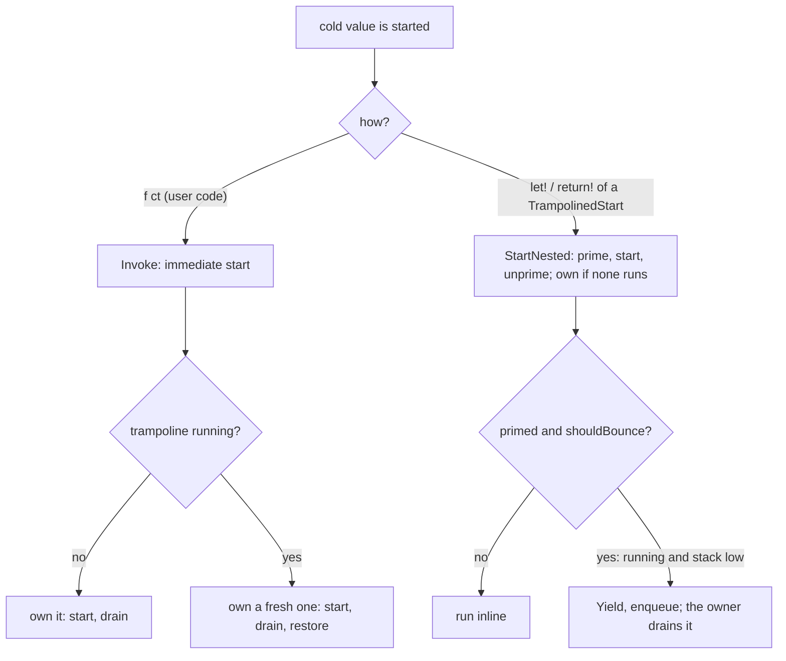

# Recursion and tail calls (design, branch `trampoline`)

Status: steps 1 to 4 done. Draft PR [TheAngryByrd/IcedTasks#54 "Enable safe recursion with trampoline"](https://github.com/TheAngryByrd/IcedTasks/pull/54) on the branch `trampoline` (remote `majocha`). Addresses issue [#3](https://github.com/TheAngryByrd/IcedTasks/issues/3). See [open enhancements](open-enhancements.md).

## Goals

1. Deep non-tail recursion through `let!` and `return!` does not overflow the stack.
2. A tail `return!` (`ReturnFromFinal`) runs in constant memory and constant stack.
3. Hard rule: code that works today must not deadlock or change results. A new behavior may appear only where today's code overflows the stack.

## Scope by builder

| Builder | Deep recursion | Tail calls | Reason |
|---|---|---|---|
| `coldTask`, `cancellableTask`, `cancellableValueTask`, `cancellablePoolingValueTask` (and background variants) | yes, for a bind of a cold value | yes | The value is an unstarted function, so the binder controls the start. A call such as `f ct` starts it at once and behaves as on `master`. |
| `task`, `valueTask`, `taskUnit`, `valueTaskUnit`, `poolingValueTask` | no | no | The value starts inside `Run`. Nothing knows if the caller awaits or blocks, so a bounce can deadlock. |
| `asyncEx` | already | already | `ReturnFrom` forwards to `async.ReturnFrom`. |

## Reference implementations

- `E:\repos\Async2\Async2\Async2.fs` (resumable code). `Async2<'t>` is an interface with `StartImmediate`, `Await`, and `TailCall`. Only `Await` (a builder `Bind`) starts a nested machine, which can bounce. `StartImmediate` inside a running trampoline installs a fresh trampoline (`Trampoline.Isolate`) and drains it before it returns, so a caller can block on the task.
- `E:\repos\FSharp.Control.Async2` (runtime async). The tail-call loop uses a `TailBox` and captures the `ExecutionContext` at the hand-over.

## Current mechanism (`src/IcedTasks/Trampoline.fs`)

- Code shape (`src/IcedTasks/Trampoline.fs`, in compile order):
  - `Trampoline` class: the state of one trampoline only. The queue, `frames`, and the `internal` properties `Running`, `Primed`, `Trusted`, plus `Drain`, `EnterFrame`, `ExitFrame`. Ownership is the struct union `Owner`: `StartOwned`, or `ResumptionOwned of previous: Trampoline`. `EnterFrame` and `ExitFrame` match on it, so only a resumption-owned trampoline counts frames and restores `previous`.
  - `Trampoline` module: the rules and the hooks as functions (`current`, `shouldBounce`, `shouldBounceCompletion`, `trust`, `clearTrust`, `started`, `resumed`, `exited`, internal `hasSufficientStack`, `canLeaveStack`). The builders call only this module and `TrampolinedStart`.
  - `TrampolinedStart<'Arg, 'Result>`: the immediate start (`Invoke`) and the nested start (`StartNested`) are its members. No `IStart` or `INestedStart` interface: the start type itself carries both starts.
  - `TrampolinedStart` module: `create`, `bind`.
  - `TrampolinedResumptionInfo<'Data>`: the dynamic path, written once for the four cold builders.
  - `NoContext` and `TrampolinedData<'Context, 'T, 'Builder>`: the state machine data of all cold builders. `NoContext` is an empty struct for `coldTask`, because a `unit` field would add a reference field to each state machine.
  - `TrampolinedCode` module: the yield and bounce points and the `MoveNext` body of the static path.
- `Trampoline` is per thread (`[<ThreadStatic>]` field `onThread`, read as `Trampoline.OnThread: Trampoline voption`, written with `Trampoline.Install`). It is not `AllowNullLiteral`: with nullness on (net9.0), a nullable type fails the `AwaitOnCompleted` awaiter constraint. It is an `ICriticalNotifyCompletion` over a `Queue<Action>`. A bounce is `ResumableCode.Yield` plus `MethodBuilder.AwaitOnCompleted(&trampoline)` on a stack local (`bounceWhen` in `ColdTask.fs` and `CancellableTaskBuilderBase.fs`), which enqueues the state machine without an allocation.
- Owner: the outermost start on a thread (`RunAsOwner`) sets `Running`, runs the start, and drains the queue in `finally`. A start while the trampoline runs (`Run`) does not drain. So bounced work always unwinds to the owner's shallow stack before it runs again.
- `shouldBounce` is `Running && not (hasSufficientStack ())`. With no owner further up there is nowhere to unwind to, so it never bounces then. The static `MoveNext` checks it after `started ()` (`TrampolinedCode.yieldOnBindLimit`). `TrampolinedCode` (`Trampoline.fs`) holds `yieldForAwait`, `bounceWhen`, the two yield functions, `awaitTrampoline`, `moveNext`, and `newResumptionInfo`, once for both cold families, over the shared `TrampolinedData<'Context, 'T, 'Builder>`.
- `shouldBounceCompletion` is the check before `SetResult` and `SetException` (`yieldOnCompletionLimit`, and `Step` in the dynamic path). It is `shouldBounce`, except on netstandard2.0, where it is also true when no trampoline runs. Reason: .NET Framework runs continuations inline with no stack guard, so a completion chain after a real async resumption can overflow. The bounce runs at once on the same thread and makes the trampoline the owner of the rest of the chain. Resumable Async2 counts depth for this (`completeCounted`, `MaxDepth`); IcedTasks uses the stack check instead, so it does not bounce where the stack is sufficient.
- Each cold builder's start value is a `TrampolinedStart<'Arg, 'Result>`, an abstract subclass of `FSharpFunc<'Arg, 'Result>` with an abstract `Start`, so `ColdTask<'T>` and `CancellableTask<'T>` stay function aliases ([ADR 0001](../../adr/0001-function-type-aliases-for-cold-results.md)). `'Arg` is `unit` or `CancellationToken`. `'Result` is `Task<'T>` or `ValueTask<'T>`. Every builder makes it with `TrampolinedStart.create`, an inline function around an object expression. `start` has `[<InlineIfLambda>]`, so the static `Run`'s object holds the state machine copy directly: one object per value, as on `master`.
- Allocation per start against `master` (net10.0, probe with `GC.GetAllocatedBytesForCurrentThread`): +8 B. The static `MoveNext` keeps the exception and the no-bounce flag in the data fields `Error: exn` and `NoBounce: bool` (both are held across the completion bounce, so they cannot be `__stack_` locals; see [run and start paths](../builders/run-and-start-paths.md) for why they are not hoisted locals). The fields have the same cost as hoisted locals: 136 B per suspended `coldTask` start before and after the move to fields. Keep `Error` a plain `exn` with `Unchecked.defaultof` and `obj.ReferenceEquals(sm.Data.Error, null)`: a `ValueOption` plus a `ValueSome error` binding costs 24 B, and an `ExceptionDispatchInfo` is not needed because `master` passes the plain exception too.
- `Source` members start a bound function with `TrampolinedStart.bind`. It type-tests for `TrampolinedStart<'Arg, 'Result>` and calls `StartNested`. Any other function is called as it is.
- `StartNested` sets `Primed` (only when `canLeaveStack ()`), calls `Start`, and clears it in `finally`. It owns the trampoline when none runs. The state machine reads and clears it with `started ()` as its first action, so no user code runs between set and read. Only a primed start can bounce.
- `Invoke` (a call from user code) is the immediate start. It owns the trampoline of the thread, or, when that one runs, a fresh trampoline that it owns, and the old one is restored after it. It stays on the current thread and stack, so recursion through it can overflow the stack, as on `master` ([ADR 0013](../../adr/0013-stay-on-the-thread-when-the-stack-is-low.md)). `CancellableTask.toColdTask` lets `coldTask` bind a `CancellableTask` as a nested start.
- SynchronizationContext rule (`canLeaveStack`): no bounce when `SynchronizationContext.Current` is not null or `TaskScheduler.Current` is not the default. There the behavior is as on `master`, including a stack overflow at extreme depth.
- Dynamic path: `TrampolinedResumptionInfo<'Data>` derives from `ResumptionDynamicInfo<'Data>` and holds four fields (`started`, `bounceAllowed`, `completing`, `error`). `MoveNext` calls the hooks, bounces the first entry when primed and `shouldBounce`, then either completes (after a completion bounce) or runs `Step`. `Step` clears `ResumptionData`, invokes `ResumptionFunc`, then completes (with a completion bounce check) or registers the awaiter that the dynamic `Bind` stored in `ResumptionData` (the boxed awaiter itself, as on `master`). A builder's `RunDynamic` overrides only `Await` (`AwaitOnCompleted`, as on `master`), `SetResult`, `SetException`, and `SetStateMachine`. The bounce passes the trampoline to `Await`. Against the earlier `DynamicState` loop (a union stored in `ResumptionData`, with `Bounce`/`Immediate` wrappers, closures, and a ref cell per start) this is 96 B less per start and 2 to 3 times faster in the probe.
- Resumption isolation: code that is not IcedTasks (for example `TaskCompletionSource.SetResult`) can resume an awaiting state machine inline while a trampoline runs further up the stack. If that resumption bounces into the running trampoline, and the code then blocks on the resumed task, nothing drains the bounce. So a resumption that is not trusted, while a trampoline runs, installs a fresh trampoline (`Trampoline(ResumptionOwned previous)`) that it owns until its `MoveNext` returns. A trusted resumption is a drained bounce (`Drain` sets `Trusted` before each item) or the completion of a cold builder task (`trust ()` and `clearTrust ()` around `SetResult` and `SetException`).
- The hooks: `Trampoline.started ()` as the first action (it also returns the primed flag), `Trampoline.resumed ()` after each yield that resumes (`TrampolinedCode.yieldForAwait`, which `Bind`, `TryFinallyAsync` and `bounceWhen` use, so no builder file calls `resumed`), and `Trampoline.exited ()` as the last statement of `MoveNext`. The dynamic path calls them once per `MoveNext`. A resumption-owned trampoline counts the `MoveNext` frames on it. When the count goes to 0 it drains, then restores the previous trampoline. No hook can go before `__resumeAt` (FS3511: it must be the start of `MoveNext`), and `exited ()` must not read the state machine: after `AwaitUnsafeOnCompleted` another thread can run it, and after `SetResult` a pooling builder can reuse it. `exited ()` returns `bool` and the static `MoveNext` calls `Trampoline.exited () |> ignore`. A unit call at the end of `MoveNext` gets the IL `tail.` prefix in the user's assembly, and the JIT compiles a method with an explicit tail call straight to FullOpts: no tiering, no dynamic PGO, so the bind's `Await` is not devirtualized and the bound computation is boxed per level. This shows only when the library is referenced as a DLL (found in Async2, where SimpleRecursion went from 32.5 to 51.6 MB). Check: scan the IL of a consuming assembly for `tail.` + `call exited`, or `DOTNET_JitDisasm=MoveNext`.
- On netstandard2.0, `hasSufficientStack` calls `EnsureSufficientExecutionStack` and catches `InsufficientExecutionStackException`, because `TryEnsureSufficientExecutionStack` does not exist there.
- Measuring: a probe outside the repository builds with the newest SDK, which compiles Debug statically. To measure the dynamic path, call `ColdTaskBuilder.RunDynamic(b.Delay(fun () -> b.Bind(b.Source x, ...)))` directly.

```fsharp
// src/IcedTasks/Trampoline.fs (module TrampolinedStart)
    let inline bind (f: 'Arg -> 'Result) (arg: 'Arg) : 'Result =
        match box f with
        | :? TrampolinedStart<'Arg, 'Result> as start -> start.StartNested arg
        | _ -> f arg
```

```fsharp
// src/IcedTasks/Trampoline.fs (TrampolinedCode.newResumptionInfo)
                { new TrampolinedResumptionInfo<TrampolinedData<'Context, 'T, 'Builder>>(initial) with
                    member _.Await(sm, awaiter) =
                        let mutable awaiter = awaiter
                        sm.Data.MethodBuilder.AwaitOnCompleted(&awaiter, &sm)

                    member _.SetResult(sm) =
                        sm.Data.MethodBuilder.SetResult sm.Data.Result
```



Invariant: a task that user code gets from `Invoke` is complete or truly pending. It never waits on a trampoline that an outer frame on the same thread owns. Also, when code that is not IcedTasks resumes a state machine, the resumption drains everything it bounced before control goes back to that code.

No thread hop: an isolated start drains its trampoline on the current stack, so recursion through hot tasks (`return! f (n - 1) ct`) grows the stack and overflows as on `master`. An earlier version moved such a start to a new thread with `Join`. It was removed because the stack check fails before the stack is full, so it changed code that works on `master`: a `lock` held by the caller and taken by the body became a permanent deadlock. See [ADR 0013](../../adr/0013-stay-on-the-thread-when-the-stack-is-low.md).

Exception cache (`src/IcedTasks/ExceptionCache.fs`): each level of a failure adds a stack frame, and each `Task` captures the full trace, so the cost of a failure grows faster than the depth from about 100 levels. `moveNext` and `TrampolinedResumptionInfo.Complete` call `ExceptionCache.trim` once for each failing state machine, before `SetException`. A thread-static reference and count (`ExceptionWalk`) count the levels. Below 64 levels nothing else happens, so the trace and the cost match `master`. From 64, `trim` throws and catches the cached `ExceptionDispatchInfo`, which restores the trace of level 64. A failure that moves to another thread (the runtime stops inline continuations on a low stack) finds its entry in the `ConditionalWeakTable` and continues the walk. An immediate start ends the walk and removes the entry, so a reused exception object does not get an old trace. Do not put the cache in a bind: a `try/with` in `Bind` throws twice per level, and the cost of a shallow failure doubles.

Results, net9.0 Release, failure at depth 20 / 100 / 1 000 / 5 000: `master` 68 us / 322 us / 25 ms / 205 ms, gated cache 71 us / 421 us / 8.4 ms / 80 ms. Limits: under a `SynchronizationContext` and on hot recursion every start is immediate, so nothing is trimmed. A reused exception object can get an old trace only if it passes 64 levels, user code catches it below the top, and it is thrown again.

### Defects removed

1. Wrapper deadlock: a plain function is not a `TrampolinedStart`, so its inner start is immediate.
2. Stale flag: `StartNested` always clears the flag.
3. Single `pending` slot: replaced by the queue.
4. Bounce counter modulo 50: replaced by the stack check, so no bounce occurs where `master` does not overflow.
5. Inline resumption from code that is not IcedTasks: removed by resumption isolation. Before, a frame inside a drain called `TaskCompletionSource.SetResult`, the waiter resumed inline and bounced its `let!` into the running trampoline, and the frame then blocked on the waiter (small stack, depth 1 000, Release).

### Defects still open

6. Cost of `TrampolinedStart.bind`: for an `[<InlineIfLambda>]` lambda literal, the type test needs a closure: +32 B per `do! fun ct -> ...` bind in the `getCancellationTokenLambda` benchmarks. The test is how a nested start is found, so it stays.
7. Speed of the dynamic path: the full Debug suite on net10.0 takes about 30 s, and the full Release suite takes about 12 s. The extra `TrampolinedStart` per value is a likely cost; it is not measured.
8. Stale trust: a hot state machine (`task`, `valueTask`) that a cold completion resumes does not clear the trust flag. If it then completes a `TaskCompletionSource` that resumes a cold waiter inline, the waiter is trusted and is not isolated. `ClearTrust()` after `SetResult` limits the window to that inline call. No test covers it.
10. Cost of a sync start: `coldTask` with 2 sync binds (3 starts) takes 42 ns on `master` and 85 ns on the branch, net9.0 Release. A start with no bind takes 11 ns against 31 ns. With `DOTNET_TieredPGO=0` the branch takes 172 ns. By removal: start wrappers and bounce checks 23 to 30 ns, `trust`/`clearTrust`/`exited` 6 ns, the rest about 12 ns. There is no single hot spot: lazy `canLeaveStack`, fewer `[ThreadStatic]` reads, and fewer `try/finally` blocks together saved about 7 ns. Not checked with BenchmarkDotNet.
9. Flaky: `IcedTasks.CancellableValueTask.CancellableValueTaskBuilder.For.TaskSeq receives CancellationToken` errored in 2 of 6 full NS21 Debug runs on the branch, with a `NullReferenceException` in `Seq.toArray` inside TaskSeq's `DisposeAsync`. It passed in 15 runs alone and in 3 full runs on `master`. The `master` suite has no `Recursion` tests, so the load differs. Those runs were before the removal of the thread hop. Not yet known if the trampoline causes it.

## Target design

### 1. Tail-call interface

`TailCall` goes on the same object as `StartNested`:

```fsharp
type TrampolinedStart<'Arg, 'Result> =
    // ...
    member StartNested: 'Arg -> 'Result
    // step 5: abstract TailCall: 'Arg * TaskCompletionSource<'T> -> unit
```

### 2. netstandard2.0 on .NET Framework

Done with `shouldBounceCompletion` (see the current mechanism). Not tested on .NET Framework: the test projects run only on .NET 8 to 10, where the runtime guards inline continuations.

### 3. Tail calls

As in resumable Async2. `ReturnFromFinal(callee)` of an exact type:

- No `TailCallSource` in the state machine data: this frame is the head. Make a `TaskCompletionSource<'T>`, call `callee.TailCall(ct, tcs)`, then `Bind(tcs.Task, Return)`.
- `TailCallSource` present: call `callee.TailCall(ct, tcs)` and return `false`. The machine is abandoned and its builder task is never made.
- The last callee completes `tcs` instead of its builder.
- Any other callee: fall back to `ReturnFrom`.

New data field: `TailCallSource: TaskCompletionSource<'TOverall> | null` in each cold state machine data struct. Cross-builder tail calls (`coldTask` to `cancellableTask`) need one shared interface for `TailCall`.

Context rules:

- The head binds `tcs.Task` with the normal awaiter, so the final resumption uses the head's captured `SynchronizationContext`, as `ReturnFrom` does today.
- Hand-overs between frames never go back to a captured context. A callee starts on the thread where the previous frame reached its tail `return!`, as today.
- `ExecutionContext` flows because each `TailCall` runs inline in the handing frame.

## Test plan

Port from the branch (already in the tests on `trampoline`):

- `Non-tail recursion`, 100 000 levels with `try/finally` and `try/with`, for `coldTask`, `cancellableTask`, `cancellableValueTask`, `cancellablePoolingValueTask`.
- `Immediate start nested recursion` (`(foo (n - 1)) ()` then `GetResult()`).
- Mutual recursion `ColdTask` and `CancellableTask`, both start sides, with accumulation and token flow.

### Sync-over-async tests (`tests/IcedTasks.Tests/SyncOverAsyncTests.fs`)

Root list `IcedTasks.SyncOverAsync`, 142 tests, in all three test projects. Run them alone with `--filter-test-list SyncOverAsync`. `runGuarded` runs each case on a background thread and fails with "Deadlock: ..." after 10 s. The stack is 64 MB, or 512 KB inside `withStack smallStack`. The large stack checks code that works on `master`. The small stack makes the builders bounce. Blocking cases run on the small stack only at depth 100, because a user-code start stays on the stack and depth 1 000 overflows, as on `master`. `A lock is held across a start at low stack` and `A start at low stack stays on its thread` check that a start does not leave its thread. The `TaskCompletionSource` cases (`coldTask` with a user-started and a `let!`-started waiter, and `cancellableTask`) run on both stacks; without resumption isolation, 3 of them deadlock on the small stack. The `BlockedContext` cases run only on the large stack, because there the builders do not leave the stack and overflow as on `master`. Cases that block are run with each of `.Result`, `.Wait()`, `GetAwaiter().GetResult()`, `Async.RunSynchronously (Async.AwaitTask t)`, at depths 100 and 1 000. `BlockedContext` is a `SynchronizationContext` that drops every `Post`.

```fsharp
// tests/IcedTasks.Tests/SyncOverAsyncTests.fs (Cold.mixed)
                elif n % 2 = 0 then
                    let! x = mixed wait (n - 1)
                    return x + 1
                else
                    return wait (mixed wait (n - 1) ()) + 1
```

Results of the first 90 tests (large stack) on net10.0, Debug and Release, main and NS20 projects (same in each):

| Case | `master` | `trampoline` |
|---|---|---|
| coldTask: block on a user-started child | pass | pass |
| block and `let!` on alternate levels (cold, cancellable, cancellableValue) | pass | deadlock |
| `let!` a plain function that blocks (defect 1; cold, cancellable) | pass | deadlock |
| block after a `let!` of a plain function (defect 2; cold, cancellable, cancellableValue) | pass | deadlock |
| cancellableTask and coldTask mutual recursion, blocking on the cold side | pass | deadlock |
| coldTask: inline resume from a `TaskCompletionSource`, then block | pass | deadlock |
| `let!` recursion under `BlockedContext` (all three) | pass | pass |
| coldTask: block and `let!` under `BlockedContext` | pass | deadlock |

Total: `master` 90 of 90, `trampoline` before step 3 14 of 90, after step 3 90 of 90. After step 4 with resumption isolation, all pass, small stack included.

Lesson: a bounced child is incomplete when its parent binds it, so the parent's `TaskAwaiter` captures the `SynchronizationContext` and posts its resumption. Under a blocked context that post never runs. Bouncing under a non-default `SynchronizationContext` therefore needs one of two rules: do not bounce, or resume a bounced child's parent without the context. Decided: do not bounce (`CanLeaveStack`). The second rule cannot tell a bounced child from one that waits for real I/O after it bounced.

Still to add:

- `lock` re-entry and a `[<ThreadStatic>]` read across a recursive call.
- Thread-pool starvation (`ThreadPool.SetMaxThreads`).
- A non-IcedTasks callee that wraps an IcedTasks value in tail position.
- Stale trust through a hot `task` (defect 8).

## Order of work

1. Merge `master` into `trampoline` (done locally, not pushed).
2. Add the deadlock tests. Record which fail on the branch (done, see the table above).
3. Replace `Allow`/`Prime`/`IsAwaited` with the exact invocation types (done).
4. Replace the trampoline with the queue, the stack-only trigger, and resumption isolation (done).
5. Add `TailCallSource` and `ReturnFromFinal`.
6. Benchmarks, then docs (`docsSrc/`, XML docs) and the lode builder files.

Related: [run and start paths](../builders/run-and-start-paths.md), [source overload priority](../builders/source-overload-priority.md), [builder catalog](../builders/builder-catalog.md).
