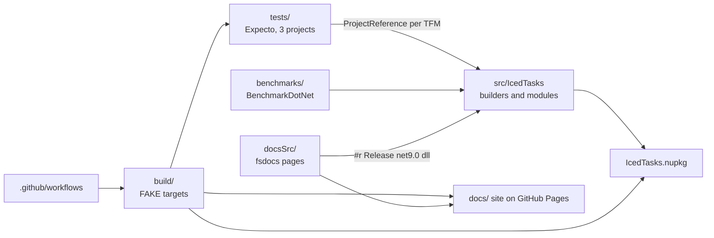

# IcedTasks summary

IcedTasks is one F# library, published as the `IcedTasks` NuGet package. It adds computation expression builders for task-like values: `valueTask`, `poolingValueTask`, `coldTask`, `cancellableTask`, `cancellableValueTask`, `cancellablePoolingValueTask`, `taskUnit`, `valueTaskUnit`, `asyncEx`, `parallelAsync`, and polyfills of `task` and `backgroundTask`. Background variants exist for `task`, `taskUnit`, `coldTask`, and `cancellableTask`. Most builders use F# resumable code, so the compiler makes a state machine for each expression. The library targets `net9.0;net6.0;netstandard2.1;netstandard2.0` (`src/IcedTasks/IcedTasks.fsproj`). A FAKE console app in `build/` builds, tests, packs, releases, and makes the docs. Expecto tests in `tests/` run the library through each of its target frameworks. The docs site comes from `docsSrc/` through fsdocs.

```fsharp
// README.md
let getDataFromAFewSites = parallelAsync {
    let! result1 = exampleHttpCall "howManyPlantsDoIOwn"
    and! result2 = exampleHttpCall "whatsTheTemperature"
    and! result3 = exampleHttpCall "whereIsMyPhone"

    // Do something meaningful with results
    return ()
}
```



Domains:

- [builders](builders/summary.md) - the library in `src/IcedTasks`.
- [build](build/summary.md) - FAKE targets, CI, release, and formatting.
- [tests](tests/summary.md) - the Expecto test projects.
- [docs](docs/summary.md) - the fsdocs site and the examples.
- [benchmarks](benchmarks/summary.md) - BenchmarkDotNet comparisons.

See [terminology](terminology.md), [practices](practices.md), and the [lode map](lode-map.md).
