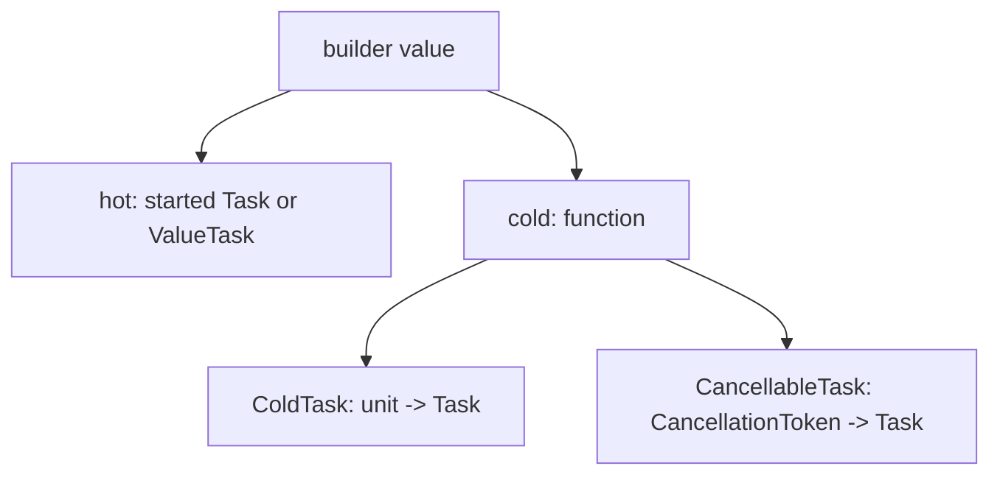

# Terminology

The repository has no glossary file. The terms below come from the code and from `docsSrc/Explanations/`.

- builder - a computation expression builder object, such as `cancellableTask`. The docs use "builder" for the keyword and its type.
- hot - the value is a started task when the expression is created. `Run` calls `MethodBuilder.Start` at once.
- cold - the value is a function. Each call makes a new state machine and starts it. `coldTask` and the cancellable builders are cold.
- multi-start - one cold value can be started more than once. Each start runs the body again.
- once-start - a hot value represents one started operation.
- ColdTask - `unit -> Task<'T>` (`src/IcedTasks/ColdTask.fs`).
- CancellableTask - `CancellationToken -> Task<'T>` (`src/IcedTasks/CancellableTask.fs`).
- CancellableValueTask - `CancellationToken -> ValueTask<'T>` (`src/IcedTasks/CancellableValueTask.fs`).
- ambient token - the `CancellationToken` that a cancellable builder keeps in its state machine data and gives to nested cancellable work.
- implicit cancellation - the builder checks the ambient token before each bind and before a start.
- static path - the compiled resumable state machine, used when `__useResumableCode` is true.
- dynamic path - `RunDynamic`, used when the compiler does not compile the state machine statically.
- resumable code - the F# 6 feature (FS-1087) that the builders use to make state machines.
- Source - a builder member that converts a bound value to an awaiter. It removes the need for one `Bind` overload for each type.
- awaiter - an SRTP shape with `IsCompleted`, `GetResult`, and `ICriticalNotifyCompletion` (`Awaiter<'Awaiter,'TResult>` in `src/IcedTasks/TaskLike.fs`).
- awaitable - an SRTP shape with `GetAwaiter` (`Awaitable` in `src/IcedTasks/TaskLike.fs`).
- LowPriority / HighPriority - AutoOpen modules of extension members that set which `Source` or `Bind` overload F# selects.
- MergeSources - the builder member behind `and!`.
- background builder - a builder variant that runs on the thread pool when a `SynchronizationContext` or a non-default `TaskScheduler` is present.
- unit builder - `taskUnit`, `backgroundTaskUnit`, `valueTaskUnit`. They return non-generic `Task` or `ValueTask`.
- pooling builder - `poolingValueTask` and `cancellablePoolingValueTask`. They use `PoolingAsyncValueTaskMethodBuilder` and exist only on `net6.0` and later.
- polyfill namespace - `IcedTasks.Polyfill.Task` or `IcedTasks.Polyfill.Async`. Opening one shadows the FSharp.Core `task`, `backgroundTask`, or `async` builder.
- AsyncEx - the `asyncEx` builder. It keeps F# `Async` semantics and adds task interop.
- companion module - the module with the same name as a type alias, such as `CancellableTask.map`.
- TFM - target framework moniker, such as `netstandard2.0`.
- NS20 / NS21 - the test projects that test the `netstandard2.0` and `netstandard2.1` builds of the library.
- immediate start / nested start - a call of a cold value from user code, or a start from a builder bind (`Trampoline.bind`). Only a nested start can bounce.
- bounce - a nested start that yields to the running trampoline because the stack is low; the trampoline's owner runs it again on a shallow stack (see [recursion and tail calls](plans/recursion-and-tail-calls.md))
- trusted resumption - a state machine resumption that IcedTasks causes (a drained bounce, or a cold builder's completion); any other resumption while a trampoline runs owns a fresh trampoline until its MoveNext returns

```fsharp
// src/IcedTasks/CancellableTask.fs
/// CancellationToken -> Task<'T>
type CancellableTask<'T> = CancellationToken -> Task<'T>
/// CancellationToken -> Task
type CancellableTask = CancellationToken -> Task
```



Related: [builder catalog](builders/builder-catalog.md), [summary](summary.md).
