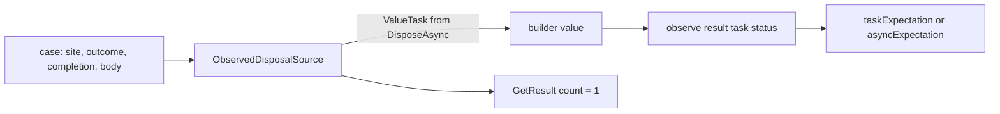

# DisposeAsync outcome tests

`tests/IcedTasks.Tests/AsyncDisposalOutcome.fs` holds a test matrix for the result of `use` on an `IAsyncDisposable` and `for` over an `IAsyncEnumerable`. `IcedTasks.Tests`, NS20, and NS21 compile it, after `Expect.fs`. Each test file of a builder that supports `use` of an `IAsyncDisposable` adds a `disposalOutcomeTests` list to its root `[<Tests>]` list. `ParallelAsyncTests.fs` has none, because `parallelAsync` forwards `Using` to `async`.

## Contract that the tests pin

- For the resumable builders, a `DisposeAsync` fault or cancellation decides the result of the builder value. It replaces the body result, the body exception, and the body cancellation. For `asyncEx`, see Expected results.
- A canceled result keeps the `OperationCanceledException` that canceled it. An await of the result (`GetAwaiter().GetResult()`) rethrows that exception, so its type and message come from the source of the cancellation. The builders pass the exception to the method builder's `SetException`, which cancels the task and stores the exception when it is an `OperationCanceledException`.
- `Wait()` and `Async.AwaitTask` do not rethrow the stored exception. For each canceled task, they throw a new `TaskCanceledException`, which `Wait()` wraps in an `AggregateException`. The tests pin the await form, because only that form shows which exception the builder stored.
- The builder calls `DisposeAsync` exactly once and reads its result exactly once. `ObservedDisposalSource` counts `IValueTaskSource.GetResult` calls.
- The builder awaits a pending `DisposeAsync`. The test checks that the result is not complete when `OnCompleted` registers a continuation, and only then completes the source.
- A cancellable builder awaits the disposal also after the ambient token cancels. This pins `BindNoCancellation` in `CancellableTaskBuilderBase.TryFinallyAsync`.

## Matrix

Each case is one combination of site, outcome, completion, and body:

| Axis | Values |
|---|---|
| site | `use`, `for` (`for` is absent for `coldTask` and `backgroundColdTask`, which have no `IAsyncEnumerable` support) |
| outcome | `DisposalSucceeds`, `DisposalFaults`, `DisposalCancels` |
| completion | `CompletedDisposal` (source completes before start), `PendingDisposal` |
| body | `BodyCompletes`, `BodyThrows`, `BodyAwaitsCanceledTask`, and `BodyCancels` for the cancellable builders. `asyncEx` has only `BodyCompletes` and `BodyThrows` |
| execution | `Static` (the builder), `Dynamic` (a test builder that takes `RunDynamic`), or `AsyncWorkflow` (`asyncEx`, which has no resumable code) |

`BodyCancels` cancels the ambient token and then binds a completed task, so the cancellable `Bind` throws. `BodyAwaitsCanceledTask` binds `Task.FromCanceled` with no token cancellation, so the `Bind` of each builder throws `TaskCanceledException`. Each body binds the canceled task only in that case, so the other cases do not await at run time. The test name gives each axis, for example `cancellableTask, Dynamic, for, DisposalFaults, pending disposal, BodyCancels`.

```fsharp
// tests/IcedTasks.Tests/CancellableTaskTests.fs
                (fun body cts resource ->
                    cancellableTask {
                        use _ = resource
                        AsyncDisposalOutcome.runBody body cts

                        if AsyncDisposalOutcome.awaitsCanceledTask body then
                            do! AsyncDisposalOutcome.canceledTask ()

                        do! Task.CompletedTask
                    }
                    |> fun t -> t cts.Token :> Task
                )
```

`backgroundTask` has no dynamic test builder, so it has only `Static` cases. `TaskTests.fs`, `TaskBackgroundTests.fs`, and `ValueTaskTests.fs` define `RunDynamic` test builders for `taskUnit`, `backgroundTaskUnit`, and `valueTaskUnit`. The `Static` cases take the static path only in Release. See [run and start paths](../builders/run-and-start-paths.md).

## Expected results

- `taskExpectation` is the contract above, for all resumable builders. `observe` gives `Canceled` the exception that an await of the result throws, as `"<type name>: <message>"`.

| DisposeAsync | Body | Result |
|---|---|---|
| faults | any | `Faulted [ "InvalidOperationException: dispose" ]` |
| cancels | any | `Canceled "OperationCanceledException: dispose"` |
| succeeds | `BodyThrows` | `Faulted [ "ArgumentException: body" ]` |
| succeeds | `BodyCancels` | `Canceled` with the message of `OperationCanceledException()` |
| succeeds | `BodyAwaitsCanceledTask` | `Canceled` with the message of `TaskCanceledException()` |
| succeeds | `BodyCompletes` | `Completed` |

The expectation reads each default message from a new exception, because the runtime localizes it.
- `asyncExpectation` is the `asyncEx` result. A dispose `OperationCanceledException` faults the result. A body exception and a dispose exception give one `AggregateException`. See [AsyncEx](../builders/asyncex-and-parallelasync.md).

## Regression tests next to the matrix

- `AsyncExTests.fs`: `use` and `use!` dispose the resource when the body throws before its first bind. `do!` of a completed `IValueTaskSource` ValueTask reads `GetResult` once. `cancelBeforeBodyTests` ("Cancellation and disposal"): before the body starts, `use`, `use!`, and `for` call `DisposeAsync` once, the body does not run, and the workflow is canceled, also when `DisposeAsync` is pending or throws. Nested `use` disposes each resource once, and an enclosing `use` can dispose before a pending inner `DisposeAsync` completes. A run that receives the cancellation exception of another run runs its own compensation. `Async.TryFinallyAsync` on a canceled token runs only the compensation, with a token that cannot cancel. A null cancellation and a cancellation inside the body run the compensation once. A cancellation inside the body followed by a failed or canceled `DisposeAsync` fails the workflow.
- `ValueTaskTests.fs` and `PoolingValueTaskTests.fs`: `Async.AwaitValueTask` and `ofUnit` read `GetResult` of a completed non-generic ValueTask once. A faulted input fails the result and does not throw at the call. `AsyncExTests.fs` has the same check for `AsyncEx.AwaitValueTask`.
- `TaskTests.fs`, `TaskBackgroundTests.fs`, `ValueTaskTests.fs`: each unit builder completes on the dynamic path when its body completes synchronously. `MethodBuilder.SetResult` completes a non-generic builder, and `MethodBuilder.get_Task` before `SetResult` returns the task that `SetResult` completes. These tests can fail only in Debug, because the copy that they detect happens only in unoptimized code. See [practices](../practices.md).



Related: [test helpers](expect-helpers.md), [tests summary](summary.md), [test projects and TFMs](test-projects-and-tfms.md).
