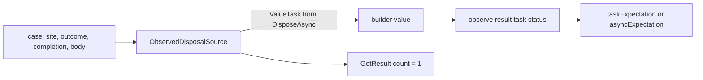

# DisposeAsync outcome tests

`tests/IcedTasks.Tests/AsyncDisposalOutcome.fs` holds a test matrix for the result of `use` on an `IAsyncDisposable` and `for` over an `IAsyncEnumerable`. All three test projects compile it, after `Expect.fs`. Each builder test file adds a `disposalOutcomeTests` list to its root `[<Tests>]` list.

## Contract that the tests pin

- A `DisposeAsync` fault or cancellation decides the result of the builder value. It replaces the body result and the body exception.
- The builder reads the `DisposeAsync` result exactly once. `ObservedDisposalSource` counts `IValueTaskSource.GetResult` calls.
- The builder awaits a pending `DisposeAsync`. The test completes the source only after `OnCompleted` registers a continuation.
- A cancellable builder awaits the disposal also after the ambient token cancels. This pins `BindNoCancellation` in `CancellableTaskBuilderBase.TryFinallyAsync`.

## Matrix

Each case is one combination of site, outcome, completion, and body:

| Axis | Values |
|---|---|
| site | `use`, `for` (`for` is absent for `coldTask` and `backgroundColdTask`, which have no `IAsyncEnumerable` support) |
| outcome | `DisposalSucceeds`, `DisposalFaults`, `DisposalCancels` |
| completion | `CompletedDisposal` (source completes before start), `PendingDisposal` |
| body | `BodyCompletes`, `BodyThrows`, and `BodyCancels` for the cancellable builders |
| execution | `Static` (the builder) or `Dynamic` (a test builder that takes `RunDynamic`) |

`BodyCancels` cancels the ambient token and then binds a completed task, so the cancellable `Bind` throws. The test name gives each axis, for example `cancellableTask, Dynamic, for, DisposalFaults, pending disposal, BodyCancels`.

```fsharp
// tests/IcedTasks.Tests/CancellableTaskTests.fs
                (fun body cts resource ->
                    cancellableTask {
                        use _ = resource
                        AsyncDisposalOutcome.runBody body cts
                        do! Task.CompletedTask
                    }
                    |> fun t -> t cts.Token :> Task
                )
```

The hot builders without a dynamic test builder (`backgroundTask`, `taskUnit`, `backgroundTaskUnit`, `valueTaskUnit`) have only `Static` cases. The `Static` cases take the static path only in Release. See [run and start paths](../builders/run-and-start-paths.md).

## Expected results

- `taskExpectation` is the contract above, for all resumable builders.
- `asyncExpectation` is the `asyncEx` result. A dispose `OperationCanceledException` faults the result. A body exception and a dispose exception give one `AggregateException`. See [AsyncEx](../builders/asyncex-and-parallelasync.md).

## Known asyncEx defects

`testsWithKnownDefects` takes a predicate that marks a case as pending (`ptestCaseTask`) with the defect in the test name. The `asyncEx` matrix has 9 pending cases of 24:

- `AsyncExBuilder.Using` evaluates `binder resource` before `TryFinallyAsync` starts. A `use` body that throws before its first bind does not dispose the resource.
- `AsyncEx.AwaitValueTask(ValueTask)` returns on `IsCompletedSuccessfully` and does not call `GetResult`.

When a fix lands, remove the matching branch of the predicate in `AsyncExTests.fs`.



Related: [test helpers](expect-helpers.md), [tests summary](summary.md), [test projects and TFMs](test-projects-and-tfms.md).
