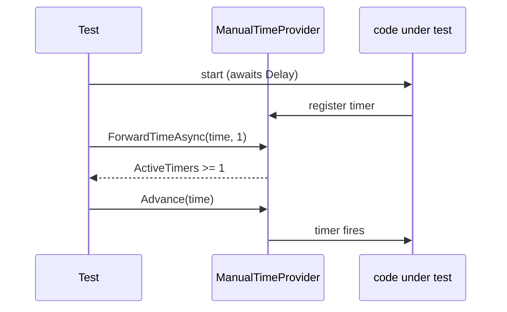

# Test helpers

`tests/IcedTasks.Tests/Expect.fs` holds the shared helpers. All three test projects compile it.

| Helper | Use |
|---|---|
| `Task.yieldMany` | runs `Task.Yield()` many times to force an async yield |
| `TestHelpers.makeDisposable`, `makeAsyncDisposable` | disposables that call a callback on dispose |
| `TestHelpers.setSyncContext` | sets a `SynchronizationContext` and restores the old one on dispose |
| `Expecto.fsCheckConfig` | FsCheck config, 10 cases on CI |
| `Expect.throwsTAsync`, `throwsTask`, `throwsValueTask` | exception assertions for async values |
| `MultiStart.sequential`, `MultiStart.overlapping` | start one cold value twice (issue #65) |
| `Expect.CancellationRequested` | calls `Expect.throwsTAsync<OperationCanceledException>` |
| `ManualTimeProvider.ForwardTimeAsync` | moves a manual clock after the timers exist |
| `CustomAwaiter` | a non-task awaiter with callbacks for `GetResult` and `IsCompleted` |
| `AsyncEnumerable.forXtoY` | an `IAsyncEnumerable` source for all projects |
| `AsyncEnumerableExtensions` | TaskSeq helpers, under `#if TEST_NETSTANDARD2_1 || TEST_NET6_0_OR_GREATER` |

`Expect.throwsTAsync<'texn>` fails when `f` throws nothing. Its type check is inverted. It fails when the thrown type is `'texn` or a base type of `'texn`, and it passes for any other exception type. `Expect.CancellationRequested` thus passes for a `TaskCanceledException` and fails for an exact `OperationCanceledException`.

## Multi-start tests

`MultiStart.sequential` starts a value, awaits it, and starts it again. `MultiStart.overlapping` starts the value a second time while the first start waits on a gate. A 5-second watchdog opens the gate, so a blocked start fails the test and does not hang it. Both helpers check that each start runs the body and returns its own result:

```fsharp
// tests/IcedTasks.Tests/Expect.fs (MultiStart.overlapping)
            Expect.isTrue
                secondReturnedWhileFirstSuspended
                "Starting the value again should not wait for the suspended first start"

            Expect.equal entered.Value 2 "Each start should run the body"
            Expect.equal (first, second) (1, 2) "Each start should return its own result"
```

The cold builder tests call the helpers through the builder and through a test builder that always takes the dynamic path:

```fsharp
// tests/IcedTasks.Tests/ColdTaskTests.fs
    type ColdTaskDynamicBuilder() =
        inherit ColdTaskBuilder()

        member _.Run(code) = ColdTaskBuilder.RunDynamic(code)
```

## Manual clock

`ForwardTimeAsync(time, minActiveTimers)` waits until the provider has at least `minActiveTimers` active timers, then advances the clock. It fails the test after 30 seconds. Count each `Delay` and each `CancellationTokenSource` timeout as one timer.



Related: [tests summary](summary.md), [run and start paths](../builders/run-and-start-paths.md).
