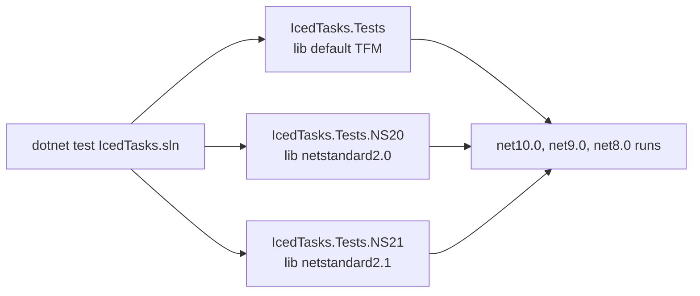

# Tests domain

The tests use Expecto with `YoloDev.Expecto.TestSdk`, so `dotnet test` runs them. `tests/Directory.Build.props` adds the shared packages: Expecto, Expecto.FsCheck, `Microsoft.NET.Test.Sdk`, `TimeProviderExtensions`, `Microsoft.Bcl.TimeProvider`, and `FSharp.Control.TaskSeq`. Each project is an executable with its own entry point:

```fsharp
// tests/IcedTasks.Tests/Main.fs
module ExpectoTemplate =

    open Expecto

    [<EntryPoint>]
    let main argv =
        Tests.runTestsInAssemblyWithCLIArgs [] argv
```

## Conventions

- Each test file is `module XTests` with a `[<Tests>]` test list. Most files name it `builderTests`, with a root name such as `"IcedTasks.CancellableTask"` or `"IcedTasks.Polyfill.Task"`. `ParallelAsyncTests.fs` names it `tests`.
- Most tests are `testCaseAsync`.
- FsCheck properties that check concurrent start run in `testSequencedGroup "MergeSourcesParallel - ..."`.
- `Expecto.fsCheckConfig` runs 10 FsCheck cases on CI (`tests/IcedTasks.Tests/Expect.fs`).
- Many timer-based tests use `ManualTimeProvider`. Some tests still use real delays, for example `CancelAfter(100)` in `AsyncExTests.fs`. See [test helpers](expect-helpers.md).
- Each file that tests a cold or cancellable builder defines test builders whose `Run` calls `RunDynamic`. These test the dynamic path in Release.
- The `*DynamicTests.fs` files test the hot builders on the dynamic path. Their test builders call `base.Run` from a `NoInlining` member, and the file has `#nowarn "3511"`.
- `ColdTaskTests.fs` explains why the cold test builders call `RunDynamic` directly: a `#nowarn "3511"` would hide static compilation failures of the other tests in the file.
- The build measures no code coverage. Commit bd902a0 removed it: "all this stuff is inlined and can't generate sane coverage reports".



Topics:

- [Test projects and TFMs](test-projects-and-tfms.md) - the three projects, shared files, and `#if` symbols.
- [Test helpers](expect-helpers.md) - `Expect.fs` helpers, multi-start tests, and the manual clock.

Related: [build](../build/summary.md), [builders](../builders/summary.md).
