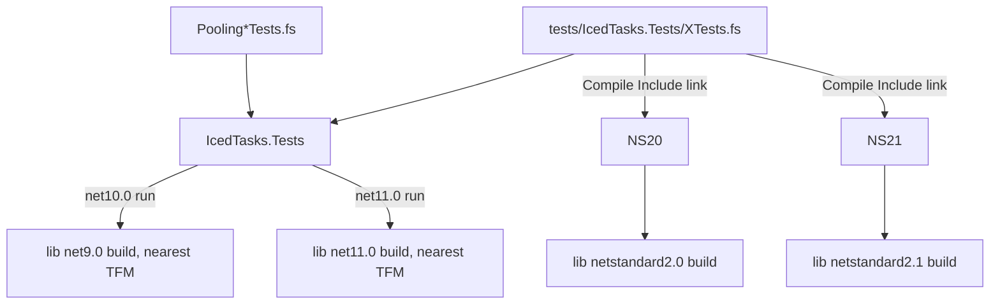

# Test projects and TFMs

Five test projects test the library builds. `IcedTasks.Tests`, NS20, NS21, and `IcedTasks.Tests.NoOpen` target `net10.0;net11.0`, so `dotnet test` runs each of them two times. `IcedTasks.Tests.RuntimeAsync` targets `net11.0` only.

| Project | Library TFM | Defines | Source files |
|---|---|---|---|
| `tests/IcedTasks.Tests` | `net9.0` on the `net10.0` run, `net11.0` on the `net11.0` run | `TEST_NET6_0_OR_GREATER` | its own 19 files, and `PublicApi/*.txt` |
| `tests/IcedTasks.Tests.RuntimeAsync` | `net11.0` | `TEST_NET6_0_OR_GREATER;TEST_RUNTIME_ASYNC` | links `Expect.fs`, `AsyncDisposalOutcome.fs`, the task, value task, cold, and cancellable test files, and `Main.fs`. Its own file is `RuntimeTaskTests.fs` |
| `tests/IcedTasks.Tests.NS20` | `netstandard2.0` | `NETSTANDARD2_0;TEST_NETSTANDARD2_0` | links `../IcedTasks.Tests/*.fs`, no Pooling test files |
| `tests/IcedTasks.Tests.NS21` | `netstandard2.1` | `NETSTANDARD2_1;TEST_NETSTANDARD2_1` | links `../IcedTasks.Tests/*.fs`, no Pooling test files |
| `tests/IcedTasks.Tests.NoOpen` | `net6.0` on the `net10.0` run, `net11.0` on the `net11.0` run | none | its own 2 files, with no `open` of an IcedTasks namespace |

The NS projects select the library TFM with `AdditionalProperties`:

```xml
<!-- tests/IcedTasks.Tests.NS20/IcedTasks.Tests.NS20.fsproj -->
    <TargetFrameworks>net10.0;net11.0</TargetFrameworks>
    <GenerateProgramFile>false</GenerateProgramFile>
    <DefineConstants>$(DefineConstants);NETSTANDARD2_0;TEST_NETSTANDARD2_0</DefineConstants>
  </PropertyGroup>
  <ItemGroup>
    <ProjectReference Include="../../src/IcedTasks/IcedTasks.fsproj" AdditionalProperties="TargetFramework=netstandard2.0" />
```

A test TFM selects the nearest library TFM. The `net10.0` run of `IcedTasks.Tests` tests the `net9.0` build, and the `net11.0` run tests the `net11.0` build. Only `IcedTasks.Tests.NoOpen` loads the `net6.0` build. `IcedTasks.Tests` also builds each TFM of `IcedTasks.fsproj` for metadata only: a target reads `TargetFrameworks` with the SDK target `GetTargetFrameworks`, adds one `ProjectReference` (`ReferenceOutputAssembly="false"`) for each TFM, copies each DLL to `PublicApi/<tfm>/`, and writes `PublicApi/shipped-target-frameworks.txt`. The `netstandard2.0` folder also gets `Microsoft.Bcl.AsyncInterfaces.dll` from the package path. The maintainer decided on 2026-11-18 that the `net6.0` and `net9.0` builds need no separate test runs. Expecto needs FSharp.Core 7.0.200 or later, so a test run cannot use the 6.0.4 floor of the `net6.0` build.

## Public surface tests

- `tests/IcedTasks.Tests.NoOpen` checks FSharp.Core `task` inference with IcedTasks referenced and no IcedTasks `open`. A reference that brings the `ColdTask` overloads into scope makes it fail with FS0041. Its third test names an IcedTasks type, so the project fails to compile without the reference.
- `OpenFormsTests.fs` uses each 0.11.9 `open` form in a nested module, with the base module open where a bind needs it, the public type abbreviations, and fully qualified 0.11.9 names. It checks with a quotation which `ValueTask.map` and `CancellableValueTask.map` `open IcedTasks` selects.
- `PublicApiTests.fs` checks that the assembly has no assembly-level `AutoOpenAttribute`, and that each project loads its own library TFM. It lists the public metadata with `PublicApiListing.fs` (`System.Reflection.MetadataLoadContext`) and checks that each entry of `PublicApi/IcedTasks-0.11.9-<tfm>.txt` is still there, and that each added entry is in `PublicApi/additions-<tfm>.txt`. 0.11.9 has no `net11.0` build, so the `net11.0` run compares with the `net9.0` list, and `additions-net11.0.txt` lists the runtime-async entries. Tests that only `IcedTasks.Tests` compiles (`#if TEST_NET6_0_OR_GREATER`) compare the metadata of `PublicApi/<tfm>/IcedTasks.dll` with the 0.11.9 list of each shipped TFM. No runtime for that TFM is necessary. A new TFM in `IcedTasks.fsproj` fails these tests until it has a 0.11.9 list or a mapping in `baselineTargetFramework`. A TFM that has a 0.11.9 list and that `IcedTasks.fsproj` no longer ships also fails a test. The NS projects link the files. Runtime reflection throws `TypeLoadException` on some IcedTasks signatures, so the listing reads metadata only.
- `PublicApi/list-public-api.fsx` makes a listing from a DLL, for example `dotnet fsi list-public-api.fsx <packages>/icedtasks/0.11.9/lib/net9.0/IcedTasks.dll IcedTasks-0.11.9-net9.0.txt <packages>/fsharp.core/9.0.300/lib/netstandard2.1 <packages>/microsoft.bcl.asyncinterfaces/6.0.0/lib/netstandard2.0`.

## Rules for new tests

- Put a new test file in `tests/IcedTasks.Tests` and add it to the compile list of that project.
- Link the file in the NS20 and NS21 projects too, unless it tests a pooling builder.
- Guard TaskSeq tests with `#if TEST_NETSTANDARD2_1 || TEST_NET6_0_OR_GREATER`. The NS20 build runs the `IAsyncEnumerable` tests through `Microsoft.Bcl.AsyncInterfaces`, and it skips the TaskSeq tests.
- A test of a builder that has a runtime-async version also runs in `IcedTasks.Tests.RuntimeAsync`. Keep the `#if TEST_RUNTIME_ASYNC` open of `IcedTasks.Polyfill.RuntimeTask` before the test module. Put a test that only the runtime-async builders need in `tests/IcedTasks.Tests.RuntimeAsync/RuntimeTaskTests.fs`.



## Configuration

CI runs the tests in Debug and in Release. Debug takes the dynamic path of each builder. See [run and start paths](../builders/run-and-start-paths.md).

Decision: [ADR 0007, separate netstandard test projects](../../adr/0007-separate-netstandard-test-projects.md).

Related: [tests summary](summary.md), [namespaces and TFMs](../builders/namespaces-and-tfms.md).
