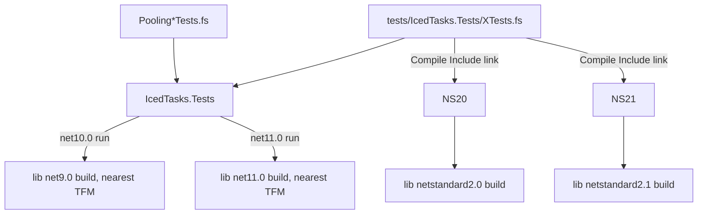

# Test projects and TFMs

Four test projects test the library builds. The first three target `net10.0;net11.0`, so `dotnet test` runs each of them two times. `IcedTasks.Tests.RuntimeAsync` targets `net11.0` only.

| Project | Library TFM | Defines | Source files |
|---|---|---|---|
| `tests/IcedTasks.Tests` | `net9.0` on the `net10.0` run, `net11.0` on the `net11.0` run | `TEST_NET6_0_OR_GREATER` | its own 16 files |
| `tests/IcedTasks.Tests.RuntimeAsync` | `net11.0` | `TEST_NET6_0_OR_GREATER;TEST_RUNTIME_ASYNC` | links `Expect.fs`, `AsyncDisposalOutcome.fs`, the task, value task, cold, and cancellable test files, and `Main.fs`. Its own file is `RuntimeTaskTests.fs` |
| `tests/IcedTasks.Tests.NS20` | `netstandard2.0` | `NETSTANDARD2_0;TEST_NETSTANDARD2_0` | links `../IcedTasks.Tests/*.fs`, no Pooling test files |
| `tests/IcedTasks.Tests.NS21` | `netstandard2.1` | `NETSTANDARD2_1;TEST_NETSTANDARD2_1` | links `../IcedTasks.Tests/*.fs`, no Pooling test files |

The NS projects select the library TFM with `AdditionalProperties`:

```xml
<!-- tests/IcedTasks.Tests.NS20/IcedTasks.Tests.NS20.fsproj -->
    <TargetFrameworks>net10.0;net11.0</TargetFrameworks>
    <GenerateProgramFile>false</GenerateProgramFile>
    <DefineConstants>$(DefineConstants);NETSTANDARD2_0;TEST_NETSTANDARD2_0</DefineConstants>
  </PropertyGroup>
  <ItemGroup>
    <ProjectReference Include="../../src/IcedTasks/IcedTasks.fsproj" AdditionalProperties="TargetFramework=netstandard2.0" />
```

A test TFM selects the nearest library TFM. The `net10.0` run of `IcedTasks.Tests` tests the `net9.0` build, and the `net11.0` run tests the `net11.0` build. No test run tests the `net6.0` build. The maintainer decided on 2026-11-18 that the `net6.0` and `net9.0` builds need no separate test runs. Expecto needs FSharp.Core 7.0.200 or later, so a test run cannot use the 6.0.4 floor of the `net6.0` build.

## Rules for new tests

- Put a new test file in `tests/IcedTasks.Tests` and add it to the compile list of that project.
- Link the file in the NS20 and NS21 projects too, unless it tests a pooling builder.
- Guard TaskSeq tests with `#if TEST_NETSTANDARD2_1 || TEST_NET6_0_OR_GREATER`. The NS20 build runs the `IAsyncEnumerable` tests through `Microsoft.Bcl.AsyncInterfaces`, and it skips the TaskSeq tests.
- A test of a builder that has a runtime-async version also runs in `IcedTasks.Tests.RuntimeAsync`. Keep the `#if TEST_RUNTIME_ASYNC` open of `IcedTasks.Polyfill.RuntimeTask` before the test module. Put a test that only the runtime-async builders need in `tests/IcedTasks.Tests.RuntimeAsync/RuntimeTaskTests.fs`.



## Configuration

CI runs the tests in Debug and in Release. Debug takes the dynamic path of each builder. See [run and start paths](../builders/run-and-start-paths.md).

Decision: [ADR 0007, separate netstandard test projects](../../adr/0007-separate-netstandard-test-projects.md).

Related: [tests summary](summary.md), [namespaces and TFMs](../builders/namespaces-and-tfms.md).
