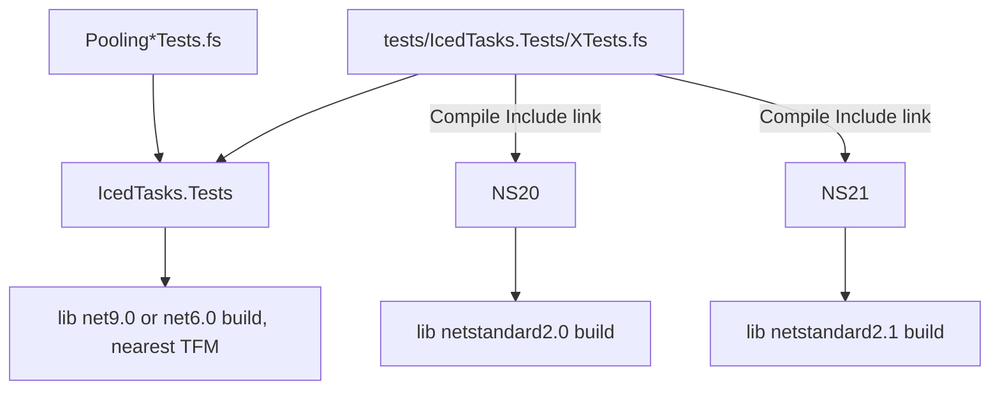

# Test projects and TFMs

Three test projects test the library builds. Each project targets `net10.0;net9.0;net8.0`, so `dotnet test` runs each project three times.

| Project | Library TFM | Defines | Source files |
|---|---|---|---|
| `tests/IcedTasks.Tests` | default reference | `TEST_NET6_0_OR_GREATER` | its own 15 files |
| `tests/IcedTasks.Tests.NS20` | `netstandard2.0` | `NETSTANDARD2_0;TEST_NETSTANDARD2_0` | links `../IcedTasks.Tests/*.fs`, no Pooling test files |
| `tests/IcedTasks.Tests.NS21` | `netstandard2.1` | `NETSTANDARD2_1;TEST_NETSTANDARD2_1` | links `../IcedTasks.Tests/*.fs`, no Pooling test files |

The NS projects select the library TFM with `AdditionalProperties`:

```xml
<!-- tests/IcedTasks.Tests.NS20/IcedTasks.Tests.NS20.fsproj -->
    <TargetFrameworks>net10.0;net9.0;net8.0</TargetFrameworks>
    <GenerateProgramFile>false</GenerateProgramFile>
    <DefineConstants>$(DefineConstants);NETSTANDARD2_0;TEST_NETSTANDARD2_0</DefineConstants>
  </PropertyGroup>
  <ItemGroup>
    <ProjectReference Include="../../src/IcedTasks/IcedTasks.fsproj" AdditionalProperties="TargetFramework=netstandard2.0" />
```

## Rules for new tests

- Put a new test file in `tests/IcedTasks.Tests` and add it to the compile list of that project.
- Link the file in the NS20 and NS21 projects too, unless it tests a pooling builder.
- Guard TaskSeq tests with `#if TEST_NETSTANDARD2_1 || TEST_NET6_0_OR_GREATER`. The NS20 build runs the `IAsyncEnumerable` tests through `Microsoft.Bcl.AsyncInterfaces`, and it skips the TaskSeq tests.



## Configuration

CI runs the tests in Debug and in Release. Debug takes the dynamic path of each builder. See [run and start paths](../builders/run-and-start-paths.md).

Decision: [ADR 0007, separate netstandard test projects](../../adr/0007-separate-netstandard-test-projects.md).

Related: [tests summary](summary.md), [namespaces and TFMs](../builders/namespaces-and-tfms.md).
